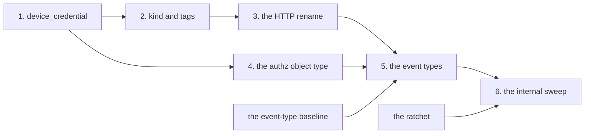

# ADR-20260826-5yj: a device is the object and a printer is the type

- status: accepted
- date: 2026-08-26
- pairing is optional, every camera holds its own permissions, and attaching
  one to a printer copies that printer's permissions across. Rules 15 to 17
  carry it, and rule 16 says what it amended
- the kind set is open. A module may declare a device kind and
  the host places it. Rules 8 and 12 are amended by
  [ADR-20260831-nbj](20260831-nbj-a-module-declares-a-device-kind-and-the-host-places-it.md),
  which also fixes step 5's origin kind at `device` for every device. The rest
  of rules 8 to 13 stand
- a device carries plain tags and no key and value labels. Rules 10 and 11
  say what a tag is and how it is filtered, and rules 24 and 25 keep the
  labels as a view over tags for one version.

<!-- nav:related -->
> [!NOTE]
> Index: [decisions](README.md) | Rules 8 and 12 and step 5 are amended by [ADR-20260831-nbj](20260831-nbj-a-module-declares-a-device-kind-and-the-host-places-it.md), which lets an installed module declare a device kind and gives every device the origin kind `device` | Builds on [ADR-20260825-zkq](20260825-zkq-api-compatibility.md), [ADR-20260825-bhe](20260825-bhe-every-vocabulary-is-a-gated-published-resource.md), [ADR-20260826-6x5](20260826-6x5-a-namespace-is-legal-everywhere-it-is-used.md), [ADR-20260827-rqc](20260827-rqc-an-extension-declares-a-permission.md) | Reads with [ADR-20260826-c77](20260826-c77-one-name-for-one-thing-on-the-wire.md)

An object is a device and a verb belongs to a type. Identity, grants, presence
and listing take the word `device`. A nozzle, a job, a gcode line and a dialect
keep the word `printer`. Earlier research
measured where that line falls.

One test decides a surface, and a person can run it without asking. Does a
camera have this thing?

| the thing | a camera has it | the word |
|---|---|---|
| an id, and a row in a registry | yes | device |
| a grant, a group, an owner | yes | device |
| arrival, departure, presence | yes | device |
| a place in a list, a page, a sort | yes | device |
| telemetry, as a mechanism | yes | device |
| a nozzle or a chamber reading | no | printer |
| a job, a queue, a file to print | no | printer |
| a gcode line | no | printer |
| a firmware band, a dialect | no | printer |

## rules

### the split

1. Spell an object, its identity, its grants, its presence and its listing
   `device`. Spell a verb, a job, a temperature, a firmware band and a dialect
   `printer`, or the word its own type uses.
2. Apply rule 1 to a new surface with the camera test above. A camera is the
   cheapest device this project will hold that is not a printer.
3. Keep the capability descriptor's name. `sdk/connectorapi.Set` is the seam:
   the mechanism is device-shaped and every verb inside it is type-shaped.
4. Keep `internal/printer` and `internal/connector/xbuddy`. Both are
   type-shaped under rule 1, so neither moves.
5. Keep the kind value `printer`. A kind names the type of a device, so
   `ref.KindPrinter` and `event.KindPrinter` are already correct and do not
   move. This corrects two rows of earlier research's cost table.
6. Keep a fault domain named for the plane that raises the fault. `core.printer`
   holds seven codes and stays. A camera plane takes a domain of its own.
7. Name a path segment for what it addresses. The collection is
   `/api/v1/devices`, and a type-shaped verb keeps its own trailing segment, as
   `/gcode` does.

### the kind and the tags

8. Give every device a `kind`, taken from `ref.Kind`. The set is closed and the
   core owns it.
9. Publish `kind` as an optional response property on the device record.
   [ADR-20260825-zkq](20260825-zkq-api-compatibility.md) rule 5 classifies that as additive, so
   it costs nothing after 1.0.0 either.
10. Give every device tags, as a list of strings in the order the operator
    gave them. A tag is a plain word or short phrase, such as `workshop`,
    `PETG only` or `night shift`. It has no key and no value.
    - a tag is trimmed, and a run of spaces inside it becomes one space. The
      case is kept as typed
    - a new tag is 1 to 64 characters, counted in characters and not in
      bytes. A device carries at most 32 tags
    - a write keeps a tag the device already carries exactly as it is, even
      when it is longer than 64 characters. The text has to match exactly,
      because a tag that is the same by the rule below can still read
      differently. A tag converted from a label can
      be up to 382 characters, and a client sends the whole list back when it
      adds one tag
    - a tag refuses a comma, a control character and a formatting character,
      which is Unicode category Cf
    - a tag refuses the characters that show nothing. These are the
      characters Unicode marks `Variation_Selector` or
      `Other_Default_Ignorable_Code_Point`, and the blank braille pattern
      U+2800. The Mongolian and emoji variation selectors, the Khmer inherent
      vowels, the Hangul fillers and the combining grapheme joiner are among
      them
    - a tag accepts a joiner U+200D and a non-joiner U+200C between two
      visible characters. Emoji sequences and Persian words need them
    - a tag accepts the presentation selectors U+FE0E and U+FE0F right after
      a visible character. One joiner may follow the selector when a visible
      character comes after the joiner
    - two of these four never stand side by side
    - a tag accepts a region flag, such as the flag of England. It is the
      black flag U+1F3F4, tag letters from U+E0020 to U+E007E, and the cancel
      tag U+E007F. The tag letters are refused anywhere else
    - a combining mark counts as part of the visible character before it. A
      mark at the start of a tag or after a space is refused
    - every other character is accepted, letters of any script and combining
      accents included
    - a tag with no letter, digit, punctuation mark or symbol in it is empty
    - a tag is compared as it was typed. A tag typed with a combining accent
      differs from the same tag typed with an accented letter. Normalising
      tags to NFC is a row on
      the old backlog
    - two tags that differ only in case, joiners or presentation selectors
      are the same tag, and a list holding both is refused. The stored text
      keeps them as the person typed it
    - so a family emoji and the same people written side by side without the
      joiner are one tag
    - each broken rule answers with its own code: `core.validation/TAG_EMPTY`,
      `TAG_TOO_LONG`, `TAG_CHARACTER`, `TAG_DUPLICATE` and `TAGS_TOO_MANY`
    - `PUT /api/v1/devices/{device_id}/tags` replaces the whole list and takes
      manage on the device. Reading the tags takes what reading the device
      takes
    - **this amends the rule's first form**, which gave every device a string
      map of labels under the key grammar of
      [ADR-20260826-6x5](20260826-6x5-a-namespace-is-legal-everywhere-it-is-used.md) rule 1
11. Read no tag in the authorization graph. A tag filters a list and never
    decides an answer, which is what makes it free of a gate.
    - `GET /api/v1/devices?tag=workshop,night%20shift` answers with the
      devices carrying every named tag. The match is on the whole tag, and it
      uses rule 10's sameness. It narrows the items and the total and never the issues
      rollup
    - the filter runs over the rows the permission query already produced, so
      it narrows a listing and never widens one
    - a comma separates the tags in the filter, and that is the reason rule 10
      refuses a comma inside a tag
    - a tag in the filter may be as long as a tag converted from a label, which
      is 382 characters
12. Refuse a kind an extension mints. An extension declares and the core places,
    which is [ADR-20260827-rqc](20260827-rqc-an-extension-declares-a-permission.md) rule 13's
    answer for a relation and is the same answer here.
13. List a device whose kind this build does not carry, and name the kind as the
    peer gave it. A federated peer may run a newer core.

### a camera is a device

14. Give a camera a device row, an id and grants of its own. That is rule 1
    applied to the object layer.
15. Bind a camera to a printer with one edge, `device#parent@device`. Pairing is
    optional and a camera is a device in its own right.
16. Place every camera and give it grants on its own row, whether or not it names
    a printer. That is what a design requirement asks for, and it is what a bound
    camera gets too. Without a placement nobody holds manage on it,
    so nobody can be granted it and nobody can grant it either.
    - **this amends the rule's first form**, which placed a
      camera naming a printer in no org and had it take its tenancy down rule
      15's edge. A camera bound to a printer this server had never met was then
      reachable by nobody, which is a failure.
    - the reason the old rule gave still has to be answered by the build. A
      second path to a camera that does not pass through its printer lets an
      administrator blocked on the printer reach the camera. The camera's own row
      is now that second path, so the block has to reach the camera as well.
17. Copy the printer's permissions onto the camera's own row when a camera is
    attached, rather than reading them down the edge. A design requirement's
    default is then a copy taken at attach time. A grant written straight on a
    camera is legal and always was, and it is an administrative act with a tuple
    behind it.
    - a copy and a walk part company later. A grant added to the printer after
      the attach does not appear on the camera, because nothing walks the edge
      for it. Whether an attach offers to copy again is a task on
      the old backlog.
18. Keep `resource_kind:camera` as the configuration of the kind. A grant there
    reaches the driver's settings and its lifecycle events, and never a frame.
    Amended by ADR-20261116-g5x: a camera's lifecycle events follow the camera
    device, and the grant reaches its settings.

### the order

19. Rename `authz.TypeDevice` to `device_credential` before anything else moves.
20. Take the HTTP rename and [ADR-20260826-c77](20260826-c77-one-name-for-one-thing-on-the-wire.md)
    step 3 in one change, so `{printer}` reaches `{device_id}` once.
21. Emit both event-type names for one window, and ship the event-type baseline
    in the same change. ADR-20260826-c77 rules 22 and 23 hold the window.
22. Rename the authorization object type in a new migration file per engine,
    with a data update over `authz_tuple` and a `make test-engines` run. An
    applied migration is never edited.
23. Follow the order below. A step taken early is named there with what it
    breaks.

### the labels view

24. Serve labels as a view over tags until the interface reads tags. Nothing
    stores a label. A label with a value is the tag `key: value`, and a label
    with an empty value is the tag `key`. The `labels` member of the device
    record, `PUT /api/v1/devices/{device_id}/labels`, the `labels` listing
    parameter and `Labels` in `sdk/deviceapi` read and write tags by that
    rule.
    - migration `0020_device_tags.sql` converts every stored label into a tag
      by the same rule, on both engines, and drops the labels column. No
      operator loses what they typed. A converted tag is not checked against
      rule 10, and rule 10 keeps it on the next write
    - the view loses tags. A label set holds one value per key, so when two
      tags have the same key, the later one in the list wins. The tags
      `site: brno` and `site: prague` become the one label `site: prague`. A
      client
      that reads the labels and writes them back removes the tags it did not
      read. A labels write also puts the tags in the order of their keys. The
      OpenAPI description of the labels route says so
    - the `labels` listing parameter takes a term in the label grammar only,
      and refuses any other term with `core.validation/REQUEST_INVALID`
    - `com.prusa.connect.device.record.changed` carries `tags` in place of
      `labels`, so the event-type set moves to version 3.0.0
25. Remove the labels view in the first change after the interface stops
    reading it, and before the next release.

## the six steps and what an early one breaks

| step | change | state | what breaks if it is taken early |
|---|---|---|---|
| 1 | `authz.TypeDevice` to `device_credential` | landed, `65ea1dc` | step 4 collides: two Go constants project onto one `authz_type.name` |
| 2 | `kind` and tags on the device record | landed | It drops the labels column, raises the schema floor to 20 and changes `device.record.changed` |
| 3 | the HTTP rename, with ADR-20260826-c77 step 3 | landed | after 1.0.0 the same rename costs `/api/v2` beside `/api/v1` |
| 4 | the authorization object type, per engine | landed, `0004_device.sql` | before step 1 it collides. After an outside deployment exists it is that operator's outage |
| 5 | the five event types | owed, on the baseline | without the baseline a subscriber stops receiving and the release reports success |
| 6 | the internal sweep, behind the ratchet | owed, on the ratchet | nothing. The ratchet holds a count that cannot rise |

Step 5 carries the event payload member with it. `arrival`, `departure`,
`presence` and `linkReading` in `internal/app/deviceevents.go` each name the
machine `printer`, which rule 1 spells `device_id`. That member has no
compatibility gate either, so it waits behind the same baseline rather than
moving with the HTTP surface.

Step 4 is the one that reaches a running database. `Reconcile` writes the Go
vocabulary into `authz_type` before anything binds a port, and `retireVocabulary`
refuses to remove a type while a tuple still names it. So a Go rename taken
against an existing database is a refusal at startup. Two projections carry the
word in their own identifiers, `authz_printer` and `printer_access`, and both
move in the same migration.

## what a published surface costs

Counted on branch `restructure` on 2026-08-26 and recounted on 2026-08-27, once
steps 3 and 4 had landed. The recount is the second column.

| surface | estimated | measured | gate | cost |
|---|---|---|---|---|
| HTTP operations | 8 of 37 | 12 of 44, on 9 paths, 8 of them taking a new operation id | `make api-check` | breaking under ADR-20260825-zkq rule 4, reported while `v1` is `reporting` |
| HTTP schemas | 12 of 56 | 10 of 56 | `make api-check` | the same, taken in one `make api-accept` diff |
| event types | 5 of 7 | 5 of 7 | none | both names for one window, plus the baseline ADR-20260825-zkq owes |
| authz shapes | 33 of 58 | 33 of 58, plus 2 of 9 types | `make authz-vocabulary-check` | a migration per engine, a data update, a `make test-engines` run |
| internal names | 5,453 in 294 Go files | 7,763 in 382 Go files | none | the largest number and the smallest risk. It goes in slices |

The two schema counts differ because the estimate counted every `Printer*`
schema outside the gcode family. Rule 2 keeps `PrinterCommand` and
`PrinterResult`: both name a verb and what a machine made of it, and a camera
has neither. `make api-check` classified the change as 32 breaking differences
and 0 unknown.

`tools/apicompat/policy.json` holds `v1` at `reporting` and `VERSION` is
`0.1.0`, so the whole HTTP cost today is one accepted baseline diff. ADR-20260825-zkq
rule 8 moves the policy to `frozen` in the change that cuts 1.0.0. That window
is the reason steps 3 and 5 carry a deadline and the other four do not.

## how a mixed fleet says what each thing is

A closed kind the core owns, and open tags beside it. Earlier research surveyed six
ecosystems, and five of them put something open beside a closed value. Home
Assistant kept `device_class` closed and added labels in 2024.4, and a Home
Assistant label is a plain name with no value. Kubernetes keeps `kind` closed
and puts key and value labels beside it.

A closed value is what a program switches on, so it can drive a filter, an icon
and a default page. A tag is what an operator organises along, on axes this
project cannot predict. A person sorting printers types a plain word, so a tag
has no key. An operator screen needs both: a device this build has never met
still appears in the list, still carries a grant, and still gets an icon.

The compatibility work is a standard with a compatibility layer on top. The
layer is an extension and not core source.

The closed kind and the open tags are the standard. A tag set shaped to the
shipping server's own labels is a module, and rule 10 is the whole of what the
core carries.

## enforcement

None of these gates is built, which is why the status is `proposed`. Each is
watched failing on a probe before it is trusted green, on ADR-20260826-6x5's practice.

| rule | gate | what it refuses |
|---|---|---|
| 1, 2 | an arch test over the device-shaped packages | the identifier `printer` in a package rule 1 calls device-shaped |
| 1 | a ratchet in `scripts/writing-style.baseline`'s format | a count of the word that rises while the sweep runs |
| 7, 20 | `make api-check` | a path or a schema the accepted baseline does not carry |
| 8, 9 | `make resource-kinds-check` | a kind outside the closed set `ref.Kind` holds |
| 10 | `TestATagIsHeldToItsRules` and `TestATagIsCleanedAndKeepsItsCase` | a tag outside the rules, each with its code |
| 10 | `TestOnlyAManagerTagsADevice` | a tag written by a caller who does not hold manage |
| 10, 24 | `TestATagTheUpgradeStoredIsKeptOnAWrite` | a write or a filter that refuses a tag the upgrade stored |
| 10, 24 | `TestALongStoredTagIsKeptOnlyOnItsOwnDevice` | a long tag one device carries that another device may take |
| 10 | `TestATagSurvivesARestart`, through the published API | a tag lost across a restart |
| 11 | `TestTheListingNarrowsToTheTagsTheCallerNamed` | a filter that ignores a tag, matches part of one, or respects case |
| 11 | `TestATagFilterDoesNotRevealAHiddenDevice` | a filter that shows or counts a device the caller cannot read |
| 11 | review | the graph reading a tag. Nothing in `internal/authz` reads the column |
| 24 | `TestEveryStoredLabelBecomesATag`, on both engines | a stored label lost or changed by the migration |
| 24 | `TestALabelIsWrittenAsATagAndReadBack` and `TestTheLabelsFilterFindsTheTagsItSpells` | a labels view that disagrees with the tags |
| 24 | `TestAMalformedSelectorIsRefusedRatherThanIgnored` | a labels filter term outside the label grammar that answers an empty fleet |
| 25 | review | the labels view left in place after the interface reads tags |
| 12 | `make authz-vocabulary-check` | a type or a shape the Go vocabulary does not declare |
| 14, 15, 16 | `TestACameraBoundToNoPrinterIsDeclaredGrantedAndServed` through `app.Run`, beside the camera plane's own | a standalone camera that no principal can be granted |
| 15 | `TestABoundCameraIsReachedThroughItsPrinter`, on both engines | a parent edge the projection does not walk |
| 17 | `TestAGrantOnABoundCameraReachesSomebodyWhoCannotSeeThePrinter` | a direct grant on a bound camera the projection refuses |
| 14 | `core.auth/DEVICE_KIND_CONFLICT` on `UpsertDevices` | a camera registered over a printer of the same id, which would carry that printer's grants |
| 21 | none until an event-type baseline exists | ADR-20260825-zkq's fourth open item owes it |
| 22 | `make test-engines` | a migration that does not apply on SQLite and on a real Postgres |
| 19, 23 | review | a step taken out of the order above |

## rejected

| option | why not |
|---|---|
| replace every `printer` with `device` | 4 of 8 printer actions and every `core.command.*` verb are type-shaped. A camera would cancel a job |
| keep `printer` and add `camera` beside it | 33 of 58 shapes are printer-named. A parallel set makes 33 more with the same role layer |
| rename the kind value `printer` too | a kind names the type of a device, so the value is already right. Moving it touches every frame and every cursor |
| rename the fault domain `core.printer` | a domain names the plane that raised the fault. Seven published URIs would move and no client reads the word |
| an open tag with no closed kind | W3C WoT's `@type` is ignorable by a consumer, so no filter, icon or default page can rely on it |
| a closed kind with no tags | Home Assistant shipped that and added labels in 2024.4. People organise along axes we cannot predict |
| key and value labels | a person sorting printers types a plain word, and a key has to be invented for it |
| convert a label to its value alone | two labels with one value on different keys would become one tag, and the key that told them apart is lost |
| compare tags with case | `PETG` and `petg` would be two chips a person cannot tell apart in a filter |
| store labels beside tags | two stores for one fact disagree the first time one of them is written |
| mark the labels view `deprecated` in the OpenAPI document now | the interface lints the generated client strictly and still reads labels, so its build would fail before it can move |
| let an extension mint a kind | ADR-20260827-rqc rule 13 keeps the relation vocabulary closed, and earlier research refused a third-party object type |
| derive a kind from the capability set | no set exists before a session, and `profile_matched` false gives one model two sets |
| rename `printer` and leave `TypeDevice` alone | the credential would keep the name of the thing it authenticates to. Rule 19 is that refusal |
| refuse a grant written on a bound camera | the graph is uniform and `blocked` already carries a deny. A special case here is a special case in the write path |
| drop a design requirement's standalone camera | a host camera over V4L2 and an IP camera ship in the first release, and neither has a printer |
| drop a design requirement | a viewer who cannot see a printer must not see its camera. Rule 15 keeps that as the default |
| wait until after 1.0.0 | ADR-20260825-zkq rule 8 freezes `v1` there, and rule 9 then costs `/api/v2` beside `/api/v1` |
| edit the migration files in place | `Migrate` refuses a file whose checksum moved, so a rename is a new file on both engines |
| one rename in one change | a published surface half renamed is a client that reaches nothing. Rule 23 orders it in six |

## open items

- A block on a printer has to reach its cameras now that each one carries its own
  row. Rule 16's old placement rule was what held that closed, and rule 16's amendment
  removed it. The task is on
  the old backlog.
- The parent walk reads no directory. `graph.reachDevice` resolves a parent by
  id whether or not that id is registered. So a camera bound to a printer this
  server has never met inherits from whatever tuples name it. No caller can
  create that alone: writing the parent edge takes manager on the child. Gating
  it was rejected because `bound` compiles the graph with no directory at all,
  so the grant surface and the projection would answer differently about the
  same object. It is recorded rather than fixed.
- `RemoveDevice` deletes the tuples written on a device and not the ones that
  name it as a subject. Unregistering a printer therefore leaves a camera's
  parent edge pointing at an id nothing is registered under. Nothing is
  reachable through it, because the printer's own grants went with it, and a
  reconcile rewrites the edge. It is the one place the graph holds an edge to a
  device that is gone.
- The listing walk in `internal/app/devices.go` reads the authorized set to page
  it. Whether a `kind` filter belongs inside that query or beside it is
  unmeasured, and earlier research records the gap.
- Rule 13 has no code behind it. Federation is not built, so a kind from a peer
  is a shape and not a path anything runs.
- A capability floor per kind, on Matter's model, is a task on
  the old backlog. Earlier research
  could not resolve whether Matter reserves a manufacturer range, which decides
  what the floor does with a kind it has never met.
