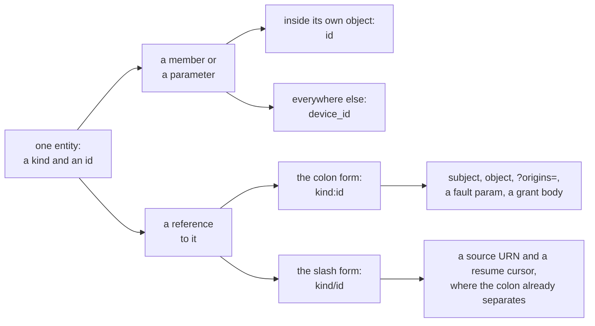

# ADR-20260826-c77: one name for one thing on the wire

- status: accepted, the renames are owed
- date: 2026-08-26

<!-- nav:related -->
> [!NOTE]
> Index: [decisions](README.md) | Builds on [ADR-20260825-zkq](20260825-zkq-api-compatibility.md), [ADR-20260825-bhe](20260825-bhe-every-vocabulary-is-a-gated-published-resource.md) | Extends [ADR-20260826-6x5](20260826-6x5-a-namespace-is-legal-everywhere-it-is-used.md)

A bare entity id is `device_id`, a reference to another object is `kind:id`,
and a list answers `items`. Eight rows settle the spellings, and the rest of
this record says what each one costs and when to pay it.

| the fact | the spelling | the drift earlier research measured |
|---|---|---|
| a bare entity id | `device_id`, `job_id`, `storage_id` | eight renderings of one printer's identity |
| a reference to another object | `kind:id` | two forms inside one SSE frame |
| a resource instance in a fault | `resource` | `resource` in one domain, `kind` plus `name` in another |
| an instant | an RFC 3339 string | four RFC 3339 members and one integer |
| a duration on the wire | an integer of milliseconds | five encodings |
| a duration in configuration | a Go duration string | one word carries both types |
| a size | a count of bytes | one key is in megabytes |
| a list | `items`, `total`, `limit`, `offset` | one of 22 operations pages |

Earlier research built a server,
probed it with curl and compared the answers. A dozen agents wrote these
surfaces and no gate compares one against another, so a client author meets a
new name at every endpoint.

Timing decides the whole plan. `tools/apicompat/policy.json` holds `v1` at
stability `reporting`, `VERSION` is `0.1.0`, and the repository carries one tag.
Under [ADR-20260825-zkq](20260825-zkq-api-compatibility.md) rule 8 a rename today is one
accepted diff in a baseline file. Under rule 9 the same rename after 1.0.0 is
`/api/v2` served beside `/api/v1`.

## the two renderings of a reference

## rules

1. One entity has one member name for its id. A bare id is the entity word plus
   `_id` on every surface that carries it alone: `device_id`, `job_id`,
   `storage_id`, `command_id`. `id` names an entity only inside the object it
   identifies. The object is the device and the printer is its type
   ([ADR-20260826-5yj](20260826-5yj-a-device-is-the-object-and-a-printer-is-the-type.md)), so
   the bare id is `device_id` on every surface and `printer_id` on none.
2. A path segment carries the name of the member it binds. `{printer}` becomes
   `{device_id}`. The path moves and the fault param stays, because
   `make api-check` classifies a path parameter and classifies nothing inside a
   `params` object.
3. A reference to another object is `kind:id` on every member, every query
   parameter and every fault param value.
4. The `kind/id` form is legal in two places only: a source URN and a resume
   cursor, where the colon is already a separator. Each parameter that takes or
   returns one names its form in its `doc`.
5. `sdk/event.Origin` owns both renderings. `String` gives the colon form,
   `Path` gives the slash form, and no other package builds either from parts.
6. A fault param key names one fact, and one fact has one key. The instance of a
   resource is `resource`, carrying the rendering rule 3 sets. The `kind` plus
   `name` pair goes.
7. A param key carrying a bound names its unit or its subject. `limit_bytes`
   stays, `core.validation/TOO_MANY_STREAMS` takes `limit_streams`, and
   `core.validation/ARGUMENT_OUT_OF_RANGE` takes `min` and `max`.
8. The fault param keys are a vocabulary under
   [ADR-20260825-bhe](20260825-bhe-every-vocabulary-is-a-gated-published-resource.md) rule 1: a
   closed set, enumerable from code, published beside the error codes. A code
   declaring a key outside the set fails the gate.
9. An instant is an RFC 3339 string on every surface. A value a device supplied
   at another precision is converted, and the member's `doc` names the precision
   the device gave.
10. A duration is a Go duration string in configuration and an integer of
    milliseconds on the wire. A wire key holding milliseconds ends in `_ms`.
11. A CloudEvents attribute is the one exception to rule 10. CloudEvents 1.0
    allows only lowercase letters and digits in an attribute name, so the
    envelope's `ttl` stays in seconds and its descriptor names the unit.
12. A size is a count of bytes. A key in any other unit ends in that unit, the
    way `limit_bytes` names its own.
13. One product word has one spelling on every surface this project may move.
    The heated bed is `bed`: the verb is `core.command.set_bed_temperature`, the
    argument is `bed_temperature`, and the state paths are `/temperature/bed`
    and `/temperature/bed_target`.
14. A response carrying exactly one list names it `items`. A response carrying
    more than one names each list for what it holds.
15. A list whose length follows the deployment pages. It takes `limit` and
    `offset` as optional query parameters, and it answers `items`, `total`,
    `limit` and `offset`.
16. A limit above the server's cap is answered with the cap and never refused,
    and the answer says which limit was applied. The default is 50 and the cap
    is 1000, as `internal/authz/filter.go` sets them.
17. A list that does not page says why on its operation and is named in the
    gate's published list. A vocabulary is a closed set a client reads once, and
    `/devices/{device_id}/files` asks a machine that answers one path per
    frame.
18. A vocabulary response carries `vocabulary`, `version`, `format` and `items`.
    That is ADR-20260825-bhe rules 2 and 3, and the gate moves from the entries to the
    envelope around them.
19. Every exported field on an `sdk/` type that reaches a wire carries an
    explicit json tag in snake_case. The three payload types in
    `sdk/eventsapi/provider.go` take theirs in the same change as the test that
    holds this rule.
20. A frozen wire string is not renamed. The five MQTT topic patterns and the
    firmware paths `/p/register` and `/p/ws` are frozen. Where a frozen string
    disagrees with rule 13, the other surfaces move and the frozen one stays.
21. A published name is renamed only on a surface that has a compatibility gate.
    Where the surface has none, the gate ships in the same change as the rename.
    The event-type vocabulary is held by `make vocab-check` under
    [ADR-20260827-qvk](20260827-qvk-a-published-version-is-refused-or-it-is-not-published.md),
    `sdk/eventsapi` by the reflection test rule 19 asks for, and the HTTP names
    by `internal/arch/wire_names_test.go`. The capability set has
    `make capabilities-check` over its entries and no version a gate can hold.
22. An event type is renamed by emitting the old name beside the new one for one
    window. The old name stays in `sdk/event`'s vocabulary for that window,
    because `ValidateType` refuses a core-namespace name the vocabulary does not
    carry.
23. That window ends when every subscriber has reconnected, and not after a
    fixed time. The replay log is a ring in memory and a restart recreates it,
    so the upgrade that renames a type also empties the log.
24. Take every rename this record orders while `tools/apicompat/policy.json`
    says `reporting`. Each one is a separate change: one `make api-accept` diff
    and one changelog entry, under ADR-20260825-zkq rule 11.
25. Take the additive rules first, the HTTP renames second, and the ungated
    surfaces last, behind the gates rule 21 asks for. The steps are in the table
    below.
26. This record settles how a name is spelled and carried. Whether the entity is
    called a printer or a device is earlier research's
    question and ADR-20260826-5yj's answer. A name both records move is moved once.

## the adoption order and the cost window

Each step is one change with its own changelog entry. Steps 3 and 4 are the only
ones with a deadline, and the deadline is the first 1.0.0 release.

| step | change | ADR-20260825-zkq class | when | now |
|---|---|---|---|---|
| 1 | `total`, `limit` and `offset` on every list that pages | additive, rule 5 | any time | done |
| 2 | `vocabulary`, `version` and `format` on every vocabulary that lacks them | additive, rule 5 | any time | done |
| 3 | `{printer}` to `{device_id}`, and `entries` to `items` on the file listing | breaking, rule 4 | before 1.0.0 | done |
| 4 | `DeviceFile.modified` from an integer to an RFC 3339 string | breaking, rule 4 | before 1.0.0 | done |
| 5 | `resource` replacing the `kind` plus `name` pair in four fault codes | outside the classifier | with the param-key gate | done |
| 6 | json tags on the three `sdk/eventsapi` payload types | outside the classifier | with the reflection test | done |
| 7 | `set_bed_temperature` and its argument | outside the classifier | with the capability baseline | done |
| 8 | the event-type renames ADR-20260826-5yj orders | outside the classifier | with the event-type baseline | owed |

Step 8 is the one left, and rules 22 and 23 are why. A rename there is not a
rename: both names are emitted for one window, and the window ends when every
subscriber has reconnected. That is a change to what the server publishes, so it
is taken on its own and not beside seven renames of member names.

## the surfaces this record does not rename

Three surfaces are frozen or deferred, and each for a different reason.

The five MQTT topic patterns are a published contract. Home Assistant installs
subscribe to `v1/devices/printers/<id>/data/state` today, and earlier research
section 7 freezes them. Earlier research found the published descriptor
wrong against those topics, so the descriptor is what moves. That work is a test
on the old backlog.

The firmware paths `/p/register` and `/p/ws` stay out under ADR-20260825-zkq rule 13.
Printers already in the field speak them and this project does not ship their
firmware.

The event types are v1 and have no compatibility gate at all. ADR-20260825-zkq's fourth
open item states the absence in the record's own words. So a rename today passes
every gate, a subscriber routing on the old type stops receiving, and the run
reports success. That is the risk, and rules 21 to 23 are the answer to it.

Rule 23 corrects one reading of the replay window. `internal/transport/stream`
holds a ring per origin, bounded by a count and a byte budget, and `Hub.New`
mints a fresh epoch because a restart recreates the log. So the old frames are
gone the moment the new binary starts, and the exposure is a live subscriber
that has not reconnected.

## ADR-20260826-5yj and what this record leaves to it

Earlier research draws the line between a
device layer and a printer layer, and ADR-20260826-5yj is reserved for it in
the backlog index. Four questions belong there and are
not answered here.

- which word an entity takes, `printer` or `device`, on the object layer
- whether the four printer event types move to `com.prusa.connect.device.*`
- whether the authorization object type `printer` becomes `device`, which is a
  migration per engine and a data update
- whether a device record carries a `kind` and operator labels

Rule 1 fixes the shape `<entity>_id` and rule 26 fixes the order. If ADR-20260826-5yj
chooses `device`, then rule 1 reads `device_id` and the two renames are taken
together, so the surface moves once.

[ADR-20260826-6x5](20260826-6x5-a-namespace-is-legal-everywhere-it-is-used.md) already governs
the grammar of a namespaced identifier, and this record adds nothing to it.
Rules 1 to 8 govern a member name and a param key, which carry no namespace.

## enforcement

Every gate is watched failing on a probe before it is trusted green, which is
ADR-20260826-6x5's practice and ADR-20260826-gtb's. `internal/arch/wire_names_test.go` holds the
four rules a machine can read out of `openapi.json`, and the `cost` column below
says what each of the rest still owes.

| rule | gate | cost |
|---|---|---|
| 1, 2 | `internal/arch/wire_names_test.go`: no property and no parameter is named `printer_id` | built. It cannot see a bare id spelled some third way |
| 3, 4 | an arch test that `Origin.Path` is called only from the URN builder and the cursor builder | one call-site test in `internal/arch` |
| 5 | the same test. `Origin` already holds one unexported field, so a caller cannot build either form from parts | none, the type carries it |
| 6, 7 | `make error-codes-check`, extended to compare the declared keys against the fact each code names | review of the fact column, and one assertion per code |
| 8 | the same target: `sdk/fault`'s closed key table, published in the error registry and on the error page | built. The endpoint ADR-20260825-bhe rule 10 asks for is not served yet |
| 9 | the wire-name test: a property named `time`, or ending `_at`, `_time` or `modified`, is `string`/`date-time` | built. It cannot see a member named some other way |
| 10 | the wire-name test for `_ms`, plus `make extensions-check` for an option key ending `_timeout` or `_interval` | the wire half is built. The option half is a name list that gate does not hold |
| 11 | none. The exception is one attribute and the reason is in the CloudEvents specification | review |
| 12 | none that is honest. A gate cannot read a unit out of a key name it has never met | review, and the configuration reference |
| 13 | `make capabilities-check`, extended to refuse two spellings of one word across a verb and its arguments | a word list, which is the whole cost and has unknown recall |
| 14, 15, 16 | the wire-name test: an operation taking `limit` or `offset` answers `items`, `total`, `limit` and `offset` | built. It says nothing about a list that takes neither |
| 17 | `cursorPagers` in the same file names each cursor pager with its reason, and a row that stopped paging fails | built |
| 18 | `TestEveryVocabularyReadCarriesItsEnvelope`, over the served answers rather than the entries | built |
| 19 | `TestEveryWireFieldCarriesASnakeCaseJSONTag`, a reflection test over `sdk/eventsapi` | built. The other `sdk/` packages comply and nothing holds them there |
| 20 | `TestTheTopicTableMatchesTheShippingAsyncAPIDocument`, plus the descriptor test the old backlog owes | already built, plus the one test |
| 21, 22, 23 | `make vocab-check` holds the event-type set under ADR-20260827-qvk, and nothing holds the window rules 22 and 23 set | the dual emission and the epoch reset, which step 8 still owes |
| 24, 25 | `make api-check` under ADR-20260825-zkq rules 8 and 11 | already built |
| 26 | review, and ADR-20260826-5yj | none |

## rejected

| option | why not |
|---|---|
| rename `printer_id` to `printer` everywhere, since the path already says it | `printer` reads as an object in a body and as an id in a parameter. The suffix carries the meaning |
| move the fault param and leave `{printer}` alone | the fault param is invisible to `make api-check`, so the change would leave no baseline diff for a reviewer to read |
| one rendering only, dropping the slash form | a source URN and a resume cursor already spend the colon as a separator, so a second colon cannot be parsed |
| keep `kind` plus `name` in the validation faults | a client then branches on the code's domain to find which key holds the instance |
| one key for an authz action, a supervised call, a verb and an HTTP method | earlier research measured them as four different facts, so four keys is the rule working |
| a cursor pager instead of `limit` and `offset` | the fleet query orders stably and an offset walks it once. A cursor costs an opaque token this API has nowhere else |
| paginate every list, including the vocabularies | a vocabulary is a closed set a client reads once, and a cursor over 49 error codes has no reader |
| one shared response type for every list | ADR-20260825-bhe rejected one shared renderer on the same ground. Share the member names and the parameters, not the type |
| give `PrinterFile.modified` invented sub-second precision | the printer reported whole seconds. Convert the encoding and say the precision in the member's `doc` |
| spell every duration in milliseconds, configuration included | an operator writes `24h`, and `86400000` is a key nobody can check by eye |
| `ttl_ms` on the envelope | CloudEvents 1.0 refuses an underscore in an attribute name. Rule 11 is that refusal |
| spell the heated bed `heatbed` everywhere, to match the frozen topic | the state paths, the argument and the printer's own field are all `bed`. Three surfaces would move to match one |
| rename the MQTT segment `heatbed` | Home Assistant installs subscribe to that topic today, and earlier research freezes it |
| rename an event type now, since no gate refuses it | the missing gate is the risk. A subscriber stops receiving, and the release reports success |
| add json tags to `sdk/eventsapi` without a gate | the next `sdk/` type repeats the defect. The tag and the reflection test ship together |
| serve both names behind a `Prusa-Version` header | ADR-20260825-zkq rule 2 already refused a header pin. A request's path is the whole of its pin |
| wait until after 1.0.0 | ADR-20260825-zkq rule 8 freezes `v1` there, and rule 9 then costs `/api/v2` beside `/api/v1` |
| a grep over the tree for key names | a grep cannot tell `id` in a printer object from `id` in a capability argument, and a gate with false refusals gets disabled |
| settle here whether the entity is a printer or a device | ADR-20260826-5yj settles the word. This record settles how a word is spelled and carried |

## open items

- `LinkNode.latency_ms` is a fraction of a millisecond and rule 10 asks for an
  integer. A round trip between two servers on one network is under a
  millisecond, so a whole number would read zero for every healthy link. It is
  named in `durationsBelowAMillisecond` in the gate with that reason. Rule 10
  has no unit suffix below a millisecond, where rule 12 has one for a size.
- The capability argument names are not settled here. Three arguments are dotted
  and two verbs in one family name one fact two ways. Earlier research has
  the list and the task is on
  the old backlog.
- Rule 6 cannot be fully gated. Whether two keys name one fact is a judgement
  over two descriptions, and the closed key set in rule 8 is the floor under it.
- `sdk/scriptapi` binds the script variable `event.printer_id`, which rule 1
  spells `device_id`. Nothing gates the names a script author writes, so rule 21
  holds the rename until a gate ships with it. The task is on
  the old backlog.
- The Prometheus label `printer_id` in `internal/app/observefleet.go` is rule 1's
  too, and the whole family around it reads `pcl_printer_*`. Moving the label
  alone leaves a metric half renamed, so it belongs to ADR-20260826-5yj step 6, the
  internal sweep behind the ratchet.
- The taxonomy has no `UNSUPPORTED_MEDIA_TYPE`, so a wrong content type answers
  422. Rule 6 does not reach it and earlier research records it.
- Rule 19 has a gate in `sdk/eventsapi` and nowhere else. `sdk/storageapi`,
  `sdk/routesapi` and `sdk/authapi` were measured: every type of theirs that
  reaches a wire already carries explicit tags. Nothing refuses the next field
  that arrives there without one. `sdk/dataapi` does not exist.
- The core event stream has no machine-readable payload description.
  `event-types` publishes the type names and no schema, so a client generator
  has nothing to read. The task is on
  the old backlog.
