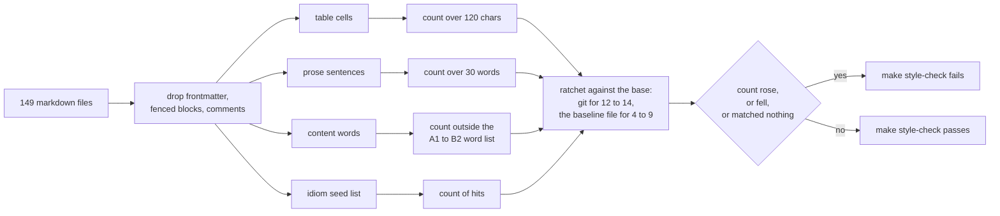

# ADR-20260826-shb: a document is read at speed

- status: proposed, the gates are owed
- date: 2026-08-26

<!-- nav:related -->
> [!NOTE]
> Index: [decisions](README.md) | Extends [ADR-20260826-gtb](20260826-gtb-writing-that-reads-as-written.md), [ADR-20260826-swm](20260826-swm-a-generated-reference-is-read-by-a-person.md) | Reads with [ADR-20260826-53y](20260826-53y-documentation-tiers-and-release-notes.md) | Rules: [writing-style](../../.agents/rules/writing-style.md)

The reader of every file here is a person who is not a technical professional,
who knows the basics, and whose first language is not English. Most of these
files are written above that level. This record sets the
bar, and it binds all 149 markdown files, not the docs tree alone.

B2 is the level the gates measure. The reader knows the basics and does not
have the trade, so a page may assume the basics and may not assume a
practitioner.

Earlier research could not be read before a meeting. Another change
rewrote both, with care and by a person. What that rewrite fixed,
and what it did not, is the whole argument of this record.

| earlier research | before | after |
|---|---|---|
| table cells over 120 characters | 12 and 6 | 0 and 0 |
| diagrams | 0 and 0 | 4 and 1 |
| words above B2 per thousand | 21.4 and 19.3 | 20.2 and 16.6 |
| rank on that rate, of 96 documents | 11th and 16th | 13th and 25th |

A careful rewrite fixes the shape and leaves the words. Only a word list moves
the last two rows, which is why rule 4 carries the gate that costs the most.

It also settles which rule to lead with.
Earlier research argues hardest
for the table rule, and 12 cells and 6 cells are not what stopped the reader. Both
rules are kept, and the sweep follows the measurement.

[ADR-20260826-swm](20260826-swm-a-generated-reference-is-read-by-a-person.md) already bound
earlier research's finding to the six generated pages. The hand-written half was
left out.

## what the 149 files measure

Branch `restructure` on 2026-08-26, over the 149 markdown files outside
`legacy/` and `node_modules/`, and not counting this record.

| what | count | detail |
|---|---|---|
| files in scope | 149 | 43 research, 42 site, 22 backlog, 21 decisions, 21 elsewhere |
| words of prose | 357,195 | outside fenced blocks and tables |
| table cells | 35,353 | median 19 characters, 2,598 over 120 |
| tables | 1,416 | 637 hold at least one cell over 120 |
| prose sentences | 24,255 | 4,506 over 25 words, 2,739 over 30, 947 over 40 |
| words above CEFR B2 | 3,107 | 14.2 per 1,000 content words in prose |
| idiom and phrasal verbs | 411 | against a seed list of 150 forms |
| mermaid diagrams | 61 | 42 of them under `docs/src` |

Where the cost sits, by group:

| group | files | cells over 120 | sentences over 30 | above B2 | diagrams |
|---|---|---|---|---|---|
| earlier research | 43 | 2,154 | 1,479 | 1,877 | 12 |
| `docs/src` | 42 | 127 | 734 | 742 | 42 |
| the old backlog | 22 | 39 | 311 | 271 | 0 |
| `docs/decisions` | 21 | 230 | 98 | 97 | 0 |
| `.agents/rules` | 7 | 8 | 14 | 33 | 0 |
| root and 10 others | 14 | 40 | 103 | 87 | 7 |

The published site is the half that was already swept, under ADR-20260826-swm. The half
read in Obsidian was not.

The cell counts above are source characters. Rule 9 measures rendered length,
because a cell spending 76 characters on a path a reader never sees is not a
long cell. In `docs/decisions/` the correction moves 239 long cells to 230, and
one cell in [ADR-20260826-gtb](20260826-gtb-writing-that-reads-as-written.md) from 133
characters to 23. It does not move the conflict rules 13 to 15 settle: 214 of
the 230 sit in a `rejected` or an `enforcement` table.

## rules

1. Every markdown file outside `legacy/` and `node_modules/` is in scope. A
   file belongs to this repository, so a reader meets it by the same route as
   any other. `frontend/README.md` and `tools/printer-emulator/README.md` are
   bound for that reason, and rule 12 means the binding costs their owners
   nothing until they next edit.
2. A page is written so that a B2 reader understands it correctly on one pass.
   B2 is about 4,000 word families. That is the bar, and the rules below are how
   it is held. The reader is somebody who is not a technical professional, who knows the basics, reading a
   second language. So the bar is the English and the trade knowledge together.
3. One bar for the English everywhere. The audience tier of
   [ADR-20260826-53y](20260826-53y-documentation-tiers-and-release-notes.md) decides which
   technical terms may stand undefined, and never how hard the sentences may be.
   A `build` page needs more terms, not harder English.
4. A word above B2 is replaced by a B2 word, or it is a term this project
   defines. `intersection`, `idempotent`, `epoch` and `projection` are load
   bearing and stay. `verbatim`, `austere`, `suffices`, `hence` and `thereby`
   are not, and go.
5. A term of art keeps one spelling everywhere. A `grant` is a `grant` on every
   page. A second word for one concept becomes a second concept for the reader.
6. A term this project defines is linked to
   `docs/src/content/docs/glossary.md` at its first use on a page. The glossary
   states this rule for the site already, and rule 1 extends it to the rest.
7. Idiom, metaphor and phrasal verbs are replaced by a plain verb. A reader
   cannot decode `load-bearing` or `reads as` from the parts, and a phrasal verb
   has no dictionary form to look up.
8. A sentence carries one idea and runs to at most 30 words. 25 is the target,
   which is the bar ASD-STE100 sets for descriptive text.
9. A table cell holds a value of at most 120 rendered characters. Rendered
   counts a link as its text, and inline code without its backticks. A rule
   that counts a URL the reader never sees pushes an author to delete the link.
   An argument goes under a heading, where it can be linked to and read.
10. A document that explains a topology, a state machine, a message flow or a
    pipeline carries a diagram of it, as a `mermaid` fence. Obsidian and the
    docs site both draw one.
11. A document opens with its answer, inside the first 40 words of body prose.
    A reader decides at the top whether to continue.
12. A check that the tree already fails ships as a baseline ratchet, on
    [ADR-20260826-gtb](20260826-gtb-writing-that-reads-as-written.md) rule 9's model and in
    its file. A count that rises fails, a count that falls fails until the line
    is corrected, and a file with no line is held to zero.
13. A table carries two axes. A column is a field the reader compares across
    rows, and a cell answers "what is this row's value for this column". One
    axis of information is a list, a heading list or a description list. This
    is [ADR-20260826-swm](20260826-swm-a-generated-reference-is-read-by-a-person.md) rule 8,
    and rule 1 extends it from the six generated pages to every page.
14. A `rejected` set whose reasons are short is a table, and every reason is
    held to rule 9. A set whose reasons are arguments becomes one heading per
    option, with the option unchanged as the heading text. The set moves whole,
    because half a table and half a heading list is harder to scan than either.
15. An `enforcement` cell that names several gates becomes one row per gate. A
    cell naming four tests is a list that lost its markup. A screen reader
    cannot tell the four apart inside one cell.

Rules 7 and 11 rest on the same published guidance
[ADR-20260826-gtb](20260826-gtb-writing-that-reads-as-written.md) rule 6 adopts for headings.
The Home Office poster for users on the autistic spectrum refuses "figures of
speech and idioms", which is rule 7. ISO 24495-1 clause 5.2.2 puts "the most
important message where readers can easily find it, commonly at the beginning",
which is rule 11. None of it contradicts this record. The heading rule is
ADR-20260826-gtb rule 6 and is not restated here.

## the standard rules 13 to 15 adopt

Rules 13 to 15 are an adoption, on the model of
[ADR-20260826-gtb](20260826-gtb-writing-that-reads-as-written.md) rule 6. Every line of them
comes from one of these.

| source | what the rules take |
|---|---|
| [WCAG 2.2, H51](https://www.w3.org/WAI/WCAG22/Techniques/html/H51) | information "is considered tabular when logical relationships ... exist in two dimensions" |
| [HTML, the `table` element](https://html.spec.whatwg.org/multipage/tables.html#the-table-element) | "The `table` element represents data with more than one dimension" |
| [Adrian Roselli, on tables](https://adrianroselli.com/2017/11/hey-its-still-ok-to-use-tables.html) | "If you only have one axis of information, use a list" |
| [GOV.UK, tables](https://guidance.publishing.service.gov.uk/formatting-content/text-formatting/tables/) | do not use one "when you can use normal page structure ... for example headings and lists" |
| the same, on cell text | "Keep text in cells concise and clear" |
| the same, on a list inside a cell | "If there are multiple items per cell, an assistive technology user will find it difficult" |
| [W3C WAI, tables tips](https://www.w3.org/WAI/tutorials/tables/tips/) | "Don't use headers in one column and all data in a second column" |
| [W3C WAI, tables](https://www.w3.org/WAI/tutorials/tables/) | "Screen readers speak one cell at a time and reference the associated header cells" |
| [WCAG 2.2, H48](https://www.w3.org/WAI/WCAG22/Techniques/html/H48) | a description list groups "name-value pairs ... terms and definitions or questions and answers" |
| [WCAG 2.2 SC 1.3.1](https://www.w3.org/WAI/WCAG22/Understanding/info-and-relationships.html), Level A | failure F43, "using structural markup in a way that does not represent relationships" |
| [Content Design London, page design](https://web.archive.org/web/2024/https://readabilityguidelines.co.uk/content-design/page-design/) | sub-headings "help users scan page content for what they are looking for" |
| [NN/g, data tables](https://www.nngroup.com/articles/data-tables/) | the first column "should be a human-readable record identifier", so a reader can "scan and locate a record of interest" |

Four notes on that set, because two of them limit what it proves.

- Content Design London published nothing on tables and nothing on lists. Its
  wiki index carries headings, links, bold and page design, and no page on
  either. The row above is the nearest guidance, and it is not on point.
- The archived wiki is the source, because `readabilityguidelines.co.uk` now
  answers 200 for every path from a commercial site. A 200 there is not the
  wiki.
- [NN/g's lawn mower study](https://www.nngroup.com/articles/lawn-mower-pattern/)
  disagrees with the first-column reading: a reader scanning a comparison table
  goes row by row. It holds for a table comparing several fields of each row,
  which a `rejected` set is not.
- A description list is the published answer for a term and its explanation, and
  markdown has no form for one. Rule 14 takes the heading, which markdown does
  have and which carries an anchor a reviewer can cite.

## how a file is checked

## enforcement

Checks 12, 13 and 14 are built. Checks 10 and 11 are not, and the status of
this record stays `proposed` for that reason. Each gate is a check in
`scripts/check-writing-style.sh`.

| rule | gate | cost | flags today |
|---|---|---|---|
| 4 | check 10, not built. Words outside the CEFR-J A1 to B2 list and outside a project term list | a vendored 233 KB CSV, a 12-line lemmatiser, and the term list | 3,107 in prose. Without the term list, 10,607 distinct off-list forms |
| 5 | none. A synonym set costs as much as the word list and a wrong pair flags correct prose | not attempted | `grant` 593 against `permission` 359, which needs a human to split |
| 6 | check 11, not built. It needs the same term list rule 4 needs | a parse of the 62 glossary anchors | 19 of 149 files name the glossary, and 14 of those are under `docs/src` |
| 7 | check 12, built. Seeded forms, outside fences, code spans and blockquotes | 142 seeded forms, which is the whole cost and has unknown recall | 216 hits in 75 files. `by hand` 58, `load-bearing` 34, `read as` 32 |
| 8 | check 13, built. Prose sentences over 30 words, outside fences and tables | a sentence splitter of 26 lines of awk | 2,663 sentences in 122 files |
| 9 | check 14, built. Table cells over 120 rendered characters | 26 lines of awk, holding the link and code-span filter rule 9 names | 2,177 cells in 80 files |
| 13, 14, 15 | none. Which job a table is doing is a judgement over its content | not attempted | 214 of the 230 long cells in `docs/decisions/` sit in a `rejected` or an `enforcement` table |
| 10 | check none. `internal/arch/diagram_floor_test.go` is the per-document floor under it | a table of 30 documents | 76 fences held. The rule itself stays a judgement |
| 11 | none. A first paragraph cannot be checked for being an answer | not attempted | 41 of 149 files carry no frontmatter `description` either |
| 12 | `ratchet()`, built. Checks 12 to 14 read the base from git instead | none | the baseline may grow |

Every check has to be watched failing on a probe before it is trusted green.
Three gates that could not fail were found in this repository. The three built here were watched failing on a cell of 166
rendered characters, a sentence of 39 words, and `low-hanging fruit`. The same
three inside a fenced block produced no hit, which is
[ADR-20260826-gtb](20260826-gtb-writing-that-reads-as-written.md) rule 7 working.

### The three built checks and the baseline

A tree-wide ratchet for them costs 277 lines: 80 files over the cell limit, 122
over the sentence limit, and 75 carrying an idiom. That cost is why checks 12
to 14 read the base commit instead. Each one reads the markdown files the push
publishes, and holds each file to its own count at the base. The ratchet is
read out of git rather than out of a file, and a file the base does not carry
is held to zero.

The rule is [ADR-20260826-gtb](20260826-gtb-writing-that-reads-as-written.md) rule 9,
unopposed. A check the tree already fails ships as a baseline ratchet, with
today's count written down. It never ships as a warning and never waits for a
sweep. The 277 lines are a cost to weigh and not a bar. Checks 12 to 14 keep the
base-commit shape they were built with, and moving them is an open item below
rather than a rule this record states.

The base is `WRITING_STYLE_BASE`, or the branch's upstream, which is the range
`scripts/check-changelog.sh` already reads. Where neither resolves, the three
count and print and refuse nothing, and the run says so on its own line.

Two costs come with that shape, and both are open items below. A file nobody
edits is never read, and a shallow checkout resolves no base.

## rejected

| option | why not |
|---|---|
| a readability score such as Flesch-Kincaid | over 96 files, r = +0.11 against the above-B2 rate and r = +0.68 against sentence length. It restates length, not words |
| Flesch-Kincaid, second reason | `error-codes.md` holds the highest above-B2 rate here, 49.9, at a median grade of 10.9. The score calls it average |
| a rule against nominalisation | 105 hits in 357,195 words. It would not have prevented the failure |
| a rule against opening a sentence with an `if` or `because` clause | 191 of 22,805 sentences, 0.8 %. Real for a B2 reader, too rare here to gate |
| ban every word outside the B2 list | 86,450 occurrences of 10,607 words, mostly product names and technical terms. Unusable as written |
| adopt the ASD-STE100 dictionary whole | about 900 approved words, one meaning each. It bans engineering English we need. The rules transfer, the words do not |
| a readability bar per audience tier | `audience:` does not exist yet, and covers 45 of 149 files when it does. Rule 3 puts the tier on terms instead |
| gate the diagram rule by a keyword proxy over headings | 42 candidate files, from a keyword list a person chose. Recall is unknown, and it needs the opt-out ADR-20260826-gtb rejected |
| a second glossary of plain-word replacements | `docs/src/content/docs/glossary.md` holds 62 terms. A second list drifts from the first |
| a cap on document length | ADR-20260826-gtb rejected it. The median is ordinary and the tail is long because the subject is |
| ship any of this as a warning | ADR-20260826-gtb rule 9. A warning is how a gate dies |
| sweep every file to the threshold in one change | 149 files and 357,195 words. Rule 12 exists to avoid that |
| an exemption for the two tables `writing-style.md` mandates | it exempts the 214 cells that measure worst, and ADR-20260826-gtb already rejected a file-level opt-out |
| raising the limit until the two mandated tables fit | the longest cell in `docs/decisions/` is 379 characters. A limit that admits it is not a limit |
| holding every rejected reason to one line instead | measured over ADR-20260825-z65's 20 rows: the four longest reach 120 only by dropping half of an argument |
| a bolded lead-in per rejected option, rather than a heading | WCAG 2.2 SC 1.3.1 failure F2, presentation standing in for structure. It also takes no anchor |
| an HTML description list for the rejected set | `<dl>` has no markdown form, gives a term no anchor, and shows as raw tags in the vault |
| counting source characters, which is what rule 9 said before | it charges a cell for a URL nobody reads, so the cheapest way to pass is to delete the link |

## the sweep

Ranked by what is read most, and not by what measures worst. Earlier research
and `docs/decisions/` are read in Obsidian.

Cost is cells over 120, then sentences over 30, then words above B2.

| wave | files | what | cost |
|---|---|---|---|
| 1 | 2 | earlier research, the two that could not be read | 0, 25, 84. Structure done, words owed |
| 2 | 21 | `docs/decisions/` | 230, 98, 97 |
| 3 | 11 | `.agents/rules/`, `AGENTS.md`, `README.md`, `CLAUDE.md` | 8, 20, 48 |
| 4 | 10 | earlier research, `proposal.md`, `00-requirements.md`, `map.md` | 418, 173, 253 |
| 5 | 32 | the rest of earlier research | 1,774, 1,281, 1,540. The largest wave |
| 6 | 22 | the old backlog | 39, 311, 271, and no diagram anywhere |
| 7 | 42 | `docs/src/content/docs/` | 127, 734, 742. ADR-20260826-swm did the tables here |
| 8 | 9 | `frontend/`, `test/`, `tools/`, `examples/`, `config/`, and 4 more | 2, 97, 72 |

Wave 3 is small and out of measured order on purpose. Earlier research found that the
rule files seed the style of everything written under them.

Three files carry most of wave 5:

- `14-resource-lifecycle-plane.md`, 167 cells over 120 characters
- `12-hierarchical-federated-authz.md`, 126 such cells and 155 long sentences
- `04-storage-abstraction.md`, 27.0 words above B2 per thousand

## this record against its own rules

Measured with the same scripts, on the file you are reading.

| rule | this file |
|---|---|
| 4, words above B2 | 0 in prose. The quotations under rules 13 to 15 carry their sources' words |
| 7, idiom and phrasal forms | 0 in prose. The 4 in code spans quote what rule 7 forbids |
| 8, sentences over 30 words | 0, and 0 over the 25-word target |
| 9, table cells over 120 rendered characters | 0 of 242 |
| 13 to 15 | the `rejected` set here is a table because every reason is short, and the enforcement table is one row per gate |
| 10, a diagram | 1 |
| 11, the answer in the first 40 words | the first sentence names the reader |

Rule 7 is why check 12 reads outside code spans. A record that states a rule
has to be able to name what the rule forbids.

## open items

- The diagram rule has no gate and may never get one. The fallback is built:
  `internal/arch/diagram_floor_test.go` holds 30 documents to the 76 `mermaid`
  fences they carry. A file that loses its diagram fails, and a file that never
  had one is not accused. The rule itself is still ungated, because whether a
  page explains a pipeline is a judgement over its prose.
- Rule 5 is unenforced. Splitting `grant` from `permission` across 952 uses
  needs a person, and a wrong synonym pair would flag correct prose.
- Rule 11 is unenforced. A gate cannot tell an answer from an introduction.
- The word list has two licences. The CEFR-J A1 to B2 profile is free for
  commercial use if it is credited. The copyright belongs to Tono Laboratory at
  TUFS. The Octanove C1 and C2 profile is CC BY-SA 4.0, and vendoring it needs a
  call this record does not make. Check 10 as specified needs only the first.
- The idiom list has unknown recall. It was seeded from forms a person noticed in
  these files, so it measures what was looked for.
- 41 of 149 files carry no frontmatter `description`. Rule 11 wants one, and
  `docs/src/content.config.ts` requires it for published pages only.
- Rules 4 and 6 both need the project term list, and neither can ship first.
- Rules 13 to 15 have no gate, and a pattern cannot get one. The enforcement
  table above says why, and it is the same judgement
  [ADR-20260826-gtb](20260826-gtb-writing-that-reads-as-written.md) rule 6 leaves to a reviewer.
  Check 14 puts a floor under it by refusing the long cell an argument produces.
- Check 7 skips any line starting with a pipe, so prose copied into a table cell
  is unscanned by the repeat gate. Measured when the three checks landed:
  reading table cells takes the count from 1 hit in 1 file to 59 hits in 27
  files. The skip hides 58 of the 59. Repairing it costs 26 baseline lines
  and is therefore held with the sweep. Check 12 reads table cells for that
  reason, and rule 14 is what makes the hidden ones visible.
- `.github/workflows/ci.yml` checks out at depth 1 and never fetches the
  upstream ref, so checks 12 to 14 resolve no base there and count instead of
  refusing. The pre-push hook refuses. A `fetch-depth: 0` on the backend job
  closes it, and that file was outside the change that built the checks.
- Checks 12 to 14 read only the files a push publishes, so the 2,177 long cells
  and 2,663 long sentences already here are cleared by the sweep alone. A file
  nobody edits is never read. Moving the three onto the baseline would close
  that, and the baseline may grow.
  The measured price is 277 lines and the whole-tree count is now 78 files and
  221 hits for check 12, 124 files and 2,712 for check 13. Whoever moves them
  takes the count of the day they land.
- The scope is `git diff BASE HEAD`, so uncommitted work is outside it. Several
  agents write in one checkout here, and a working-tree scope reports one
  agent's draft against another agent's run. The cost is that `make
  style-check` before a commit says nothing about the edit in hand, and the
  pre-push hook is where the refusal lands.
- `WRITING_STYLE_BASE=none` takes the report path on a machine that has an
  upstream. It is how the branch is probed and how the whole-tree count is
  read, and without it the branch has no test.
- Check 12's seed list holds 142 forms and finds 216 hits in 75 files. The
  earlier estimate of 411 was against a 150-form list this record did not keep,
  so the two numbers are not comparable.
- [ADR-20260826-gtb](20260826-gtb-writing-that-reads-as-written.md)'s 21-row `rejected` table
  is the largest set rule 14 has not moved. This record does not change it.
- Closed on 2026-08-29. `docs/decisions/README.md` indexed ADRs 0001 to 0004
  while 0005 to 0012 existed, so eight accepted records the code links to could
  not be reached from the index. Each has a row now.
