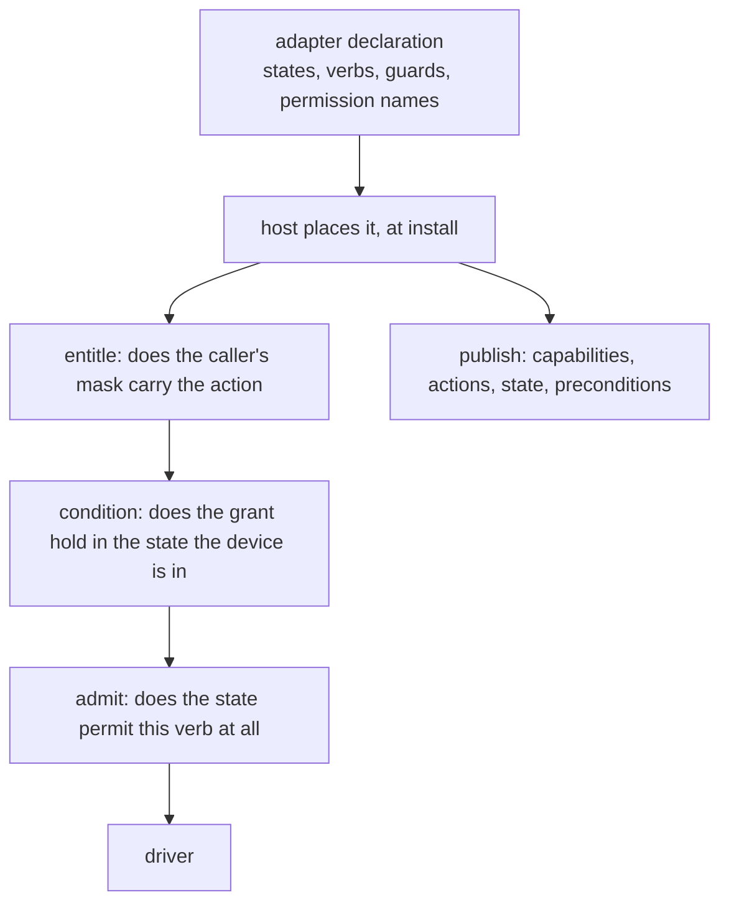

# ADR-20260831-c7b: an adapter declares the states and the permissions and the host places them

- status: proposed. Every gate is owed
- date: 2026-08-31

<!-- nav:related -->
> [!NOTE]
> Index: [decisions](README.md) | Amends [ADR-20260827-rqc](20260827-rqc-an-extension-declares-a-permission.md) rules 2, 6 and 14, [ADR-20260831-nbj](20260831-nbj-a-module-declares-a-device-kind-and-the-host-places-it.md) rules 8 and 17, and AGENTS.md's four things that never become pluggable | Reverses [ADR-20260828-xdp](20260828-xdp-a-contributed-resource-kind-is-a-grantable-object.md) rule 10 on that rule's own condition | Builds on [ADR-20260825-z65](20260825-z65-raw-gcode-and-sequences.md), [ADR-20260827-wgm](20260827-wgm-a-caller-may-ask-what-it-may-do.md), ADR-20260828-xdp rules 6 and 8 | Reads with [ADR-20260825-dee](20260825-dee-the-capability-vocabulary.md), [ADR-20260826-5yj](20260826-5yj-a-device-is-the-object-and-a-printer-is-the-type.md)

An adapter declares what states its device has, what it can do, what each state
permits, and what permissions it offers. The host places all four. The core
carries the shape of a declaration and none of its values, and the stored
permission mask never widens.

## the three rules this record amends

The rules below block that, and each one is the owner's.

**The printer state model was closed by rule.** AGENTS.md lists four things
that never become pluggable, and the printer state model is the first. He
removed it on 2026-08-31, in answer to the finding below.

**A declared permission could not be granted.** [ADR-20260827-rqc](20260827-rqc-an-extension-declares-a-permission.md)
rule 2 puts every declared permission at the administering level, which is
`manage` on a device. So an adapter permission was held by every manager and
could be given to nobody else. That rule is dropped.

**The device object took no declaration.** ADR-20260827-rqc rule 14 and ADR-20260831-nbj
rule 17 refuse one. Rule 18 was written to keep opening it cheap. This record opens it.

One thing that looked like a blocker is not one. There is no core table of
device states to remove. The state value travels as free text and nothing
validates it. `sdk/eventsapi.PrinterState.State` is a bare string, and the host
forwards whatever a driver put at `/state`. The xBuddy driver maps nothing and
passes the machine's own word through. The Moonraker driver maps its dialect
onto six words of its own choosing. A doc comment in an adapter names a
vocabulary the core does not define. So a
declared state set is the first validation this surface has ever carried, and
this record tightens the surface rather than opening it.

## the five concerns and where each one is decided

| concern | question it answers | who decides |
|---|---|---|
| declare | what can this device do at all | the adapter, placed by the host at install |
| entitle | may this caller perform this action | the authorization graph |
| condition | does this caller's grant hold right now | the graph, from a predicate on the grant |
| admit | does the device's state permit this verb | the host, above the driver |
| publish | what is a client told before it tries | the API, stamped with an epoch |

## rules

### the shape

1. Keep the five concerns above apart, and never answer two of them in one
   field. A field carrying both what a device can do and what it can do right
   now expresses neither well. Home Assistant's architecture issue 338 records
   that failure against `supported_features`.
2. Hold in the core the shape of a declaration, the registry that stores it,
   the check that runs it and the refusal that reports it. Hold no value of it.
   No core table names a vendor, a device class or a state.
3. Read every declaration from the set the host installed, and never from a
   running module. That is ADR-20260828-xdp rule 2 and ADR-20260831-nbj rule 6, extended to the
   state set and the permission names.
4. Derive the namespace from the declaring adapter and refuse one passed in.
   That is `extension.NamespaceOf`, which ADR-20260827-rqc rule 16 already uses.

### the state set

5. Take a device kind's state set from its adapter, as a list of declared names
   with a display name for each. The host validates the list at install and
   refuses a state the grammar rejects.
6. Declare the transitions with the state set. Each names the state it leaves
   and the state it enters, and it names the verb that causes the move only
   where a verb causes one. A machine leaves a printing state because the file
   ran out, and requiring a verb there would invent one. OPC UA Part 16
   publishes a state machine this way, and a state set with no transitions is a
   list nobody can act on.
7. Declare the capability set and the guard as two separate things. The
   capability set of [ADR-20260825-dee](20260825-dee-the-capability-vocabulary.md) says which
   verbs the device has at all, and does not move. A guard says which of them
   the device will accept in the state it is in.
8. Carry a guard as declarative data the host evaluates, never as adapter code
   the host calls. A host that cannot read the guard can enforce it and cannot
   show the control as unavailable. VS Code context keys, Eclipse
   `enabledWhen` and polkit policy files all place the expression in the host
   for that reason.
9. Serve a declared state set from the per-install half of the published
   vocabulary, on ADR-20260828-xdp rule 8's split. Two installs of one build answer
   differently, which ADR-20260831-nbj rule 23 already accepts for the device kind.
   Serve it to an identified caller only, where the other vocabularies are
   public. Its entries name the device kinds a deployment runs and the adapter
   that declared each. ADR-20260831-nbj rules 22 and 24 exist to keep an internal
   device class out of what the core publishes.

### the permission

10. Let a declared permission enter the operator level and not only the
    administering one. This amends ADR-20260827-rqc rule 2. Without it an adapter permission is held
    by every manager of every device of that type and is grantable to nobody,
    so the declaration confers no authority.
11. Carry a declared grant in a table of its own, beside `authz_tuple` and
    never inside it. The row names the subject, the object and the declared
    permission by its name. So the relation vocabulary stays closed and the
    tuple table does not change, and ADR-20260827-rqc rules 9 and 13 both stand. This is
    chosen over opening the relation vocabulary.
    - **Amended by [ADR-20260901-b2z](20260901-b2z-driver-declared-permissions.md) rules 26 and
      38.** Classes are held in the one tuple system, so there is no second
      general grant path. The table this rule mints is kept and repurposed as
      the dangerous tier's, a named row per verb, which is the second
      grant table doing narrower work.
12. Compile a declared grant into the same projected masks a tuple compiles
    into, by mapping its name onto core action bits per device kind. A
    projected row carries core bits only, so the list filter keeps one
    predicate and one parameter and the event stream filter does not change.
    - **Amended by [ADR-20260901-b2z](20260901-b2z-driver-declared-permissions.md) rules 3 and
      5.** There are no declared permission *names* to map onto bits. A
      declared verb carries a class the core already owns, and the projection
      compiles tuples exactly as today.
13. Refuse at install a declared name that maps onto no core action. The
    refusal is read where a person sees it, which is ADR-20260831-nbj rule 16's timing
    applied to a permission.
    - **Amended by [ADR-20260901-b2z](20260901-b2z-driver-declared-permissions.md) rules 3 and
      5.** As rule 12: the mapping has no name to place.
14. Retire the bit assignment of ADR-20260827-rqc rule 6. Two binaries reading one database compile a different
    assignment from the same sorted names, which earlier research already
    argues. Rule 11 removes the need for the assignment.
15. Hold the mask width in one constant in one place, and widen it by a
    migration a person takes. Never widen it automatically. Linux capabilities went from 32 bits to 64 across three
    header versions and three revisions of the stored attribute. A width that
    moves without a decision changes what every stored row means.
16. Revoke a declared permission by deleting its row or by retiring its name,
    and let the next recompile produce a mask without those bits. A projection
    is truncated and rebuilt from its sources, so the sources are where a
    revocation belongs. Never reuse a retired name: a name a second adapter can
    claim after an uninstall is Android's dangling custom permission.
    - **Carried forward by [ADR-20260901-b2z](20260901-b2z-driver-declared-permissions.md) rule
      22.** The never-reissue principle survives whole. It applies to a verb's
      first-seen class and marking rather than to a permission name, and it is
      keyed so a renamed kind does not escape it.

### the payload no host can read

17. Keep one core action for a payload the host cannot inspect, spelled without
    a dialect, at the manager level. `send_gcode` leaves the core action
    vocabulary and becomes the xBuddy adapter's name for that action. The
    dialect-free action takes the bit `send_gcode` holds and no stored row
    moves. Rule 14 retires ADR-20260827-rqc rule 6, and the sentence inside it that
    gives the reason survives: a bit that moves reinterprets every row already
    written.
    - **Amended by [ADR-20260901-b2z](20260901-b2z-driver-declared-permissions.md) rules 16, 17
      and 21.** A level is too blunt: manager hands the payload to every
      manager of every device. An opaque-payload verb is conferred by no class
      and no level, and reaching it takes an explicit per-verb row.
18. Refuse a mapping that places a payload action below manager. The level is
    about the payload and not about the authority. A payload the capability
    model cannot parse is one the host cannot hold to a descriptor, so the
    manager floor is the only check left before an act nobody reviewed. That is
    [ADR-20260825-z65](20260825-z65-raw-gcode-and-sequences.md) rules 7 and 8. They stop what
    cannot be undone, and they do not try to stop everything
    dangerous. Rule 6's word denylist is refused to every caller including a
    manager, so it is not what this level buys.
    - **Amended by [ADR-20260901-b2z](20260901-b2z-driver-declared-permissions.md) rule 21.**
      The level model this rule floors on goes. The owed gate keeps a stronger
      floor. A verb the host computes as unconstrained is marked
      `opaque_payload` whatever the declaration says, and the marking confers
      on nobody rather than on every manager.
19. Add two actions to the core floor: reading what a device produced, and
    clearing a fault. The first is the camera media question `internal/authz/doc.go`
    names as unanswered. Both are axes every device class has, and an axis the
    floor omits is one every adapter maps onto the wrong action.
    - **Amended by [ADR-20260901-b2z](20260901-b2z-driver-declared-permissions.md) rule 3.**
      Clearing a fault becomes a declared verb at
      the `operate` class, which is its right place, and needs no core action.
      Reading what a device produced is deferred, not solved: it collapses into
      `observe` for now, until the media
      plane's own grant is decided.
20. Keep the three job actions as they stand. `upload`, `cancel_job` and
    `fetch_job` assume a device that runs discrete work, and a device class
    with no jobs ignores them. Job
    management is common enough that a camera ignoring it costs nothing.
    - **Amended by [ADR-20260901-b2z](20260901-b2z-driver-declared-permissions.md) rule 3.**
      `upload` and `cancel_job` fold into the `operate` class. That moves no
      role's reach, because `level.deviceMask()` confers all three at operator
      today. `fetch_job` stays on the agent relation unchanged.

### the condition on a grant

21. Carry a state condition on the grant and never in the graph's own tables.
    Writing the condition is a grant write and moves the epoch. The state it
    names is supplied at the attempt by the device plane and moves nothing, so
    a machine changing state costs the graph no work.
22. Evaluate a condition at the attempt, and never inside the list query. A
    listing whose membership follows the machines' states pages
    non-deterministically, and the same caller sees a row twice or not at all.
23. Admit a device to a listing on every action the grant carries, conditional
    ones included, and mark the conditional subset beside the action set the
    row already returns. ADR-20260827-wgm rule 9's property holds: the row's action set
    is the one the filter used. A caller whose only grant is conditional would
    otherwise reach nothing even while the condition holds.
24. Answer a review with three outcomes and not two: permitted, refused, and
    permitted under a condition. SpiceDB added the third outcome to
    `CheckPermission` when it added conditions, for the same reason: a
    conditional grant has no honest yes or no.
25. Keep ADR-20260827-wgm rule 11 over a state answer too. A published precondition is
    a hint, and the attempt is the decision.

### the hold a person sets

26. Hold two state axes and keep them apart. The adapter declares the states
    the machine reports. The core owns one device-neutral hold a person sets.
    The state that gates a student's command is both: one the machine reports
    and one a person sets, kept separate.
27. Read the hold as belonging in the core under rule 2. It describes the
    supervision of a machine and not its mechanics, so it names no device
    class and carries no adapter value.
28. Let a condition name either axis. "This account may send commands only
    while the machine reports ready" and "only while a supervisor has lifted
    the hold" are the same mechanism over two inputs.
29. Gate lifting the hold on a permission. Whoever may let a student operate a
    machine is a question the graph already knows how to express.

### the refusal

30. Keep four refusals apart and never answer one with another. The verb does
    not exist. The caller may not do it. The device's state does not permit it.
    The device is already in that condition. IPP separates
    `client-error-forbidden`, `client-error-not-authorized` and
    `client-error-not-possible`, and SECS-II's command acknowledge codes make
    the same four distinctions.
31. Add the third refusal to `sdk/fault`. The tree has no code today for an act a state does not
    permit. So the printer's own answer is the only report, and it arrives in a
    vocabulary the host does not own.
32. Check the permission before the state. A device whose state refuses an act
    answers that only to a caller holding the action, and answers not-found to
    everybody else. Existence stays a permission-gated fact. The tree holds
    this ordering for presence today, in `reachLive`, and owes the test for
    state. Rule 31 says there is no state check yet, so this ordering is one to
    establish and not one to preserve.

### the declared grant table

33. Read the device kind in the projection compiler. It reads device ids today,
    and rule 12's mapping cannot be applied without the kind.
    - **Amended by [ADR-20260901-b2z](20260901-b2z-driver-declared-permissions.md) rules 3 and
      26.** The name-onto-bits machinery has no declared name left to compile.
      The table survives as the dangerous tier's, keyed by verb.
34. Write a declared grant only on a device of the declaring adapter's kind.
    Refuse one on an org, a group or a device group. Those span kinds, so one
    name under one grant would expand to different bits on different devices,
    which is the defect this record refuses in its own rejected table.
    - **Amended by [ADR-20260901-b2z](20260901-b2z-driver-declared-permissions.md) rules 3 and
      26.** As rule 33.
35. Rebuild the whole projection when an install changes a mapping or retires a
    name. A scoped recompile moves only the objects a mutation named, so a
    changed mapping would leave a stale expansion on every object nothing else
    touched.
    - **Amended by [ADR-20260901-b2z](20260901-b2z-driver-declared-permissions.md) rules 3 and
      26.** As rule 33.
36. Keep the declared name on the stored row. It is what an operator reads and
    what makes a revocation possible, and it is the provenance a mask alone
    cannot carry.
    - **Amended by [ADR-20260901-b2z](20260901-b2z-driver-declared-permissions.md) rules 3 and
      26.** As rule 33.
37. Carry two masks on a projected row: every action the caller holds, and the
    subset of them a condition qualifies. The list filter reads the first, so a
    conditional grant admits its device to a listing and rule 22 still forbids
    reading a condition in the query. The API reads the second to mark an
    action as conditional under rule 24.
38. Refuse a condition on a read action. A subscription re-authorizes only when
    the epoch moves and `Visible` admits a device on the read action alone, so
    a conditional read would be enforced on two surfaces of three. That is
    ADR-20260827-rqc rule 7's reasoning applied to a condition rather than to a scope.

## enforcement

| gate | holds |
|---|---|
| `internal/kernel/devicestate` | a declared state name the grammar rejects is refused, and a refused declaration refuses the placement |
| owed | a declaration reaches the host from a real install, which is what the row above cannot yet see |
| owed | a stored mask carries no bit outside the core region, asserted over both engines |
| owed | a declared name mapping onto no core action is refused at install |
| owed | a mapping placing a payload action below manager is refused |
| owed | the list query's predicate stays one parameter, held by a test over the generated SQL |
| owed | a condition is never read inside a list query, held by the query-cost test of `internal/app` |
| owed | the mask width is one constant, and no second file names 32 |
| owed | a retired declared name revokes the bits it expanded to |
| owed | a module verb carrying an unconstrained argument is refused a placement below manager |
| owed | a fifth refusal is refused a spelling that folds it into one of the four |
| owed | a registered fault code with no raise site is refused, which is the old backlog gate 5 |
| owed | a declared grant on an org, a group or a device group is refused |
| owed | a retired name and a deleted row both leave a mask without those bits |
| owed | an install that changes a mapping rebuilds the whole projection |
| owed | a condition on a read action is refused at the grant write |

One row is held and the rest are owed. Three files name the mask width today
and no test in `internal/arch` reads it, so that row claims nothing.
The old backlog carries them.

## rejected

| option | why not |
|---|---|
| a state model the core owns, with a row per class | the requirement of ADR-20260831-nbj rule 1 refuses a per-class core edit |
| a guard the adapter evaluates in its own code | the host can then enforce it and cannot render it |
| a reserved bit meaning "look in a side table" | no authorization system surveyed uses one, and the fast path loses its index |
| widening the mask automatically | a width that moves without a decision changes what every stored row means |

### a 32-bit permission space per adapter

Each adapter would own its own mask, interpreted in the namespace of the
device's declaring adapter, so collisions are impossible and each adapter holds
about 18 free bits.

It loses on three counts. The mask constant becomes a function of the row, so
every query that today tests `(actions & ?) <> 0` gains a join. Proposal A5's
one-predicate property goes with it. The persisted index is the second count. A
bit handed to an adapter and reused after an uninstall is Android's dangling
custom permission, and a bit carries no name, so nothing mismatches. SELinux
allocates dense integers for the same purpose and refuses to let them reach
disk, calling them local and non-persistent; ours reach disk in
`device_access.actions` and `resource_access.actions`. The third count is that an operator reading a grant reads
a number. Windows solved the storage half this way and left the naming half
open. Its own tooling prints hex for any object type outside its fixed file
vocabulary.

### a generic permission each adapter reinterprets

The core would keep broad actions, and each adapter would decide what one means
on its own device class.

An action then means one thing on a printer and another on a CNC. A grant
cannot be read on its own, and an audit line cannot be read at all. An operator
granting across a mixed fleet cannot know what they gave. Rule 11 gives the
adapter its own names at the same speed, so nothing is bought by overloading a
core one.

## open items

- the hold has no shape yet: what a person sets it to, and what it is called on the wire
- the guard expression language is unchosen. Rule 8 requires the host to evaluate it and rule 1 requires it to be readable, and nothing else is settled
- the bound on a declared state set per kind is unmeasured, on ADR-20260828-xdp rule 5's model. An install may declare an unbounded list until it is set
- nothing installs a declaration yet, so rule 5's check never runs on a real one and the endpoint answers an empty list in every build. ADR-20260831-nbj carries the install path this waits on, and it is the largest gap in this record
- the tree has no device-kind predicate. A declaration is refused on `ref.Kind.Valid()`, which accepts `db` and `storage` as device kinds, and `validDeviceRow` carries the same hole. ADR-20260831-nbj rule 4's directory owes it
- the install refusal of rule 5 has no registered fault code, so it reports through a generic one
- the published example of a per-install set is fabricated, because no byte the server sends can stand as one. It lands in the anonymously served OpenAPI document naming `printer` and four printer states, and this record does not say whether that is accepted
- `send_gcode` moving off the core action vocabulary is a wire change and owes [ADR-20260825-zkq](20260825-zkq-api-compatibility.md) a migration note
- ADR-20260827-rqc rule 7 refuses a read permission finer than an `event.Origin`. So a read scope over one device's own state waits on a per-subscription filter in the hub
- ADR-20260831-nbj rule 14 refuses a module verb placement by naming `send_gcode`, and rule 17 retires that name. Nothing then decides which module verbs carry a payload. A module verb carrying an unconstrained string or opaque argument, placed on `send_command`, reaches an operator with a payload nothing inspected. Rule 18 exists to stop that and does not reach it
- rule 24 changes a published response shape, so it owes [ADR-20260825-zkq](20260825-zkq-api-compatibility.md) a migration note beside `send_gcode`
- the fault domains carry no `core.device`. A record about device classes beyond the printer lands its device-neutral refusal under `core.printer`, and that code's `printer_id` parameter names a camera. ADR-20260826-5yj separates the object from the type and the domains do not
- rule 30 asks for four refusals and the tree can hold three. "The device is already in that condition" has no host code, and `core.printer/TRANSFER_BUSY` is the only instance of it
- rule 32 states a pair where the code has a triple. Whether the verb exists at all is decided before both the permission and the state, deliberately, so that the refusal names no device. This record is silent on where that sits
- nothing computes the states in which a verb is accepted, so rule 8's motivation is unmet even where the refusal exists. `core.printer/VERB_NOT_ALLOWED_IN_STATE` publishes no such list because nothing can fill one
- `core.printer/VERB_NOT_ALLOWED_IN_STATE` has tests and no raise site. The old backlog gate 5 refuses a registered code nobody raises and is unbuilt, so this code needs an exemption with an argument when that gate lands
- The old backlog carries the same wound on `core.printer/COMMAND_REJECTED`: a machine's own state refusal is folded into a result body and answered 200
- the `(actions & ?) <> 0` predicate is written in eleven places, so a gate over the list query alone leaves ten free to drift
- `internal/authz/doc.go` states that the vocabulary is closed, that this package owns it, and that a new action is a change to one file. It also carries `send_gcode manager` as a transcribed line. Rules 10, 11 and 17 refute both passages
