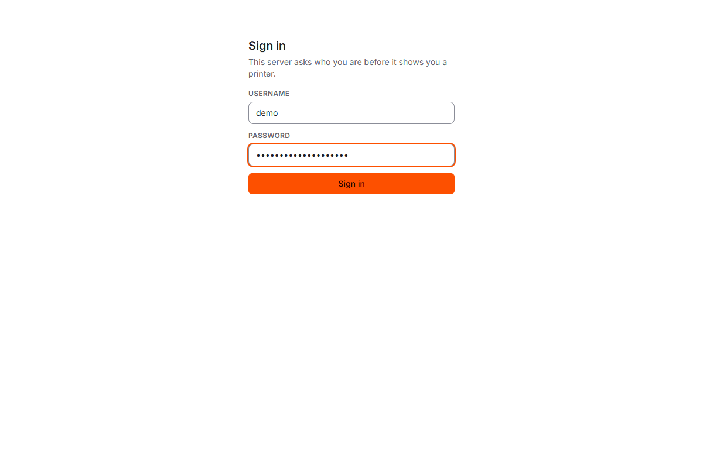
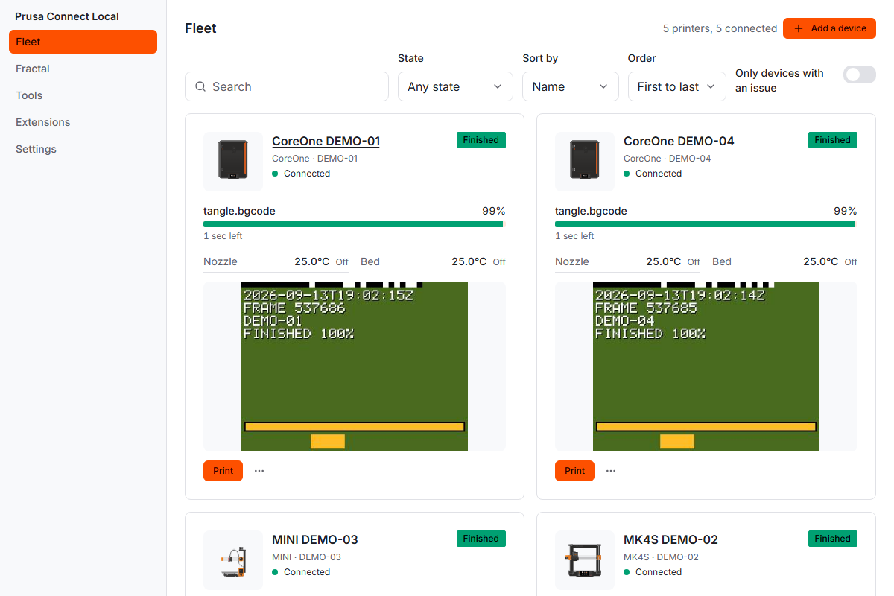
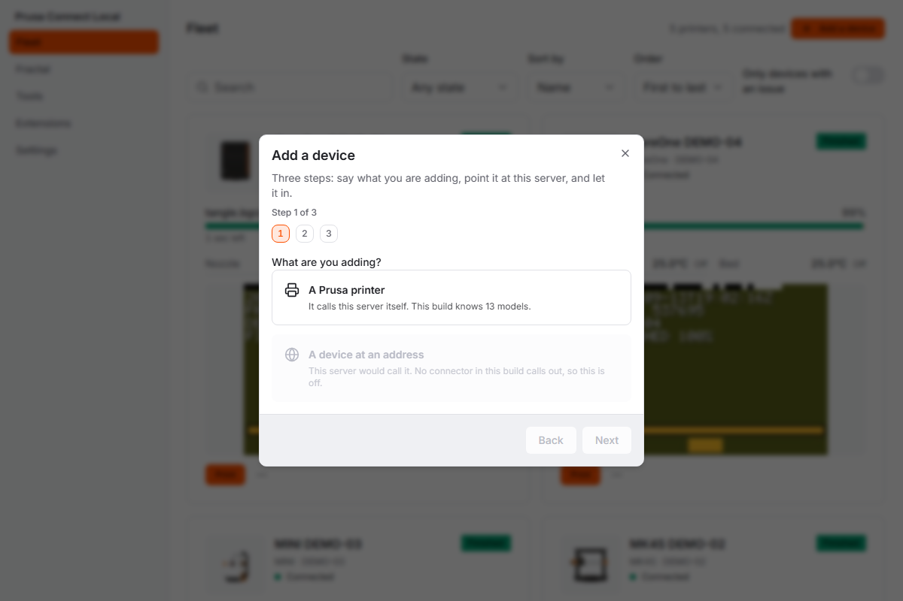
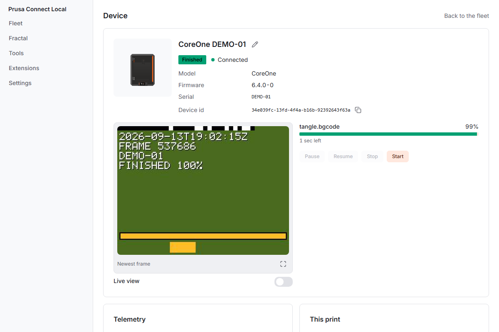
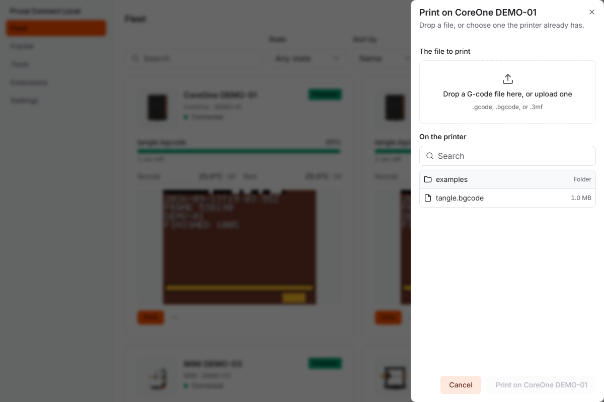
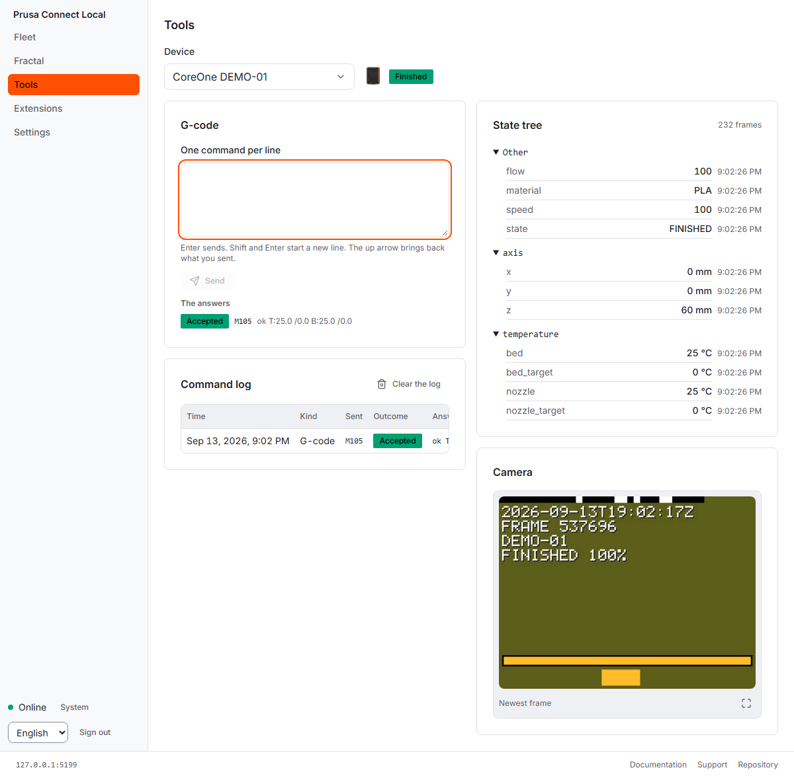
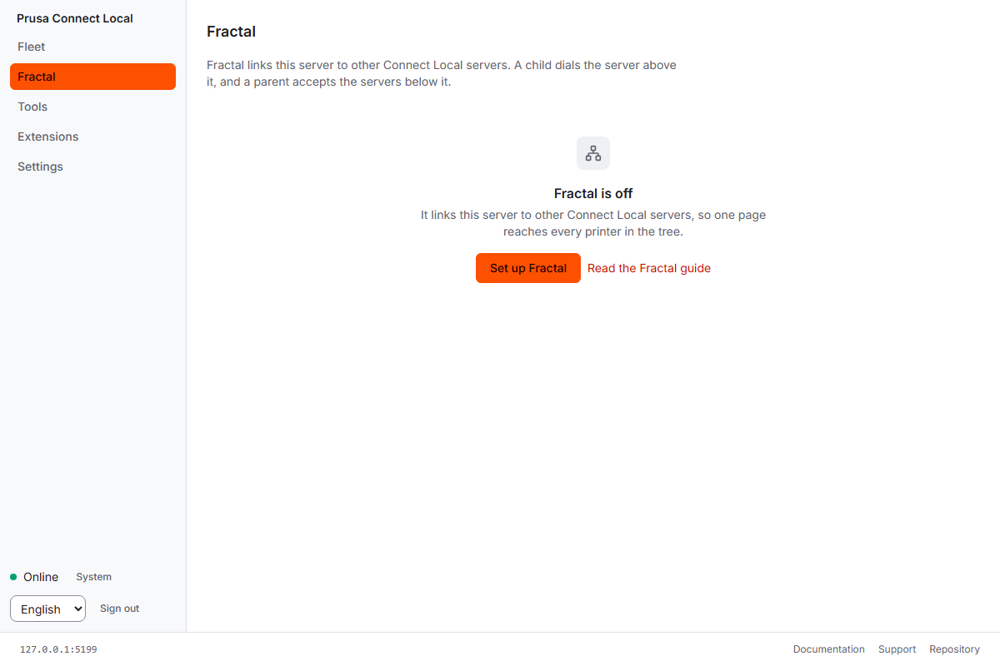
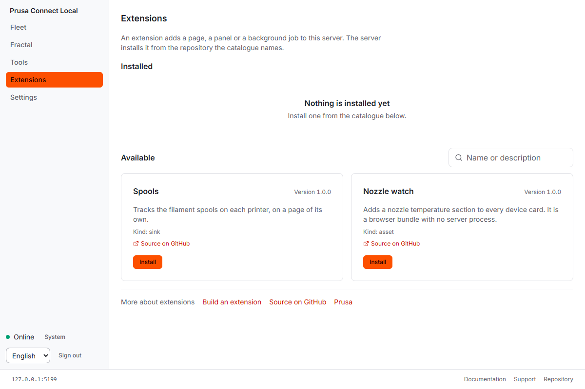
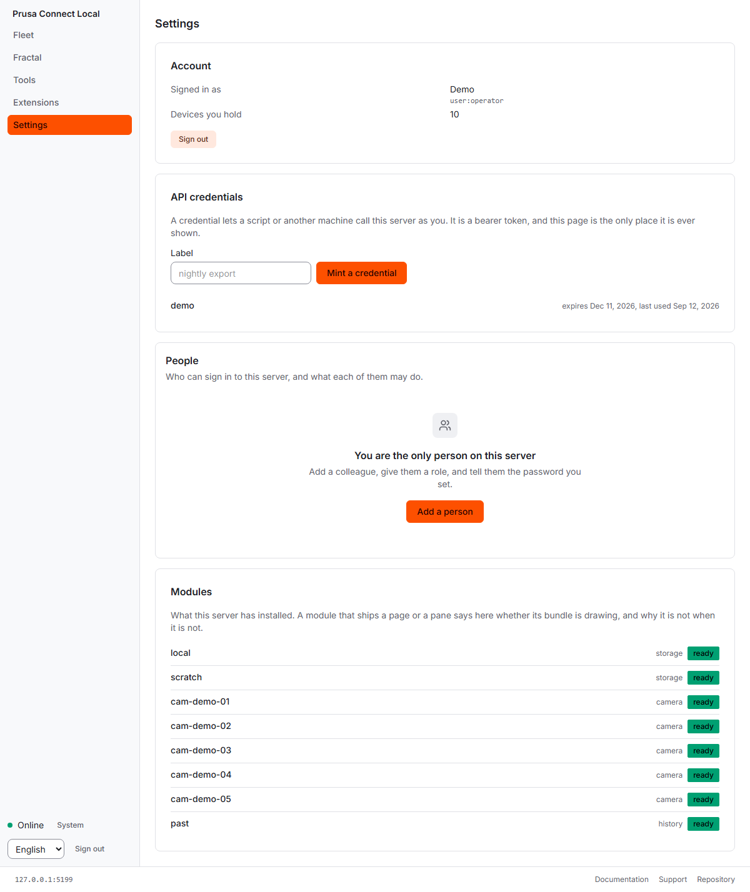
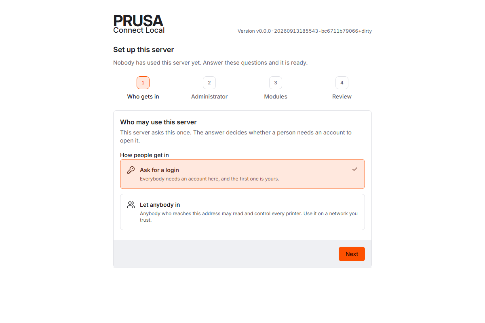

`make demo` starts the server and four simulated printers in one process,
and the web app is at `http://127.0.0.1:8080/`. This page goes through every
page of that app in the order a new person meets them, with one picture of
each. You need Go and pnpm. No printer is needed, and Docker only for the
two-server Fractal mockup at the end.

## Start the demo

```bash
make demo
```

It first builds the example modules and the extensions in `extensions/`, so
the Extensions page has something to offer, and the web app, which the demo binary embeds. Then it builds that
binary and starts it. After about ten seconds it prints the fleet, the camera
addresses and the account:

```
Sign in as the demo account. Its password is new on every run:

  username  demo
  password  qsjphyacz2gosnkva22a
```

Copy the password from your own terminal, because it changes on every run.
Then open `http://127.0.0.1:8080/` in a browser. Leave the terminal open:
Ctrl+C stops the printers and the server.

Flags go through `DEMO_ARGS`. The pictures on this page come from
`make demo DEMO_ARGS="-printers 5"`, so they show five printers instead of
three. [Run the server](./getting-started.md) lists every flag.

## Sign in

The first page asks who you are. Type `demo` and the password from the
terminal, then press Sign in.



The session is a cookie in this browser. Sign out is at the bottom of the
sidebar and in Settings.

## The fleet

The fleet is the first page after signing in, and the Fleet entry in the
sidebar brings you back to it. The header counts the printers and how many are
connected. Under it you can search by name, model or serial, filter by state,
sort, and show only the printers with an issue.



Each card answers three questions: which printer, what it is doing, and what
you can do. It shows the model drawing, the name, the state badge and the
connection dot. Under them are the file being printed with its progress and
time left, the nozzle and bed temperatures, the newest camera frame, and a
Print button. The three dots open a menu with the other actions. The printer's
name opens its page.

The demo printers cycle through three models, so the drawings differ. One
printer goes away for fifteen seconds every minute and comes back, so you can
watch a card lose its connection dot and get it back. `-flap 0` keeps every
printer connected.

Every printer but the second keeps printing, with the odd cancelled or failed
print. The second waits on a question on its display instead. The
demo records history and starts with 21 days of past prints, so there is
something to read from the first minute. One printer fails about a quarter of
its prints.

## Add a device

Add a device, at the top right of the fleet, opens a dialog with three steps.



| step | what it shows |
|---|---|
| What to add | A Prusa printer, which calls this server itself. A device at an address is off in this build |
| Point it here | the lines for `prusa_printer_settings.ini` with this server's address, and the printer menu that loads them |
| Let it in | the printers waiting to be let in, each with the code its screen shows, and a button for each answer |

The demo cannot show step 3 with a waiting printer. Its printers are let in
the moment they call, so the step waits and counts the seconds. With a real
printer on the same network, follow step 2 on the printer and its code
appears here. [Printer configuration](./printer-configuration.md) explains
the settings file.

## One printer

Click a printer's name on its card. The page opens with the printer's model,
firmware, serial and id, its state and connection, and the newest camera
frame. Live view switches the frame to a stream, and the corner button fills
the screen with it.



Beside the camera is the running print with its progress, and the four print
controls: Pause, Resume, Stop and Start. A control that does not apply now is
disabled, and hovering it says why, such as "Available when printing."

Below are the telemetry panel with the nozzle, bed, axes, speed, flow and
material, the current print, the recent prints, and the files on the printer
by storage. The values move as the simulated printer reports them.

## Print a file

Press Print on a card. A sheet opens for that printer. You can drop a
`.gcode`, `.bgcode` or `.3mf` file on it, or choose a file the printer already
has.



On the demo the file is on the printer's `usb` storage. Open `usb`, choose
`tangle.bgcode`, and press the Print button at the bottom. The sheet
closes, the card's badge reads Printing, and the progress bar starts again
from one percent. On a printer that is not idle, Print is disabled.

## Tools

Tools is for a developer or an integrator. Pick a printer at the top, then
type a G-code line in the box and press Enter.



`M105` asks for the temperatures. The answer appears under the box:

```
Accepted   M105   ok T:25.0 /0.0 B:25.0 /0.0
```

That is the nozzle at 25 degrees with a target of 0, and the bed the same.
The command log below keeps every line you sent with its outcome, newest
first. The state tree on the right is what the printer reports, one row per
value, with the time of the last change. The camera pane is the same one the
printer's page shows.

The text after `ok` comes from the simulator, so a person at a bench has a
reading to look at. Real firmware only acknowledges a G-code line, and the
answer column stays empty. Sending raw G-code takes a grant for it or
ownership of the printer, so an account that can print and pause may still
see a refusal here.

## Fractal

Fractal links this server to other Prusa Connect servers. A child dials the
server above it, and a parent accepts the servers below it. The demo declares
no link, so the page says Fractal is off and offers to set it up.



Set up Fractal opens a dialog that asks for the role, top of the tree or
joining a parent, and the parent's address. With a link declared, the page
shows a card with the role, the enrolment, the address, this node and its
public key. A table lists the other nodes with their state, last heartbeat and
round trip.

Linked servers take Docker:

```bash
make mockup-up
make mockup-status
make mockup-down
```

`make mockup-up` builds one image and starts four servers in one tree. `hq` is
the top at `http://127.0.0.1:18080`, and `brno` is under it at
`http://127.0.0.1:18081`. `workshop` is under `brno` at
`http://127.0.0.1:18082`, and `garage` is under `hq` at
`http://127.0.0.1:18083`. `workshop` and `garage` each have two simulated
printers. Each child dials its parent inside the compose network. `make mockup-status` signs in to both
and prints the links each one reports, and `make mockup-down` removes
everything but the image. Each server has its own `demo` account with its own
printed password, which `make mockup-status` reads out of the container log
for you.

## Extensions

Extensions has two lists: what is installed, and what this server can
install. `make demo` builds the example modules into release folders under
`bin/demo-modules` and names each in `core.modules_local`, so the demo offers
Spools and Nozzle watch as local modules with no network. It also builds every extension in `extensions/` into
`bin/demo-modules/extensions`, so it offers those too, such as Parts, Fleet
stats and Prusa printer logs. An extension that does not build
prints a warning and is not offered.



| extension | kind | what it adds |
|---|---|---|
| Spools | sink | tracks the filament spools on each printer, on a page of its own |
| Nozzle watch | asset | a nozzle temperature section on every device card, as a browser bundle with no server process |
| Parts | sink | a private catalogue of parts, with folders, file versions and printing, on a page of its own |
| Fleet stats | asset | job KPIs, a utilization heatmap and a failure breakdown read from history |
| Prusa printer logs | sink | keeps the logs and metrics your Prusa printers send, for a day |

Each row shows the version, a link to the source and one on/off switch. The
first switch-on of a module that is not installed yet opens the install
question. That dialog says what will be installed and what the module asks
for, then installs it. A module with a server process needs a restart
of the server to run, and the dialog says so. [Adapters, modules and
runtimes](./extension-concepts.md) explains the kinds.

A module's title opens its own page. The header shows the version, the source,
the state and the same switch. The Permissions tab lists what the release asks
for. A Settings tab shows when the module declares options. Each settings pane
the module adds is one more tab.

## Settings

Settings has these panes.



| pane | what it does |
|---|---|
| Account | who you are signed in as, how many devices you hold, and Sign out |
| API credentials | mints a bearer token for a script or another machine, and lists each token's label, expiry and last use |
| People | who can sign in and what each of them may do. Add a person asks for a name, a username, a password and a role |
| Modules | every module this server has declared, with its kind and state |
| Server | whether the server is ready, and how the printers behind each connector are doing |

A new token is shown once, on this page, and never again.

The three roles are Viewer, who sees the fleet, Operator, who prints, pauses
and stops, and Administrator, who manages people and settings. The demo has
one person, so People shows its empty state. Add a colleague there and they
can sign in at once. The row menu of a person sets a new password, changes
the role or removes them. [Local accounts](./local-accounts.md) covers the
same over the API.

## The first run

The demo creates its own account before you arrive, so it never shows the
first-run page. To see that page, stop the demo, then run the server on a
fresh directory with no account. Build it, copy the default configuration
into an empty directory, and start it there:

```bash
make build
mkdir -p /tmp/fresh/config
cp config/config.yaml /tmp/fresh/config/
./bin/server core -config /tmp/fresh/config/config.yaml
```

The server binds the address the copied file names, `:8080`. The demo
holds that port, so it has to be stopped first. The log says this server has
recorded nothing about identity and serves only the first run. Open
`http://127.0.0.1:8080/` and the app opens the setup page.



It has four steps: who gets in, the administrator, the modules to switch on,
and a review. The first step chooses between asking for a login and letting
anybody in. Ask for a login makes the account you create next the
administrator. Until the last step is done, every other request answers 503
with `core.auth/SETUP_PENDING`. [Local accounts](./local-accounts.md) shows
the same steps as API calls, and what each choice records.

## Read these next

| page | covers |
|---|---|
| [Run the server](./getting-started.md) | every demo flag, the server alone, and connecting a real printer |
| [Printer simulator](./emulator.md) | what the simulated printers do and do not copy from real firmware |
| [Local accounts](./local-accounts.md) | the first run, adding people and changing a password over the API |
| [Use the API from a page](./using-the-api-from-a-page.md) | calling the same API from a browser page with a credential |
