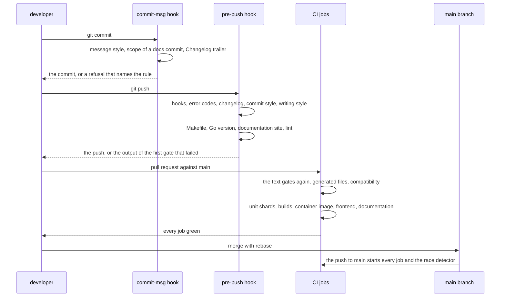

This page describes how the repository is built and checked. The build is one
`Makefile` for GNU make 3.81, and a recipe that needs more than a few lines is
a shell script in `scripts/`. A gate is a check that refuses a change. It exits
with an error and prints what it wants. Gates run at the commit, at the push
and in CI. A git hook is a script that git runs by itself. The `commit-msg`
hook checks the message at `git commit`, and the `pre-push` hook runs the text
gates at `git push`. CI is the set of jobs GitHub runs for a pull request and
for a push to `main`. CI runs the gates again and adds the tests, the builds
and the container image. `AGENTS.md` lists the gates to run before a push. This
page says what each gate refuses and how to make it pass.

## A change goes from a commit to main

The example is a `fix:` commit on a branch that becomes a pull request against
`main`.



1. `.githooks/commit-msg` runs when the message is written. It calls
   `scripts/check-commit-style.sh` with `--message`. That script refuses an em
   dash, a subject over 72 characters and a body over 20 lines of prose. It
   also refuses a subject without a known prefix, a `Co-Authored-By` line, and
   a `fix:` commit without a `Fixes:` trailer.
2. The same hook calls `scripts/check-docs-commit-scope.sh`, which refuses a
   `docs:` commit whose staged changes include Go code. Then it asks
   `git interpret-trailers` for a `Changelog:` trailer. A subject with the
   prefix `feat`, `fix`, `perf`, `schema` or `infra` needs one, and
   `Changelog: none` is a valid answer. A merge, a fixup, a squash and a revert
   pass without one.
3. `.githooks/pre-push` reads the pushed refs from standard input and finds the
   commits that this push adds. For a new branch the range starts at the oldest
   commit that no remote branch has. For an existing branch it starts at the
   merge base of the remote tip and the local tip.
4. The hook runs its gates in a fixed order and stops at the first failure. The
   order is `scripts/check-hooks.sh`, `make changelog-check`, `make commit-style-check`, `make style-check`,
   `make makefile-check`, `make go-version-check` and `make lint`.
5. `.github/workflows/ci.yml` starts on every pull request, whatever its base,
   and on a push to `main`. On a pull request,
   `CI / What the change touches` sorts the changed paths into areas, and a
   job skips when the change leaves all of its areas alone. The section on
   what runs only in CI lists the areas. CI repeats every gate of step 4 except the hook gate, so a
   clone that never installed the hooks meets them there.
   `Repository / Commit, text and workflow gates` runs the changelog, commit
   style, writing style, Makefile and document number gates, actionlint and
   the architecture tests, on every change. `Backend / Error codes` runs the
   error code gates.
   The Go version gate runs in `Backend / Verify generated code`, the
   documentation gates in `Documentation (Starlight)`, and the linter in
   `Backend / Lint`. The web gates run in five jobs whose names start with
   `Web /`. Inside a job, a failed gate does not stop the gates after it.
   `CI OK` waits for every other job and runs even on a cancelled run. It
   fails when the run was cancelled, when a job failed or was cancelled, and
   when a job skipped where neither the event nor the areas explain it.
6. The push that a merge makes on `main` starts every job, whatever the
   change touched. It also
   starts the `Backend / Race` jobs, which run each unit shard under the race
   detector with `make test-shard SHARD=<name> RACE=1`. One more job runs the
   sdk module and the modules under `packages/` under the detector. They run
   every night at 03:00 UTC as well.

`make install-hooks` sets `core.hooksPath` to `.githooks`. An install in
`frontend/` runs husky, which sets `core.hooksPath` to a folder named `_` that
husky generates inside `frontend/.husky`. The scripts that husky starts from
there are `frontend/.husky/commit-msg` and `frontend/.husky/pre-push`, and each
one runs the hook of the same name in `.githooks`. The order of
`make install-hooks` and the frontend install therefore changes nothing.
`frontend/.husky/pre-commit` runs `lint-staged` on staged frontend files only.

## The gates

Every command runs from the repository root in Git Bash or another POSIX
shell. A gate prints the file and the reason when it refuses.

| command | what it refuses | how to make it pass |
|---|---|---|
| `make style-check` | an em dash, an emoji, a comment that tells history, and in a changed page an idiom or a sentence over 30 words | rewrite the text. Lower the line in `scripts/writing-style.baseline` when a count falls, and never add one |
| `make docs-check` | a page that breaks the site build, a mermaid block that does not parse, a link or an anchor that does not resolve | fix the page. `make install-docs-deps` installs the site when the gate says it is missing |
| `make openapi-check` | `openapi.json` in `internal/transport/http/httpapi` differs from what the registered operations produce | `make generate-openapi`, then commit the file |
| `make api-check` | a change to `openapi.json` that `tools/apicompat/policy.json` does not allow, and a change it cannot classify | make the change additive, or run `make api-accept` and commit `tools/apicompat/baseline.json` |
| `make vocab-check` | a file in `docs/vocabularies` whose entries changed and whose version did not | raise the version in the Go code, run the `generate-` target, then `make vocab-accept` |
| `make error-codes-check` | a response code that is not registered, a code missing from `docs/errors/error-codes.json`, a code that was removed | `make generate-error-codes`, then commit. Put a removed code back, because clients still read it |
| `make extensions-check` | an extension missing from `docs/extensions/extensions.json`, an entry that was removed, a registration without documentation | `make generate-extensions`, then commit |
| `make capabilities-check`, `resource-kinds-check`, `authz-vocabulary-check`, `event-types-check`, `device-issues-check` | an entry without a summary, and a committed vocabulary file that differs from the Go table | the `generate-` target of the same name, then commit |
| `make sdk-reference-check`, `client-sdk-check`, `slots-check` | a generated file or region that differs from its source, and a name that is missing from its page | the `generate-` target of the same name, then commit |
| `make config-reference-check` | a configuration key without a sentence, a sentence over 30 words, a configuration file in the tree that the loader refuses, and a key table in `docs/src/content/docs/config.md` that differs from the structs | `make generate-config-reference`, then commit |
| `make wire-check` | a frame the Go codec reads differently from the test vectors, and an example in another language that fails them | fix the codec or the page. `make generate-wire-protocol` writes the artefact |
| `make binary-check` | a build that fails for linux amd64, arm64 or arm, a binary that links cgo, a binary over its row in `BUDGETS` | find what grew, or raise the row and give the reason in the commit |
| `make sdk-check` | an import in `sdk/` from outside the standard library, and an example module that does not build in its own folder | remove the import, or fix the module that `scripts/check-side-modules.sh` names |
| `make makefile-check` | `$(MAKE)` without quotes, a broken line continuation, an `echo` with a backslash, a `.PHONY` list that differs from the targets | edit the line the gate prints. A new target also goes into `.PHONY` |
| `make hooks-check` | a hooks folder without `commit-msg` or `pre-push`, and a `commit-msg` hook that accepts a `fix:` without a trailer | `make install-hooks`, or restore the delegate in `frontend/.husky` |
| `make changelog-check` | a bump-worthy commit without a `Changelog:` trailer, a trailer without its entry, and a fragment a release cannot file | `make changelog-new NAME=<words>` writes a fragment |
| `make commit-style-check` | the rules of step 1 for every commit in `RANGE` | reword the commit before the push. A pushed commit cannot be repaired |
| `make go-version-check` | a Go version in a Dockerfile or a page that differs from `go.mod`, and a pin older than the newest release of five days | change the pin in every file the gate lists |
| `make deadcode-check` | a function in `internal/` or `adapters/` that no `main` and no test reaches in the full build | delete it, or add it to `scripts/reachability.allow` with the reason |
| `make lint` | a finding of golangci-lint in the core, in `sdk/` or in `packages/graphql` | `make lint-fix` repairs formatting. The rest is a code change |
| `go test ./internal/arch/` | a forbidden import between package groups, a page that names a missing path or target, a gate script that no CI job runs | the failure names the file and the table to edit |
| `make compose-check` | a binary composed with the adapter in `test/compose/fixture` that does not start or does not list the adapter | fix `cmd/compose-build` or `compose/compose.go` |
| `make docker-check` | an image that runs as root, a probe that does not answer, a compose stack that does not reach healthy | fix `docker/server/Dockerfile` or the compose file. It needs Docker |

`make style-check` also refuses a table cell over 120 characters in a changed
page, and a comment that speaks to the reader. For `make vocab-check`, a new
entry needs a higher minor version and a removed entry a higher major version.
`make changelog-check` also refuses a trailer that is not the first sentence of
its entry. `make changelog-check` and `make commit-style-check` read the
commits in `RANGE`, for example `make changelog-check RANGE=origin/main..HEAD`.
`make commit-style-check` also refuses too many sentences of the form "X, not
Y" across recent commit bodies.

`make help` prints a target only when its header has a `##` comment.
`style-check`, `api-check`, `binary-check` and `error-codes-check` have none,
so `make help` does not list them. `grep -E '^[a-zA-Z0-9_-]+:' Makefile` lists
every target.

## The architecture tests

`go test ./internal/arch/` reads the repository and runs no server code. The
table `groups` in `internal/arch/layout_test.go` is the import law.
`internal/kernel` imports no other package under `internal/`.
`internal/connector`, `internal/transport` and `internal/platform` import the
kernel and the domain packages. `internal/extension` imports the kernel only.
`internal/app` imports every group. Every other folder under `internal/` is a
domain package, and it imports the kernel and no other domain. An import that
goes through `adapters/`, `examples/`, `tools/` or `test/` counts as well.
`TestInternalImportsFollowTheDependencyLaw` prints the forbidden import.

`internal/arch/airlock_test.go` compares `adapters/tags.json` with
`docs/extensions/extensions.json` and with the build tags in the adapter files.
`internal/arch/taggedtests_test.go`, `internal/arch/hooks_test.go` and
`internal/arch/ci_gates_test.go` read the `Makefile`, the hook folders and the
workflows. The documentation tests read the pages. They refuse a path or a make
target that does not exist, a line citation that points at the wrong
declaration, and a page that lost a diagram. Most of these tests have a table
with a minimum count for each page. A rewrite of a page changes its row in
`internal/arch/build_page_paths_test.go`, `internal/arch/citation_docs_test.go`
and `internal/arch/diagram_floor_test.go`.

## The build variants and build tags

A build tag is a label that tells the Go compiler to include a file.
`make build` reads `config/config.yaml`, or the file in `CONFIG_FILE`.
`cmd/detect-build-tags` turns that file into tags through `adapters/tags.json`.
A configuration file never names a tag. `core.observability.enabled` gives
`observability`, and a `db` block of type `core/postgres` gives `postgres`.
`cmd/detect-build-feature` says whether the web application is built first.

The `full` variant includes the web application from
`internal/transport/http/httpapi/appdist`, which `make embed-app` fills.
`cmd/compress-app` then replaces each text file there with a gzip copy. The
server sends that copy to a browser as it is stored, and decompresses it only
for a client that does not accept gzip. The
`minimal` variant is `make build-minimal`. It builds with `CGO_ENABLED=0`, has
no web application and removes the symbol tables. `make build-full` uses every
tag in `FULL_TAGS`, and `make build-ci` compiles the same binary without the
application and the site. `make build-cross ARCH=aarch64 VARIANT=minimal`
builds for another processor. `scripts/check-binary-budget.sh` has one size
limit for each pair of processor and variant.

## What runs here and what only runs in CI

`make ci-local` runs `scripts/ci-local.sh`. Each lane of that script calls the
make target that a CI job calls, in the order of cost. The script then prints
which lanes it skipped and why. `make ci-local-list` prints the plan and runs
nothing. `make ci-local-fast` stops after the lanes marked `fast`.

The script runs several lanes at once, a third of the cores by default.
Each lane writes its output to `bin/ci-local/<id>.log`. The terminal shows
one line when a lane starts and one when it ends. The summary lists the lanes
in table order and names the log of each lane that failed.
`make ci-local CI_LOCAL_ARGS=-j1` runs one lane at a time and prints its
output on the terminal.

Some lanes must not run beside others. The `shares` column of the lane table
in `scripts/ci-local.sh` names them, and `make ci-local-list` prints the
groups.

| shares | runs beside |
|---|---|
| `-` | any lane |
| `compose` | no other `compose` lane. Each starts services of `docker-compose.local.yml` |
| `js` | no other `js` lane. Each installs into and builds `packages/svelte`, `packages/typescript` and `frontend` |
| `printermodel` | no other `printermodel` lane. Each writes the printer profile the printer build compiles in |
| `solo` | no lane. These lanes run after all the others |

A lane is `solo` when it rewrites a file that other lanes read, such as a
committed generated file or the web app the full build embeds. It is also
`solo` when it walks the whole tree, or when one of its tests fails under load.

Two settings differ from CI on every run. The lanes get a short `TMPDIR`
under `/tmp`, because a Unix socket path under the long macOS default passes
the 104-byte limit. When another program holds port 55432, `PGFIXTURE_PORT`
moves the Postgres fixture to the next free port.

`make ci-local RANGE=origin/main..HEAD` names the commits that the `changelog`
and `commit-style` lanes judge. Without `RANGE` they judge the commits a push
from this branch would add. `scripts/ci-local.sh` has no lane for
`make hooks-check` and `make side-modules-check`, which no CI job runs. The
pre-push hook runs `scripts/check-hooks.sh`, the script of `make hooks-check`.

These differences stay after a full local run:

- every runner is Linux. A path separator, a line ending, a file mode and the
  case of a file name behave differently on Windows.
  `make test-race-linux PACKAGES=./test/e2e/` runs one package on Linux in a
  container
- `.github/workflows/wizard-smoke.yml` is the one workflow that runs the
  release binaries on Windows, macOS and ARM. It builds every binary a release
  publishes and walks the first-run wizard on each, with `cmd/wizard-smoke`.
  It runs only when a person starts it, and its `ref` input names the branch,
  tag or commit to test. The same command runs one binary on your own
  machine: `go run ./cmd/wizard-smoke -binary <file>`
- a runner executes the whole suite on few cores, so a test that depends on
  timing can fail there only
- no shard of a pull request runs under the race detector. The
  `Backend / Race` jobs run after the merge and at night
- CI runs `scripts/check-go-version.sh --refresh`, which asks go.dev for new
  releases. The vulnerability database of `govulncheck` also changes without a
  commit. Each can fail CI while the tree is the same
- `.github/workflows/extensions.yml` runs the gates of the extensions under
  `extensions/`. It starts only for a change to the paths it lists, and every
  night. Those paths include `internal/`, `cmd/`, `go.mod` and `packages/`,
  which the gates build. `make ci-local` does not run it. Run
  `make -C extensions check` yourself after a change to the core, `sdk/` or
  `packages/`
- on a pull request, a job runs only when the change touches one of its
  areas. `scripts/ci-areas.sh` sorts each path into `go`, `web`, `docs`,
  `changes`, `removed` or `sign_in`, and a path no rule names runs
  everything. `bash scripts/ci-areas.sh origin/main HEAD` prints the areas
  of your branch, and its standard error names the areas of each path.
  A push to `main`, the
  nightly run and a run a person starts run every job.
  `make ci-local` reads no areas and runs every lane.
  `make ci-local CI_LOCAL_ARGS=--changed` reads the areas of the branch
  against `origin/main`, uncommitted and untracked files included, and runs
  only the lanes whose job a pull request would start
- `Web / Sign-in at <provider>` runs on a pull request only when the change
  touches a path that reaches the sign-in, the `sign_in` area. The nightly
  run runs it too, at all three providers. `make oidc-providers-check` runs
  one provider on your machine, and `OIDC_PROVIDERS=all` runs the three
- `.github/workflows/nightly.yml` repeats the connector, printer and scenario
  tests under the race detector to find tests that fail only sometimes
- the tests that open the real mDNS socket run only where `PCL_NETWORK_TESTS`
  is 1. CI sets it, and `scripts/ci-local.sh` sets it on Linux. Elsewhere they
  skip. To run them yourself, use `PCL_NETWORK_TESTS=1 go test ./internal/discovery/`

## The test lanes

| command | what it runs |
|---|---|
| `make test-unit` | `go test -short ./...`, then the packages whose tests need a tag, then the `sdk/` module. `make test` is the same |
| `make test-shard SHARD=app PART=1/3` | one shard as CI runs it: `app`, `demo`, `httpapi`, `authz`, `internal` or `rest`. `BUILD=minimal` for the minimal build |
| `make test-race` | the unit suite under the race detector, here with a C compiler and otherwise through `make test-race-linux` |
| `make test-race-linux PACKAGES=./internal/app/ TAGS=""` | one package under the race detector in the `race` service of `docker-compose.local.yml`, with the Postgres fixture |
| `make test-engines` | the authorization, database and start-up tests against SQLite and a real Postgres, with a missing engine as a failure |
| `make test-adapters` | the event sink adapters against Mosquitto, RabbitMQ and Redpanda containers, which it removes afterwards |
| `make test-matrix-full` | every printer model at every firmware version in `test/fleet/releases.json`, through the real driver |
| `make test-matrix` | the same with only the newest firmware of each model |
| `make test-e2e` | `test/e2e`, which builds the binary and drives it over real sockets with a simulated printer |
| `make compose-check` | `test/compose`, a binary composed with an adapter from outside the core |
| `make test-firmware` | real printer firmware in the MINI404 emulator against the built binary. It is slow and no CI job runs it |
| `make mini404-smoke`, `make firmware-up` | one emulated printer for a manual session. `scripts/build-mini404.sh` and `scripts/build-firmware.sh` produce what they need |

A bare `go test ./...` is not a full run. A test file behind a build tag
is absent from a run without the tag, and a package whose test files are all
absent prints `ok`. `internal/authz/engine_postgres_test.go` is behind the
`postgres` tag. `make test-unit` names each such package again with its tag.
`TestEveryTagGatedTestPackageIsRunByTestUnit` in
`internal/arch/taggedtests_test.go` refuses a tagged package that the recipe
does not name. A run from the repository root also does not reach `sdk/`,
which is a Go module of its own.

## Releases

Prusa Connect is `0.0.x`: only the patch number moves, and no release promises
compatibility with the one before. `make release-alpha` cuts the next
`0.0.N-alpha.M`, `make release-beta` the next `0.0.N-beta.M`, and
`make release-stable` the stable `0.0.N`. All three run `scripts/release.sh`,
which also takes a version outright for a jump they cannot make. `BUMP=minor`
or `BUMP=major` starts the cycle at the next minor or major instead:
`make release-alpha BUMP=major` cuts `1.0.0-alpha.1`. `VERSION`
holds `0.0.N` throughout: the packages and module ranges read it as a plain
triple. The alpha or beta label lives in the tag, and the release binaries
report the tag's version.

The script refuses uncommitted changes. It runs
`scripts/check-release-changelog.sh`, which refuses a fragment left in
`docs/changes/` and a newest version heading that is not the new version.
`scripts/cut-release-changelog.sh <version>` files the fragments and deletes
them, and the commit carries both. Then
it writes `VERSION` and `internal/kernel/version/VERSION`, runs
`scripts/stamp-version.sh` for the client packages that repeat the version,
commits, and creates the tag `v` plus
the version. It does not push.

An alpha or beta tag is a GitHub prerelease, and the release workflow hands it
to the beta portal as well (`.github/workflows/beta-portal.yml`). It sends the
documentation built for that version, under `/connect-local/docs/<version>/`,
so the next release does not replace it. A stable release stays off the portal
unless a `beta-portal/v` tag on it asks for it.

`sdk/VERSION` is the version of the SDK module. Go finds the version of a
module in a folder through a tag that starts with the folder name. An SDK tag
is therefore `sdk`, a slash, `v` and the version. When a commit since the last
SDK tag changed `sdk/`, the script raises `sdk/VERSION` and creates the next
SDK tag. While the SDK major is 0, a major release of the application raises
only the SDK minor. A pushed tag that starts with `v` starts
`.github/workflows/release.yml`. That workflow builds the `minimal` binaries
for amd64, armv7, armhf and aarch64, and the `full` binaries for those four and
for Windows and macOS. It builds the printer binary when `PRINTER_MODEL` is set. It
then creates the GitHub release, marked as a prerelease when the tag carries a
hyphen.
Its npm job runs only when the repository variable `PUBLISH_NPM` is `true`.
Every build target copies `VERSION` into the embedded file through
`sync-version`.

## Rules a change to the build must keep

1. Every script named `check-` in `scripts/` or in `docs/scripts` runs in a CI
   job, or is listed with a reason in `gateScriptsCIExempt`. A gate that exists
   only in a hook does not run for a clone without hooks.
   `TestEveryGateScriptRunsInACIJob` refuses the script.
2. A gate that read no input fails. The shell gates call `armed` with a minimum
   count, and the Go tests call `requireScanned`. Without it, a moved folder
   makes the gate read nothing and print success.
3. A gate that selects tests with `-run` counts the tests that ran, as
   `vocab-check` and `device-issues-check` do. `go test -run` with a name that
   matches nothing reports success.
4. A test run is never piped into `grep`, `head` or `tail` without keeping its
   exit status. Make 3.81 has no `pipefail`, so the pipe reports the status of
   its last command and a failed test passes.
5. A recipe calls make as `"$(MAKE)"` with the quotes. On Windows the value has
   a space, and the unquoted form is a shell syntax error.
6. A missing tool is a failure with one sentence that names the tool, as
   `REQUIRE_GO` and `REQUIRE_DOCKER` do. A gate that prints a warning and exits
   with success hides that it did not run.
7. A package whose tests need a build tag is named with that tag in the
   `test-unit` recipe. The paths stay written out in the recipe, because
   `internal/arch/taggedtests_test.go` reads the recipe as text.
8. A CI step calls the make target, and `scripts/ci-local.sh` calls the same
   target. A second copy of a gate in a workflow step misses the refusals that
   the script has.
9. A generated file has a `generate-` target, a `-check` target and a CI step
   that calls the check. Without the CI step, the committed file differs from
   the code and no job says so. `error-codes-check` and `extensions-check` also
   regenerate in place and compare with `git diff`, so they fail until the
   regenerated file is committed.
10. A budget in `scripts/check-binary-budget.sh` rises only with the reason in
    the commit message. The rows assume an empty `appdist`, so run
    `make clean-app` before `make binary-check`.
11. A file that Go code, the web packages or the documentation build reads is
    in the area of the jobs that run that code, in `scripts/ci-areas.sh`.
    `TestEveryFileACIJobReadsIsInItsArea` refuses a read the script puts in
    another area, and `pathGatedJobs` in `internal/arch/ci_ok_test.go` names
    the areas each job reads.

## What the gates do not catch

No local command checks the committed state. Every gate reads the working
folder, so a file that was changed and not committed can make a local run pass
while CI fails on the commit. `scripts/ci-local.sh` prints how many files are
uncommitted and does not stop.

The writing checks find an em dash, an idiom and a long sentence. They do not
find a false sentence, and no gate compares the exported Go API of `sdk/` with
the last release. The race detector reads a change only after the merge. The
firmware lane runs only when a person starts it. `CI OK` in
`.github/workflows/ci.yml` waits for every other job, so a branch protection
rule needs to name that one job. No such rule is set yet, because the GitHub
plan of the organisation offers none for a private repository.

## Failures on Windows with Git Bash

| what happens | why | what to do |
|---|---|---|
| make stops with `This Makefile needs a POSIX shell`, or with `CreateProcess(NULL, ...) failed` | GnuWin32 make finds no `sh` in PowerShell or cmd, and runs a recipe through `cmd.exe` | run make from Git Bash |
| `make -n pre-commit` fails with `CreateProcess(NULL, "", ...) failed` and `e=87` | make runs a recipe line with `$(MAKE)` even under `-n`, and GnuWin32 make does not quote the space in `C:/Program Files (x86)` | run the target. Do not use a dry run to diagnose make |
| `go: command not found`, or `FAIL  Go is not on PATH` | Go is installed and the shell does not have its folder in `PATH` | add the `bin` folder of the Go installation to `PATH` for that shell |
| `-race requires cgo` | the race detector needs a C compiler, and this machine has none | `make test-race`, which uses Docker and says which way it ran |
| `make lint` reports every Go file as not formatted | the file was checked out with CRLF line endings, and `.gitattributes` asks for LF in `*.go` | `git ls-files --eol` shows `w/crlf`. Check the file out again |
| `docs-site: the documentation dependencies are not installed` | the documentation gate does not pass without a build | `make install-docs-deps`, which needs pnpm |
| the pre-push hook fails on a file that another process is writing | the gates read the working folder, and that file is half written or not yours | push the committed state from a clean worktree, as below |
| a push from a new worktree runs no hook | `core.hooksPath` names the folder that husky generated, and a new worktree does not have it | pass `-c core.hooksPath=.githooks`, as below |
| the firewall asks to allow a test binary | the test joins a multicast group or listens on an address other machines can reach, and every build is a new binary | keep it on loopback, or call `networktest.Require` first. `internal/arch/loopback_test.go` refuses the rest |

To push while another process changes the working folder, create a worktree of
the branch and push from there:

```sh
git worktree add ../pcl-push HEAD
cd ../pcl-push
git -c core.hooksPath=.githooks push origin HEAD:refs/heads/my-branch
```

The worktree has only committed files, so the gates judge what the push sends.
The `-c` setting reaches the hook as well, so `scripts/check-hooks.sh` reads
`.githooks`. `make docs-check` needs the site dependencies in the new worktree
too.

## Files to read first

- `Makefile`: every target. The comment above a target says what it refuses
- `.githooks/pre-push`: how the range of a push is found, and the order of the
  gates
- `.github/workflows/ci.yml`: every job, with the reason for its place in the
  comment above it
- `scripts/ci-local.sh`: the table of lanes, and what a local run cannot answer
- `internal/arch/layout_test.go`: the table of package groups and the imports
  each group may have
- `internal/arch/ci_gates_test.go`: how a gate script is found and followed
  into a CI job

The rules for a commit and a changelog entry are in
`.agents/rules/git-discipline.md` and `.agents/rules/changelog-discipline.md`.
The SDK checks are described on
[the sdk and extensions](the-sdk-and-extensions.md).

## Testing a change to a gate

A gate is trusted after it was seen to fail. Make the mistake it exists for,
run it, and read the refusal. Then remove the mistake and run it again.

- for `make style-check`, put an em dash into a page and run the target
- for `make makefile-check`, add a target without its `.PHONY` entry
- for the commit-msg hook, run `make hooks-check`, which gives the hook a
  `fix:` message without a trailer and expects a refusal
- for a `-check` target, edit the committed artefact by hand and run the target
- for a test in `internal/arch`, break the tree in the way the test names and
  run `go test ./internal/arch/ -run` with the test name. Check that the output
  says `FAIL`, because a name that matches nothing prints `ok`
- `internal/arch/release_changelog_test.go` and
  `internal/arch/docs_commit_scope_test.go` run their scripts over fixture
  files. A new shell gate gets the same kind of test
- `make lint`, `make makefile-check` and `go test ./internal/arch/` before the
  push
