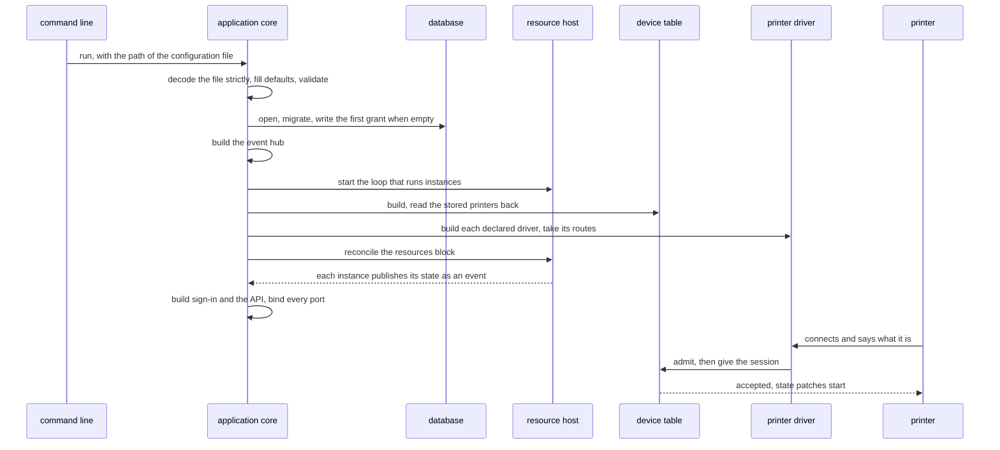
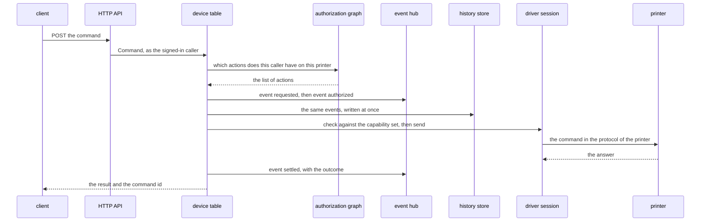

The application core is the package `internal/app`. It starts the server and
connects its parts. It reads the configuration file, opens the database, builds
each part in a fixed order, serves HTTP, and stops the parts in the opposite
order. It is the only package under `internal/` that imports an adapter. An
adapter is a package under `adapters/` that implements one contract, such as a
storage backend or an event sink. The package also contains the device table.
That is the list of printers the server knows, the state each printer reported
last, and the path of a command from the API to a printer. The package has no
rules about printing. Those are in the packages it connects.

## The server starts from a configuration file

1. `Main` in `compose/compose.go` parses the flags. It calls `Run` in
   `internal/app/app.go` with a context that ends on an interrupt or a
   termination signal. `cmd/prusa-connect/main.go` only calls `Main`.
2. `Load` in `internal/app/config/load.go` reads the file. `decodeStrictly`
   refuses a key this build does not read and names its line. `refuseBlock`
   refuses a top-level block other than `core`, `persistence` and `resources`.
   A missing file is the default configuration. `Core.Validate` checks the
   result. The keys are listed in [configuration](../config.md).
3. `Run` builds the logger and calls `serve`. `openGraph` opens SQLite or
   PostgreSQL and runs the migrations. `bootstrapGraph` writes the first grant
   for `core.principal` when the database has none. The graph is described in
   [authorization](authorization.md).
4. `stream.New` builds the event hub, the part that delivers events to
   subscribers. An instance publishes its first state change while it starts,
   so the hub comes first. `startPlane` in `internal/app/plane.go` builds the
   resource host and starts `Host.Run` on a goroutine. The context of that
   goroutine is detached from the caller, so the instances keep running while
   the listeners drain. The resource host is described in
   [the extension host](the-extension-host.md).
5. `serveOver` calls `newDevices` in `internal/app/devices.go` to build the
   device table. `restore` in `internal/app/devicerecords.go` reads the printers
   the last run stored. Each of them is marked as away, because this process has
   no connection to it.
6. `mountConnectors` in `internal/app/connectors.go` builds every driver under
   `core.connectors`, or the `xbuddy` driver when the file declares none.
   `mountOne` gives the driver the stored registration table and a capability
   resolver, and takes the routes that a printer connects to. A driver is not a
   supervised instance, and a change to one needs a restart.
7. `serveOver` binds the device table, the registration tables and the driver
   routes to the resource host. Then `Store.Reload` in
   `internal/app/resource/store.go` reads the `resources` block and the overlay.
   The overlay is the file the server writes when a resource changes through
   the API. The server never writes the operator's file. `Host.Reconcile`
   starts the instances. A module reads the device table while it starts, so
   the binding comes first.
8. `buildIdentity` in `internal/app/auth.go` chooses how a caller signs in.
   With `core.auth.issuer` it is an OpenID Connect provider, and start-up fails
   when the provider does not answer. With `core.auth.local`, or a recorded
   mode of `required`, it is the account table of this server. With a recorded
   mode of `open`, every request is served as `core.principal`.
9. A server with no recorded mode serves only the health routes, the web page
   and the first run. `firstRun.Record` in `internal/app/authsetup.go` creates
   the administrator, writes the admission choice and, last, the mode. The
   mode applies at once. The admission choice applies at the next start,
   because step 6 already built the driver. Until a choice is recorded, step 6
   builds the driver in the mode that asks first, so a printer that dials
   before the first run is finished waits for approval.
10. `startDialling` in `internal/app/dial.go` starts the loops for printers that
    the server connects to itself. `httpapi.New` builds the API. `listen` in
    `internal/app/listen.go` binds every port before it serves any of them. The
    routes and the stream are described in
    [transport and the stream](transport-and-the-stream.md).
11. A printer connects, and the driver calls `arrivals.Admit`. `devices.admit`
    gives the printer its id and resolves its capability set. The driver then
    calls `arrivals.Arrived`. `devices.arrived` registers the printer in the
    graph, publishes `com.prusa.connect.device.arrived` and starts `pump`, one
    goroutine for each printer.
12. `pump` reads each state patch from the driver. `device.record` in
    `internal/app/devicetext.go` writes the patch into the state tree of the
    printer, under a byte limit. `pump` publishes the same patch as
    `com.prusa.connect.device.telemetry.sampled`. `flushRecords` writes changed
    printers to the database every two seconds. Drivers are described in
    [printers and drivers](printers-and-drivers.md).

## A command goes from the API to the printer

The example is `POST /api/v1/devices/{device_id}/commands` with the verb
`core.command.pause_print`. The print route, the G-code routes and a module
reach the same `devices.Command`.

1. `registerSendCommand` in `internal/transport/http/httpapi/devices.go` calls
   `Command` with the caller that `principalFrom` returns. The API has already
   authenticated that caller.
2. A module calls `moduleFleet.Command` in `internal/app/modulefleet.go`. A call
   that names a person is accepted only while a request from that person is
   open. A call that names nobody runs as the principal of the instance, and
   only for an action the operator listed.
3. `devices.Command` refuses a verb that no driver in this build declares, with
   the same answer for every caller. `authz.ActionForVerb` derives the action
   from the kind of the device and the verb. No caller names the action.
4. `mintCommand` creates the command id before the check. `reachHolding` in
   `internal/app/deviceaccess.go` asks the graph which actions the caller has
   on the printer. A caller with none gets status 404, the same answer as for
   an id that does not exist, and nothing is published. A caller that can read
   the printer and lacks the action gets status 403.
5. After that check every refusal is recorded. `refuseCommand` in
   `internal/app/devicecommand.go` publishes a requested event and a settled
   event with the status `unauthorized`. It runs for a printer whose session
   ended. It also runs when `reachesVerb` refuses a verb marked dangerous. Such
   a verb needs a grant that names the verb, or ownership of the printer.
6. `claimKey` stores the idempotency key of the call. A second call with the
   same key on the same printer, while the first is running, gets the first
   command id and `Duplicate: true`. The command is not sent twice.
7. `publishRequested` and then `publishAudit` publish on the origin of the
   printer. For a dangerous verb the requested event has a SHA-256 digest in
   place of the arguments. The authorized event names the caller, and a reader
   needs `view_audit` to see it. `publishCommand` calls `hub.PublishStored` and
   then `durable.write`, which writes the event to the history store at once.
8. `Session.Do` in `internal/printer/capability/session.go` checks the verb and
   the arguments against the capability set, and then calls the driver. For a
   printer that is away, the call waits for the printer until the context of
   the caller ends.
9. `publishSettled` runs on a context detached from the request, so the outcome
   is recorded when the caller has left. `settleStatus` chooses `succeeded`,
   `refused`, `failed`, `timed_out` or `abandoned`. The last two mark the
   outcome as unknown, because the printer may have run the command. A refusal
   by the printer is status 200 with `ok` false. A failure of the server is an
   error document with the parameter `command_id`.
10. After a restart, `closeOpenCommands` in `internal/app/commandsweep.go`
    settles every command the last run left open, with the status
    `server_restarted`.

## The server stops in a fixed order

1. The signal ends the context. `drain` in `listen.go` tells every event stream
   to end and shuts all listeners down together, within `core.shutdown_timeout`.
2. The deferred calls in `serveOver` run. The camera recorder stops, then the
   dial loops. Then `devices.Close` closes every printer session, waits for
   every `pump`, and writes the device records one more time.
3. `plane.shutdown` stops the history feed and waits for its last write. Then it
   cancels the resource host and waits for it, again within
   `core.shutdown_timeout`. `serve` then closes the event hub, and after it
   the database.

## Rules a change must keep

1. Only `internal/app` imports a package under `adapters/`, and
   `go test ./internal/arch/` fails on any other import. Without the rule,
   removing an adapter means a change in several packages.
2. `Run` decodes the file strictly and validates it before it opens anything.
   A change that opens a port or a file earlier leaves it behind when the
   configuration is refused.
3. `Host.Run` is running and the device table is bound before `Store.Reload`.
   `Host.Reconcile` waits for the `Run` goroutine, so an earlier reload blocks.
   The bindings are plain fields with no lock, so a module that starts before
   them reads an empty device table.
4. `announce` in `plane.go` never takes the lock of the resource store and never
   blocks. A write through the API keeps that lock while `Host.stop` waits for
   the goroutine that runs `announce`, so a hook that takes the lock is a
   deadlock.
5. Every goroutine has an owner that stops it and waits for it during shutdown,
   in the order of the section above, and each wait has a time limit. A hub that
   closes before the instances loses their last events. A wait with no limit
   makes a process the operator cannot stop.
6. Every command goes through `devices.Command` with the principal of the
   caller, and the action comes from the verb. A path that calls the driver
   session directly, or names the action itself, lets a person who may pause a
   print send raw G-code.
7. Nothing is published on the origin of a printer before `reach` passes. Each
   origin has a small replay window, and a caller with no grant could push the
   presence events of a printer out of it.
8. A caller with no grant on a printer gets the answer for a printer that does
   not exist. Any other answer shows a caller which ids exist.
9. The requested event is published and stored before the driver is called, and
   the settled event uses a detached context. Without the first, a command can
   run with no record. Without the second, the record of a command whose caller
   left stays open until a restart.
10. One instance that fails never stops start-up and never undoes a write.
    `parseFile` in `internal/app/resource/load.go` records the failure for that
    instance alone. Without it, a mistake in a sink stops a working storage
    backend.

## What the application core does not do

An instance with `required: true` does not stop start-up. `readiness.verdictOf`
in `internal/app/readiness.go` makes `GET /api/v1/readiness` answer 503 while
that instance is not serving, and the supervisor never gives up on it. The
server still binds its ports and serves. Only a part that `Run` builds itself
stops start-up, such as the database, the sign-in provider or a port.

A driver has no supervisor. A panic on a goroutine of a driver ends the server,
and nothing restarts a driver that stops working.

Some goroutines do not end with the context of the server. `pump` ends only
when `devices.Close` closes its session. `closeOpenCommands` and
`sweepInterruptedTransfers` run on a detached context with a time limit of their
own, and shutdown does not wait for them.

The idempotency keys are in memory, so a restart forgets them. A duplicate call
publishes no events, so the record shows one caller for a command that two
callers asked for. With no history instance declared, `durable.write` does
nothing, and a restart loses the command events.

## Failures and where they show up

A failure during start-up is one line on standard error, and the process exits
with code 1. After start-up the log has a `readiness` line for every change, and
`GET /api/v1/readiness` has the same verdict. The record of one command is at
`GET /api/v1/commands/{command_id}`, and its events are on the stream.

| what happens | what the server does | where it shows |
|---|---|---|
| the file has an unknown key or an unknown top-level block | `Run` returns before it opens anything | standard error, with the line of the key |
| one block under `resources` does not decode | that instance is not started, the others are | warning `a declared resource instance will not load and is not running` |
| a required instance is not serving | readiness is false, the ports stay open | status 503 at the readiness route, log `readiness` with `blocked` |
| the OpenID Connect provider does not answer at start-up | start-up fails | standard error `reach the identity provider` |
| a port is in use | every port already bound is closed, start-up fails | standard error `bind the api listener` |
| a caller has no grant on the printer | nothing is published | status 404 |
| a caller lacks the action or a dangerous verb | 403. The verb case is recorded as `unauthorized` | the error document has `command_id` |
| the session of the printer has ended | refused and recorded | status 409 with the code `SESSION_ENDED` and `command_id` |
| the caller leaves or the deadline passes while the printer has the command | settled as `abandoned` or `timed_out`, outcome unknown | the command record |
| the process stops while a command is open | the next start settles it as `server_restarted` | the command record, log `the commands the last run left open were closed as unknown` |
| an instance does not stop within `core.shutdown_timeout` | every module process is killed. A requested restart goes on, and any other stop exits with an error | log `a supervised resource did not return; killing every module process and abandoning it` |

The defaults are in `internal/app/config/config.go`. The shutdown limit is 15
seconds and the state tree of one printer is 256 KiB.

## Files to read first

- `internal/app/app.go`: `Run`, `serve` and `serveOver` are the whole start-up
  order, and the package comment states the reason for each step
- `internal/app/plane.go` and `internal/app/listen.go`: how the resource host
  and the ports start and stop
- `internal/app/devices.go`: the device table, `Command`, `admit`, `arrived` and
  `pump`
- `internal/app/devicecommand.go` and `internal/app/deviceaccess.go`: the
  command events and the authorization checks
- `internal/app/resource/store.go`: how the file and the overlay become one
  document, and how a write through the API is checked and saved

The instances that `Store.Reload` starts are described in
[the extension host](the-extension-host.md), and the checks behind
`reachHolding` in [authorization](authorization.md).

## Tests for a change here

- `go test ./internal/app/...` runs the package tests. Many of them start the
  whole server from a configuration file on a free port
- `make test-race RACE_PACKAGES=./internal/app/` runs the package under the race
  detector. Run it for any change to the device table, the feeds or shutdown
- `go test ./internal/arch/` checks the import rules, among them the rule that
  only this package imports an adapter
- `make test-e2e` builds the binary and drives it with a simulated printer on a
  real socket
- `make lint` and `make test` before the push
