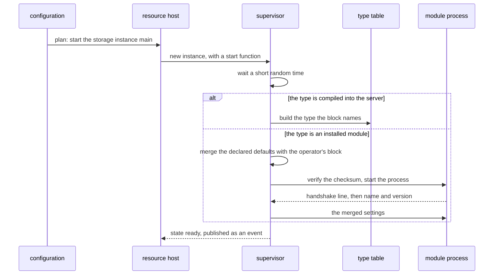
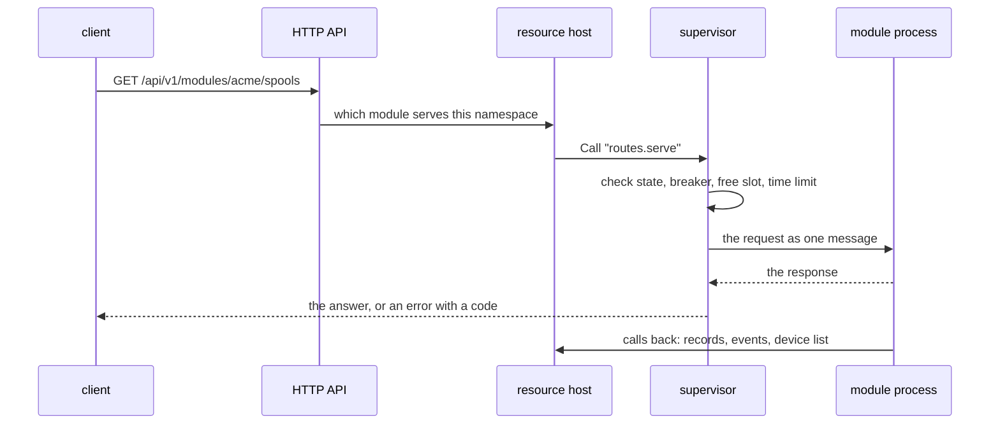

The extension host runs the parts of the server that can fail on their own.
Examples are a storage backend, an event sink, a login provider, a camera and a
module an operator installed. Each of them is an instance. An instance is a
block in the configuration file with a kind, a name and a type, such as the
storage instance `main` of type `local`. The host builds the instance, starts
it again when it fails, puts a time limit on every call into it, and tells the
rest of the server whether it works. Code compiled into the server and a module
get the same treatment. A module is a program the operator installs. The host
starts it as a separate process and talks to it over its standard input and
output.

## An instance starts from its block in the configuration

1. A write to the configuration produces a plan. `Diff` in
   `internal/app/resource/reconcile.go` compares the document in force with the
   new one and gives each instance an outcome: start, stop, restart, replace,
   change in place, or nothing.
2. `Host.Reconcile` in `internal/app/resourcehost/host.go` passes the plan to
   the goroutine that `Host.Run` owns, and waits. Every instance therefore runs
   under the context of the server process, and the HTTP request that caused
   the write can end without stopping anything. `Host.step` applies one outcome.
3. `Host.start` in `internal/app/resourcehost/instance.go` builds a
   `supervisor.Config`. Its `Start` function chooses by the `runtime` of the
   block. `builtin` looks the type up with `registry.Construct`. `script`
   compiles the expression with `buildScript`. `service` starts a module
   process with `buildService`. `asset` verifies and opens a folder of files
   with `buildAsset`.
4. `Instance.Run` in `internal/extension/supervisor/lifecycle.go` is the loop
   of one instance. It waits a short random time so that a deployment does not
   open every connection at the same moment. Then `startOnce` calls `Start`
   under the start time limit, and `publish` makes the result callable and
   moves the state to `ready`. `serve` waits for a failure report or a restart
   request.
5. For a module, `Host.dependenciesMet` in
   `internal/app/resourcehost/requires.go` reads the `requires` list the
   install recorded in the declaration. A capability is looked for in the
   method set `Host.servesTo` just built for this instance. A core range is
   held against this build's own version. A type is met by one ready instance
   of it. An entry that is not met stops the start here, before any file is
   opened.
6. For a module, `buildService` in `internal/app/resourcehost/service.go`
   compares the `contract_major` in the block with the one this server
   supports. `wirehost.Find` picks the file named `<type>_<os>_<arch>` in the
   install folder. `Launch` in `internal/extension/wirehost/launch.go` verifies
   the SHA-256 checksum of the file and starts the process. It reads one
   handshake line from the standard output of the process and agrees on the
   protocol version. Then it calls `plugin.info` to ask the module what it is.
   A module that serves HTTP routes must describe them in that answer, as an
   OpenAPI document.
7. For a module, `moduleSettings` in `internal/app/resourcehost/settings.go`
   builds the settings before anything is executed. It starts from the default
   of every option the install recorded off the module's manifest, and writes
   the operator's `config:` block over it key by key. A key the module does not
   declare, a required key nobody wrote, and a declared default that is not its
   own type each refuse the start. Once the child has answered `plugin.info`,
   `configure` sends the merged block on `plugin.configure`, before any other
   call. A module that leaves that method out of its `serves` list takes no
   settings, and an instance carrying a block for one of those is refused.
8. `serviceChild.watch` waits for the connection to the module to end. When it
   ends and the host did not ask for it, the instance restarts like any other
   failed instance.
9. The supervisor calls `OnStatus` on every state change. `announce` in
   `internal/app/plane.go` writes a log line, sets the `pcl_resource_up`
   metric and publishes a `com.prusa.connect.resource.state.changed` event.

## A call goes through the supervisor

The example is an HTTP request to a module. A call to a storage backend or a
login provider takes the same path from `supervisor.Call` on.

1. The router asks `Host.Module` in `internal/app/resourcehost/modules.go`
   which running instance serves the namespace. The API has already
   authenticated the caller and checked the permission, except on a public
   route the operator approved, which takes no caller (ADR-20261120-xys).
2. `moduleHandler.ServeHTTP` reads the body up to `routesapi.MaxModuleBody`.
   On a staged route it writes the body to the module's data folder instead,
   up to the route's limit. It records in `flights` that this module is
   serving this person, and calls `supervisor.CallWithin`, which gives a
   staged request the budget of its route.
3. `CallVoid` in `internal/extension/supervisor/call.go` does the shared work.
   `acquire` refuses the call when the instance is not serving. `begin` asks
   the circuit breaker, takes one of the instance's call slots and sets the
   deadline. `invoke` runs the function and recovers a panic. `finish` frees the
   slot, records the duration, and passes the result of `Classify` to the
   breaker. The circuit breaker stops calls to an instance that fails too
   often, and lets a test call through after a pause.
4. Code inside the server does not call `supervisor.Call` directly. The wrappers
   in `internal/extension/supervised`, such as `Store` and `Sink`, implement the
   same interface as the resource and call the supervisor in every method.
5. A caller that must never wait uses `Offer`. The work goes on a queue of fixed
   size, and one goroutine per instance runs it with the same checks. A full
   queue drops an item and counts it.
6. A module can call the server back on the same connection. `Host.servesTo`
   decides which methods it gets: a key and value store for its own namespace,
   the event names the operator listed, the device list, and a subscription to
   events. A `capability` entry in the module's `requires` list names one of
   those methods, and the start checks it against this set.

## Rules a change must keep

1. Only the supervisor sets the lifecycle state, from what `Start` and `Stop`
   returned. A resource can report `OK`, `Recoverable` or `Permanent` and
   nothing more. If other code set the state, the API could show `ready` for an
   instance that has stopped.
2. Every status report and every signal has the generation number of the start
   it belongs to, and `report` drops one from an earlier start. Without that
   check, a goroutine left over from a stopped instance marks its replacement
   as failed.
3. Every start builds the resource again from the block in force at that
   moment, and `instance.adopt` replaces all parts of the stored block together.
   A start that reused earlier values would run a module file from one version
   of the block against the checksum of another.
4. One instance has one `Run` loop. `Host.start` stops an instance of the same
   name first, and `Host.stop` waits until the loop has ended. Two loops would
   each close the resource that the other built.
5. Every call into a resource goes through `Call`, `Stream`, `Offer` or `Peek`,
   and `Peek` is only for a getter that does no input or output. A direct call
   has no state check, no time limit and no panic recovery, so one panic in a
   driver ends the server.
6. The breaker counts a failure only when `Classify` says recoverable or
   permanent. If it counted a missing file or a cancelled request, users could
   close a healthy storage backend to everyone by asking for files that do not
   exist.
7. A driver or a camera has no breaker, and `Policy.Validate` refuses one on a
   driver. A printer that is switched off is normal, and a breaker would stop
   the server from connecting to it again.
8. `wirehost.Launch` verifies the checksum before every start of the process,
   before anything runs. A check made only at install time would run a file that
   somebody replaced later.
9. What a module can reach on the server is decided before its process starts,
   from the operator's block. No message from the module can name a namespace,
   an event type or a user that the server did not give it. `flights` accepts
   a user only while a request from that user is open. Without this, a module
   reads the records of another module or acts as any user.
10. A module's calls to its record store go through `gatedRecords` with its own
    slots, and never through `supervisor.Call`. A route handler in the module
    already has a call slot, so taking a second one from the same pool stops
    all requests when every slot is in use.

## What the host does not protect against

A module process starts in the working directory of the server, and nothing
limits which files or network addresses it can reach. Its environment is an
allowlist (`childEnv` in `internal/app/resourcehost/childenv.go`): the path,
home, temporary folder, time zone, locale and proxy variables, and
`GOMEMLIMIT` at 85 % of its memory budget. No other variable of the server
reaches it.

A module process runs in a session of its own, a job object on Windows
(`internal/kernel/procgroup`). A stop kills every process the memory walk
finds, so it also ends the processes the module started, including one that
leads a group of its own. On Linux the walk starts from the session and
follows the parent links. On macOS it uses the process group and the parent
links. It kills only through `Child.Kill` in
`internal/extension/wirehost/launch.go`. It holds the lock of the reap, so a
kill never reaches a group whose leader is already reaped. On Linux the server is a
child subreaper, and one `procgroup.Reaper`, built at the entry of the process,
collects the orphans that a killed module leaves behind. It collects only
zombies outside the server's own process group. A child the host starts in its
own group must therefore not daemonise. A process that left the group with
`setsid` is killed too while its parent lives, and survives once its parent has
exited. When it still holds the module's standard output or
error, the host waits five seconds for the pipes and then closes its own end, so
the stop ends.

The memory budget is a watched limit, not a kernel limit.
The host reads the group's memory every two seconds
(`memoryWatch` in `internal/app/resourcehost/memorywatch.go`). On Linux it sums
`RssAnon` over the module, every process in its session or group, and their descendants.
A process whose parent exited, as after a double fork, stays in the group and
is still counted. A process that left the group
with `setsid` is still counted while its parent lives, and is lost once its
parent exits. Shared memory and `memfd` memory
are not counted.
On Linux the host also writes `800` to the module's `oom_score_adj`, so the
kernel's out-of-memory killer picks a module before the server. The `permissions` list in a module's manifest names API actions
only. It limits what the module can do through the server when it acts for
itself, and it does not limit the process.

`wirehost.Launch` compares the answer to `plugin.info` with what the install
recorded. `buildService` builds that record from the declaration. The
name comes off the type the artefact was installed under, the release off the
`module` block, and the wire major off the `service` block. An instance declared by
hand carries no `module` block, and one of those is compared with nothing.

A time limit stops the server from waiting. It does not stop the resource. Code
that ignores its context keeps running after the caller got a timeout. A panic
is recovered only on a goroutine the host started. A compiled-in resource that
panics on a goroutine of its own ends the server, and only a separate process
protects against that.

## Failures and where they show up

The status of one instance is at `GET /api/v1/resources/{kind}/{name}`, with
`state`, `result`, `attempt` and a list of conditions that say why. Every state
change is also a log line with the instance name and an event on the stream.

| what happens | what the server does | where it shows |
|---|---|---|
| `Start` returns an error or runs past 30 seconds | state `retrying`. The wait is a random time under a limit that doubles from one second to five minutes | log `resource failed to start`, `attempt` in the status |
| an optional instance has failed for an hour and at least five attempts | state `failed`, result `give-up`. An instance with `required: true` never gives up | condition reason `StartLimitHit` |
| an error registered as never retryable, a status 401 to 403, or a panic | state `failed` until `POST /api/v1/resources/{kind}/{name}/restart` | `result` in the status. A panic is logged with its stack |
| the module file is missing | retries, so a later install brings it up | `RESOURCE_PLUGIN_MISSING` |
| wrong checksum, unsupported contract version, or routes with no OpenAPI description | state `failed`, no retry | `RESOURCE_PLUGIN_CHECKSUM`, `RESOURCE_PLUGIN_CONTRACT`, `RESOURCE_PLUGIN_UNDOCUMENTED` |
| the `config:` block names an undeclared key, leaves a required key out, or the module refuses it | state `failed`, no retry | `RESOURCE_PLUGIN_SETTINGS` |
| the instance carries a `config:` block and the module answers no `plugin.configure` | state `failed`, no retry | `RESOURCE_PLUGIN_UNCONFIGURABLE` |
| a module starts and writes nothing | the handshake wait ends after ten seconds, the process is killed, the start counts as failed | log, state `retrying` |
| a module answers no `plugin.ping` three times in a row | the host kills the module without `plugin.shutdown`, and it restarts | result `not-responding` |
| a module process ends | `watch` reports a recoverable failure and the instance restarts. Every process the walk finds is killed | result `exited` or `signal`. The last lines of standard error are in the log |
| a module process uses more than its memory budget | with `stop` the host kills the module and it restarts. With `warn` it logs a warning and keeps the module | result `over-memory` with the figures, or `status.memory.over_budget` |
| the budgets of the enabled modules pass the memory pool | nothing is refused. The client shows a warning, and start logs it | `GET /api/v1/modules/memory` |
| a module process uses 80 % of its budget or more | nothing | `status.memory.near_budget` |
| a service module fails as often as its switch-off allows, by default three times within one hour | state `failed`, result `switched-off-by-host`. It stays off until the operator acts | `status.memory.switched_off`, a warning in the log |
| a call is slower than ten seconds | the caller gets status 504 | `RESOURCE_TIMEOUT` |
| half of the recent calls failed | the breaker opens and refuses calls for 30 seconds. State `degraded` | `RESOURCE_BREAKER_OPEN`, status 503 |
| the breaker is not closed for over two minutes, and a call in the last minute ran into its deadline | the same stop and restart as a missed ping | result `not-responding` |
| the module requires a capability this build does not serve, or a server version this build is not | state `failed`, no retry. What a build serves is settled when it is compiled | `RESOURCE_DEPENDENCY_UNSERVED`, condition `DependenciesSatisfied` |
| the module requires a type no ready instance answers | retries, so installing that module brings it up | `RESOURCE_DEPENDENCY_MISSING`, condition `DependenciesSatisfied` |
| the module requires a `state.*` capability and no record backend serves | retries, so declaring a backend under `resources.db` brings it up | `RESOURCE_RECORDS_UNSERVED`, condition `DependenciesSatisfied` |
| two modules require each other | every instance in the ring is `failed`, and the message names the ring | `RESOURCE_DEPENDENCY_CYCLE` |
| the module marked a request header required and the service block does not grant it | state `failed`, no retry. Granting the header changes the declaration and starts it again | `RESOURCE_HEADER_NOT_GRANTED`, condition `DependenciesSatisfied` |
| a call arrives while the instance is not serving | refused before it reaches the resource | `RESOURCE_NOT_READY`, status 503 |
| the queue of an instance is full | one item is dropped according to the drop policy of the queue | `dropped` in the status, `RESOURCE_QUEUE_FULL` |
| `Stop` does not return within five seconds | the goroutine is abandoned. A module process is killed | condition reason `Wedged`, an error in the log |

The host pings every module every 15 seconds and waits five seconds for each
answer. A stop for a missed ping counts toward the switch-off, and
`on_over_memory: warn` does not exempt a module from it. A child whose stdin
pipe is full blocks the write of the ping. The 30 second write bound then
closes the session, and the status shows the result of a child that exited.

The second signal needs a call that ran into its deadline: a call that timed
out, or a call that waited for a free slot until its deadline. A breaker that
is open with no call since never stops an idle module. A module that answers
errors is not stopped.

On Windows a `warn` module still stops at the hard limit of its job, which is
the budget plus 25 %. A stop kills every process the memory walk finds.

A crash, a stop over the budget and a failed start each count as a failure,
and a restart the operator asks for does not. `Store.SwitchOffByHost` in
`internal/app/resource/switchoff.go` writes `enabled: false` and a record of
the stops into the overlay, so an installed module stays off across restarts.
It cannot write `config.yaml`, so a module declared there is held off in memory
until the server restarts, and the status says `held_until_restart`. A failed
start that latches for its own reason keeps its own result. The last stop of a
module is in `status.memory.last_stop`.

Each service instance also keeps what an operator needs to see why a module
stopped. `memoryWatch` holds one hour of samples, one every two seconds, in a
ring of `samplesKept` entries. A sample whose reading failed has no value, and
the page draws it as a gap. The same object holds the log of the instance:
a `LogRing` with at most 200 lines and 64 KiB (`logTailLines` and
`logTailBytes` in `internal/app/resourcehost/logtail.go`). Both outlive the
child process, so a restart of the module keeps them. Both live in memory only,
so a restart of the server clears them.

The log keeps the standard error of the module whatever the server's log level
is (`tail` in `logtail.go`). A server that logs only errors still holds every
line, and it passes on to its own log only what the level allows. The
`GET /api/v1/resources/{kind}/{name}/log` handler needs `configure_resource` on
the kind, because the lines are not redacted.

The numbers are the defaults in `internal/extension/supervisor/policy.go`.
`defaultPolicy` in `internal/app/resourcehost/host.go` chooses the policy for
each kind.

## Files to read first

- `internal/app/resourcehost/instance.go`: `Host.start` connects a block in the
  configuration to a supervised instance and chooses the runtime
- `internal/extension/supervisor/lifecycle.go`: the start, serve, stop and retry
  loop of one instance
- `internal/extension/supervisor/call.go`: everything that happens around one
  call
- `internal/extension/supervisor/classify.go`: how an error becomes retry, fail
  or ignore
- `internal/app/resourcehost/service.go` and
  `internal/extension/wirehost/launch.go`: how a module process starts, is
  watched and is stopped
- `internal/kernel/procgroup` and `internal/app/resourcehost/memorywatch.go`:
  how a module's process group is killed and measured, and when the budget
  kills it
- `internal/app/resourcehost/settings.go`: how a module's declared defaults and
  the operator's block become the one block the process is sent
- `internal/app/resourcehost/modules.go`: how an HTTP request reaches a module,
  and which server methods a module can call

The protocol between the server and a module is described in
[the plugin wire protocol](../plugin-wire-protocol.md). How an author registers a
type is in [the sdk and extensions](the-sdk-and-extensions.md).

## Tests for a change here

- `go test ./internal/extension/...` runs the supervisor, registry, script and
  process tests. The process tests build a small Go program from
  `internal/extension/wirehost/testdata/blobchild` and start it
- `go test ./internal/app/resourcehost/` builds the module in
  `examples/service-plugin` and drives it from a configuration file, through
  start, restart, an HTTP request and stop
- `make test-race RACE_PACKAGES=./internal/extension/...` runs the same packages
  under the race detector. Most rules above are about goroutines, so run it for
  any change to the supervisor
- `make wire-check` checks the wire protocol against the JavaScript example in
  `examples/wire-protocol`
- `make lint` and `make test` before the push
