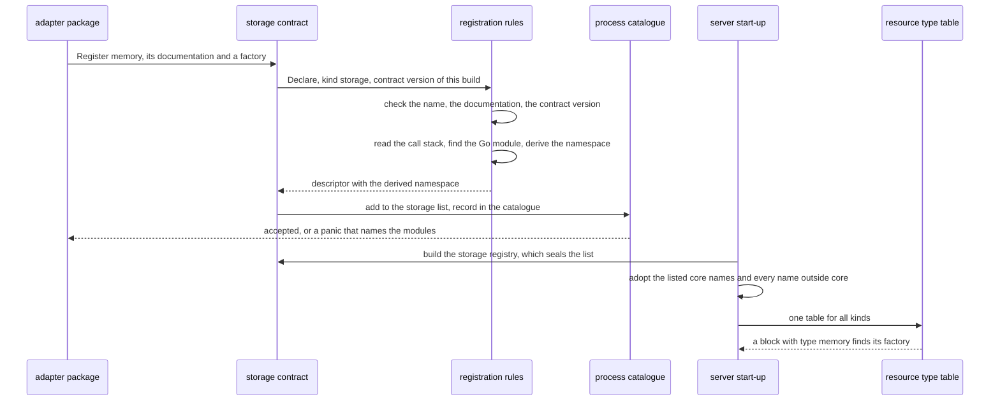
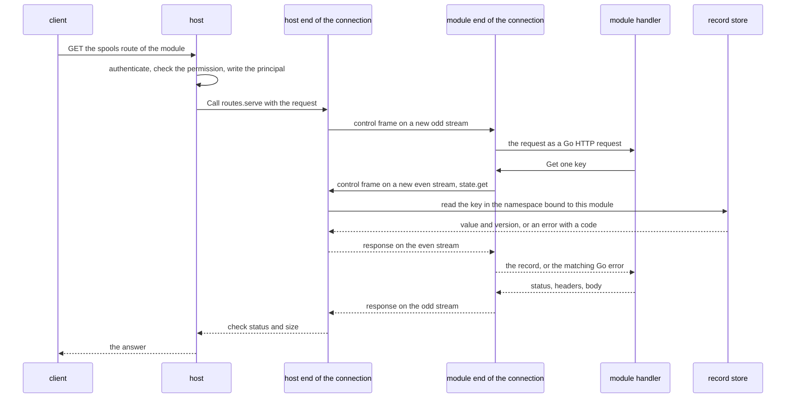

The SDK is the Go module in `sdk/`. A person outside this repository compiles
against it to add something to the server, and that code is an extension.
Examples are a driver for another printer, a storage backend, a login provider,
an event sink, a camera and a history store. Each kind of extension has a
contract. A contract is a package such as `sdk/storageapi` with the interface
the author implements, a `Register` function, and the types that go between the
extension and the server. A build tool compiles an extension into the server
binary, or the server starts it as a module. A module is a separate program,
and the server talks to it over its standard input and output. The messages of
that conversation are defined in `sdk/` too. The code in `sdk/` imports only
the Go standard library, so an author who requires it gets no other dependency.
This page is for the person who changes `sdk/`. Every exported name there is used by code that this repository
does not contain and cannot repair. An author starts from
[writing a driver](../writing-a-driver.md),
[writing a module](../writing-a-module.md),
[extension concepts](../extension-concepts.md) and the generated reference, for
example [the extension package](../reference/go-sdk/extension.md).

`sdk/fractal` is a library for the Fractal protocol between servers, and its
package comment is its documentation.

## An extension registers when the binary starts

The example is the storage type `memory` in `examples/adapters/storage-memory`.
Its Go module path is `example.com/prusa/storage-memory`, and a composed build
compiles it into the binary.

1. `init` in `examples/adapters/storage-memory/memory.go` calls
   `storageapi.Register` with the name `memory`, an `extension.Doc` and a
   factory. Go runs every `init` before `main`, so the server does not exist
   yet.
2. `declare` in `sdk/storageapi/provider.go` refuses a nil factory. It calls
   `extension.Declare` with the kind `storage` and `storageapi.Contract`, the
   version of the storage contract in this build.
3. `Declare` in `sdk/extension/descriptor.go` checks the name with
   `ValidateName`: lowercase letters, digits and inner hyphens, at most 63
   bytes. `Doc.validate` refuses a registration without a summary, a
   description, a version, a contract version or a stability level. It also
   refuses an option, an event or a destination without a summary.
   `Version.CompatibleWith` refuses another major contract version, and a minor
   version higher than the one of this build.
4. `callerModule` in `sdk/extension/namespace.go` reads the call stack.
   `registrantOf` skips the packages in `KnownWrappers` and takes the first
   package after them. `deriveNamespace` finds the longest module path in the
   build information that contains this package. `reverseDNS` turns
   `example.com/prusa/storage-memory` into
   `com.example.aux.prusa.storage-memory`, where the label `aux` marks the end
   of the host name. A package in the module of this repository or in `sdk/`
   gets the namespace `core`.
5. `Set.Add` in `sdk/extension/set.go` adds the entry to the list of the storage
   contract. `Catalogue.record` in `sdk/extension/catalogue.go` stores the
   descriptor for the whole process. It refuses a kind and qualified name that
   is taken, and the error names the module of each registrant. `Register`
   turns every error of steps 2 to 5 into a panic.
6. `startPlane` in `internal/app/plane.go` calls `builtin.Registry`.
   `newContracts` in `internal/app/builtin/adapters.go` calls `NewRegistry` of
   each contract package. That call drains the list and seals it, and a later
   `Register` gets `ErrSealed`.
7. `contracts.shipped` adopts the `core` names that are written in lists such as
   `adaptedStorages`. `contracts.linked` adopts every registration with another
   namespace, so a composed adapter needs no entry in a list. `adoptStore` wraps
   `Registration.Build` in a constructor, and `registry.Adopt` in
   `internal/extension/registry/registry.go` keeps the descriptor that the SDK
   made.
8. An operator writes `type: memory` in a storage block. `Registry.Lookup`
   accepts the bare name while one namespace has it. When another module also
   registers `memory`, the bare name gets `ErrAmbiguous`, and the operator
   writes the namespace, a slash and the name. The instance then starts as
   [the extension host](the-extension-host.md) describes.

A sink, a login provider, a camera, a history store and a record backend take
the same steps through their own contract package. A driver does not enter the
resource type table. `mountOne` in `internal/app/connectors.go` reads
`connectorapi.NewRegistry`, and `internal/app/devicekinds` reads the device
kinds from `connectorapi.RegisterKind`.

## A build adds an extension from outside

`cmd/compose-build` reads a build file such as `examples/compose/build.yaml`,
which names the core and each adapter module by path or by version. `write` in
`cmd/compose-build/main.go` creates a temporary Go module. Its `go.mod` requires
the core and the adapters, and its `main.go` imports each adapter for its `init`
and calls `compose.Main`. `carryReplaces` copies the `replace` lines of the
core, because Go reads them only in the main module. `Main` in
`compose/compose.go` is the only exported function of the core outside `sdk/`,
and `cmd/prusa-connect` calls it as well. A composed adapter is admitted
because it is linked, and no configuration key switches it on. The steps for an
author are in
[build-time modules](../extending/build-time-modules.md).

## A call crosses to a module and the module calls back

The example is a module that serves `GET /spools` and reads one record from the
server while it answers. `examples/service-plugin/main.go` makes the same call
back, `records.Get`, while it starts.

1. `moduleRequestOf` in `internal/app/resourcehost/modules.go` builds a
   `routesapi.Request`. The body is at most `routesapi.MaxModuleBody`, and
   `Principal` is the person the server authenticated. The path has no mount
   prefix. `moduleHandler.ServeHTTP` sends it through `supervisor.Call`, which
   is on [the extension host](the-extension-host.md).
2. `Conn.Call` in `sdk/wirerpc/conn.go` opens a stream. The host uses odd
   stream numbers and the module even ones, so neither asks the other first.
   `Stream.Call` in `sdk/wirerpc/stream.go` writes one JSON-RPC request in a
   control frame and waits for the response on the same stream, for the end of
   the connection, or for the context.
3. In the module, `Conn.dispatch` opens the stream it did not know and gives it
   credit. `deliverControl` starts one goroutine for the request, so a slow
   handler does not stop the read loop. `invoke` finds the handler in the
   `Methods` of this end of the connection, and `call` turns a panic into an
   error.
4. `Serve` in `sdk/routesapi/module.go` turns the request into an
   `http.Request`, removes the hop-by-hop headers and runs the handler of the
   author against a recorder in memory. The module opens no port.
   `PrincipalOf` returns the person that the server wrote.
5. The handler calls `Client.Get` in `sdk/stateapi/wire.go`, which sends
   `state.get` with the key. The parameters have no field for a namespace.
   `Host.servesTo` built the `stateapi.Handlers` for this module from the block
   of the operator, before the process started.
6. `getHandler` reads the record. `refusal` sends an error of the contract, for
   example `ErrNoRecord`, as a number from 1000 up with its text. Every other
   error crosses as the fixed text `HostFailed`, and the detail stays in the log
   of the server. In the module, `sentinelFor` turns the number into the Go
   error again, so `errors.Is` in the module matches an error that the server
   made.
7. The recorder becomes a `routesapi.Response`. On the host,
   `serveThroughChild` checks it with `Response.Validate`: a status from 100 to
   599 and a body within the limit.

`busapi` with `bus.emit` and `bus.subscribe`, `deviceapi` with the `device.`
methods and `linkapi` with `link.changed` are called back the same way as step
5. The host calls `link.status`, `link.approve` and `link.revoke` on a link
module the same way as step 2. Every module answers `plugin.info` and
`plugin.shutdown` from `sdk/wirerpc/lifecycle.go`. The frame format is on
[the plugin wire protocol](../plugin-wire-protocol.md).

## Rules a change must keep

1. No file in `sdk/` imports a package outside the standard library, and a test
   file counts. With one import, every author gets that dependency and its
   versions in their own build. `database/sql` is also refused, because a
   contract could then give an extension the database of the server.
2. Every exported type, function, constant and variable in `sdk/` has a doc
   comment, and `make lint` refuses one without. The reference pages are
   generated from these comments, so a missing comment is an empty entry for the
   author.
3. A namespace comes from the Go module path of the registrant and from nothing
   the author passes. `Descriptor` has only unexported fields, and `Declare` is
   the only function that fills them. A parameter for the namespace would let
   an outside module register `core/local` and replace the storage of the
   server.
4. A package that stands between an author and `extension.Declare` is listed in
   `KnownWrappers`. Without the entry, the stack walk stops in that package. A
   package of this repository has the namespace `core`, so every registration
   through it gets `core` too.
5. A name that is registered twice is an error, and a bare name that more than
   one namespace has is an error at lookup. With replacement or a first match,
   the import order or a module path decides which code reads the files of the
   operator.
6. A change that an extension can ask for raises the minor of that package's
   `Contract`. An incompatible change raises the major. `CompatibleWith` is the
   only check that stops an extension from running on a server that lacks what
   it needs.
7. An optional ability is a separate small interface that the server finds with
   a type assertion, such as `storageapi.Renamer` or `connectorapi.Admits`. A
   method added to `storageapi.Provider` stops every outside implementation
   from compiling.
8. An error that a client can see has a code from `fault.Register`, with a
   summary, an action, a retry setting and a redaction setting. `fault.New`
   with an unknown code returns `core.internal/UNREGISTERED_CODE` and hides the
   detail. The retry setting is also what `supervisor.Classify` reads, so a
   changed setting changes whether the server restarts a resource.
9. A registered error code, extension name or event type stays once it is in a
   committed artefact. `docs/errors/error-codes.json`,
   `docs/extensions/extensions.json` and
   `docs/vocabularies/event-types.json` are those artefacts, and the check
   targets fail on a missing entry. A client in use still branches on the code,
   and a configuration file still names the type.
10. The parameters of a method that a module calls have no field for the
    namespace, the origin of an event or the permissions of the module. The host
    binds these when it builds the handlers. A field for one of them lets a
    module read the records of another module.

## What this part does not do

No tool compares the exported Go API of one version of `sdk/` with the next.
`tools/apicompat` compares the HTTP document `openapi.json` with its baseline,
and `tools/vocabcompat` compares the generated vocabularies. `sdk/README.md`
says that from version 1 CI compares each release with the last one, and no
workflow or make target does it. `sdk/VERSION` is `0.3.0`, and a version under 1 allows a
breaking change, so review is the only check for a removed or changed symbol.

`eventsapi.Contract` went to `1.1.0` when `FactObserved` was added to the
`Processor` interface. The comment on the constant says a sink built against
`1.0.0` still registers. That is true of `CompatibleWith` only. Such a sink does
not implement `Processor` any more and does not compile against this SDK.

The conformance suites are `connectorapitest`, `storageapitest`,
`eventsapitest`, `authapitest` and `cameraapitest`, and `wire/wiretest` has the
test vectors of the frame format. `historyapi`, `stateapi`, `transferapi` and
`scriptapi` have none. `busapi`, `deviceapi`, `linkapi` and `routesapi` have
only their own unit tests, and nothing checks a module written in another
language against these method sets. `sdk/README.md` says every contract has a
suite. Only the storage suite is required by a test,
`TestEveryStorageProviderRunsTheContractSuite` in `internal/arch`.

`ProviderSpec.Config` in `eventsapi`, `authapi` and `cameraapi` is a
`map[string]any`, and `manifest.FromTree` takes one. No check refuses an untyped
map or a plain `string` in a new signature. `routesapi.Request.Principal`,
`extension.Emission.Type` and `extension.Requirement.Capability` are plain
strings that a function validates.

The namespace separates names. It does not isolate code. A compiled-in
extension runs in the server process, can call every exported function of
`sdk/fault`, and can use a `core.` capability key, which
`connectorapi.Capability.IsCore` tests by prefix only. `fault.NewDomain`
refuses a `core` domain, and `DomainInternal` and the other core domains are
exported functions.

The doc comment rule does not reach struct fields. `storageapi.ProviderSpec` has
fields without a comment.

## Failures and where they show up

A registration fails before `main`, so the only place it shows is the panic text
of a binary that does not start. After start-up,
`GET /api/v1/vocabularies/extensions` lists every descriptor of the process,
with the reason when the host refused one. The log line
`resource types registered` lists the qualified names of the type table. A
failure across the process boundary shows in the status of the module instance
and in the log under the instance name.

| what happens | what the server does | where it shows |
|---|---|---|
| a `Doc` has no summary, description, version, contract or stability | `Register` panics with `ErrUndocumented` | the binary does not start, and the text names the kind and the name |
| an extension was built against another major, or a higher minor, of a contract | `Register` panics with `ErrIncompatibleContract` | the text has the version of the extension and of the server |
| a module path has a label that is not lowercase letters, digits and hyphens, or has the label `aux` | `Register` panics with `ErrNoNamespace` | the text names the label |
| one kind and qualified name is registered again | `Register` panics with `ErrDuplicate` | the text names the module of each registrant |
| a list such as `adaptedStorages` names a type that is not linked | `builtin.Registry` collects every such error and start-up fails | the log, with all missing names at once |
| a block names a type that this build does not have, or a bare name that more than one namespace has | the instance does not start | the error lists the qualified names that exist |
| a device kind registers, and its verbs disagree with what this deployment stored for that kind | the server runs without the kind and calls `Catalogue.Refuse` | an error in the log, and the reason in the extensions listing |
| a module reports a `Contract` that `wirerpc.Contract` does not accept | the process is stopped and the instance fails | `RESOURCE_PLUGIN_CONTRACT` |
| a module calls a method the host did not install for it | the host answers with the code `-32601` | the Go error in the module |
| a module calls `state.get` before its instance is ready | the host answers with the code 1005 | `stateapi.ErrNotReady` in the module |
| a handler in a module panics | `call` recovers, the caller gets `-32603`, the connection stays open | the client gets a 500 with the code `core.internal/UNEXPECTED`, and the module's own text is in the log |
| the other end does not read one frame for 30 seconds | the timer that `Conn.write` starts closes the connection | the instance restarts, as on the extension host page |
| a frame is larger than 1 MiB | `wire.Reader` refuses it and the connection ends | the log of the instance |
| a handler returns an answer larger than 1 MiB | `wire.Writer` refuses it before it is sent, and the caller gets `-32001` at once. The connection stays open | the log of the side that answered. The client gets a 500 with the code `core.internal/UNEXPECTED` at once |
| a call is larger than 1 MiB | `wire.Writer` refuses it before it is sent, and `Call` returns `wire.ErrPayloadTooLarge` | the Go error on the side that called |
| a response has a code that is not registered | `AssertBodyRegistered` fails the handler test | `make error-codes-check` |

The limits of the frame format are constants in `sdk/wire/frame.go`. The time
limit for one write is `writeBound` in `sdk/wirerpc/conn.go`. The error numbers
of a method set are constants at the top of its `wire.go`, for example
`sdk/stateapi/wire.go`.

## Files to read first

- `sdk/extension/descriptor.go` and `sdk/extension/namespace.go`: what a
  registration must declare, and how the namespace is derived
- `sdk/storageapi/provider.go`: the shape that every compiled-in contract has,
  with `Register`, `Registration`, `Declarations`, `Registry` and the optional
  interfaces
- `internal/app/builtin/adapters.go`: where the registrations of the SDK become
  resource types of the server
- `sdk/wirerpc/conn.go` and `sdk/stateapi/wire.go`: one connection with calls in
  each direction, and a method set with its handlers, its client and its error
  numbers
- `sdk/fault/registry.go` and `sdk/fault/fault.go`: what a registered code is,
  and what a client gets for a code that is not registered
- `sdk/vocabulary/deprecation.go`: the `Deprecation` marker every published set
  puts on an entry it is going to remove, and `Window`, the number of minor
  releases that entry stays published after the marker ships
- `compose/compose.go` and `cmd/compose-build/main.go`: how a binary with
  adapters from outside is built

The server side of an instance is on
[the extension host](the-extension-host.md). The driver contract is on
[printers and drivers](printers-and-drivers.md).

## Tests for a change here

- `cd sdk && go test ./...` runs the SDK as its own module. `make test` runs it
  after the core, and `go test ./...` from the repository root does not reach it
- `make sdk-check` checks the imports of `sdk/` and builds a temporary module
  that requires the SDK by its published path with no `replace`. It also runs
  `make side-modules-check`, which builds and vets every example module in its
  own folder
- `make compose-check` builds a binary with the fixture adapter in
  `test/compose/fixture`, starts it and reads the adapter from the type table
- `make extensions-check`, `make error-codes-check` and `make event-types-check`
  fail on an entry that is gone and on an artefact that is out of date. The
  `generate-extensions`, `generate-error-codes` and `generate-event-types`
  targets write the artefacts
- `make slots-check` runs the slot table's own tests and fails when the
  generated wire struct, mapping, reference page or guide region differs from
  the table in `sdk/manifest/slots.go`. `make generate-slots` writes them
- `make vocab-check` checks that the version of a vocabulary moved with its
  entries
- `make sdk-reference-check` checks that every exported name is on its reference
  page. `make generate-sdk-reference` writes the pages
- `make wire-check` runs the frame vectors, the JavaScript implementation in
  `examples/wire-protocol` and a host with a module in a second process
- `go test ./internal/arch/ -run TestTheNamespaceWalkKnowsEveryWrapper` after a
  new package calls `extension.Declare`
- `make lint` and `make test` before the push
