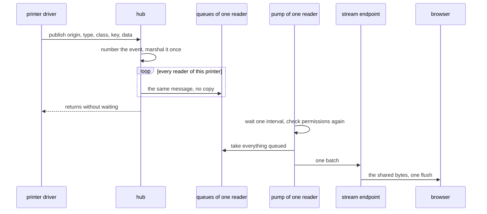
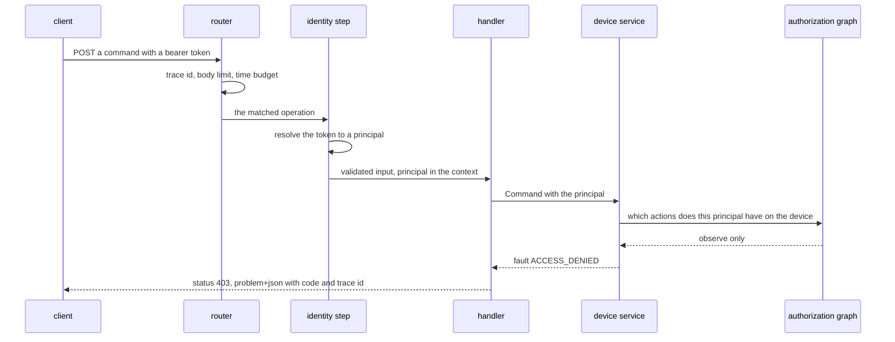

The code under `internal/transport` is where data leaves the server and where
requests enter it. The event hub in `internal/transport/stream` takes one event
from a printer driver and gives it to every reader that may see it. A reader is
called a subscriber. The HTTP API in `internal/transport/http/httpapi` registers
every route, finds out who the caller is, and calls the core of the server. It
also serves the event stream to a browser as server-sent events. That is one
HTTP response that stays open while the server writes events into it. Every
route is described in an OpenAPI document, which is a machine-readable list of
the paths, inputs and answers of the API. A failure leaves as a fault. A fault
is an error with a registered code and an HTTP status. The codes of the
transport are in `internal/transport/http/httpfault`.

## An event goes from a printer driver to every reader

The example is a nozzle temperature from one printer, read by a browser. The
hub is the most performance-critical code in the server, because the steps up
to the return of `PublishStored` run for every message a printer sends.

1. `devices.publish` in `internal/app/devices.go` builds a `Publication`. The
   origin is the resource the event came from, here the printer. The class is
   `telemetry`, `state`, `command` or `audit`. The key names the value that a
   newer telemetry value replaces.
2. `Hub.PublishStored` in `internal/transport/stream/hub.go` checks the
   publication. It reads the generation number of the authorization graph
   before the event exists. Then `Hub.channel` finds the channel of the origin
   with one atomic load. A channel is the sequence counter, the replay window
   and the subscriber list of one origin.
3. `Hub.envelope` gives the event its id, its sequence number and its time.
   `newMessage` in `internal/transport/stream/encoding.go` marshals the envelope
   to JSON. This is the only marshal of the event.
4. For every class except telemetry, `history.append` in
   `internal/transport/stream/history.go` gives the event an offset and stores
   it in the replay window of the origin. A reader resumes by offset. Telemetry
   has no offset, because a reader that reconnects gets a fresh value soon.
5. `Subscription.deliver` in `internal/transport/stream/subscription.go` runs
   once for each subscriber of the channel. It checks the origin, the audit
   class and the type filter of the reader. Then it puts the pointer to the
   message in a queue. `telemetryQueue.put` in
   `internal/transport/stream/queue.go` keeps only the newest value for each
   key. `eventQueue.put` keeps every event in order. `signal` wakes the reader
   without waiting, and `PublishStored` returns.
6. `Subscription.pump` is one goroutine for each subscriber. After a wake it
   waits one interval, 200 milliseconds by default, and calls `reauthorize`.
   `drain` empties both queues into a `Batch`. `Message.Encode` builds the
   server-sent event form of a message once, and every reader shares it.
7. `eventStream.pump` in `internal/transport/http/httpapi/events.go` reads the
   batches. `writeWindow` writes the shared bytes into one buffer of fixed size,
   and `flush` sends it under a write deadline. `writeCursor` adds a frame with
   the place to resume from when the reader follows several origins.
8. A browser that reconnects sends `Last-Event-ID`. `Hub.replay` fills the gap
   from the replay window. When the window does not reach back far enough, the
   batch has `Resync` set. `writeContinuityLost` then sends a
   `stream.continuity.lost` frame, and the page loads its state from the API
   again.

The history store, the event sinks and the installed modules subscribe through
the same `Hub.Subscribe` with the JSON encoding and read the same batches. The
history store asks for `Lossless`, so its telemetry goes through `seriesQueue`,
which keeps every reading.

## A request goes through the router, identity and a handler

The example is `POST /api/v1/devices/{device_id}/commands` from a caller who
may read the printer and may not operate it.

1. `New` in `internal/transport/http/httpapi/server.go` builds the router once,
   at start-up. `registerOperations` in
   `internal/transport/http/httpapi/routes.go` calls one `register...` function
   for each group of routes. Each of them calls the typed constructor `register`
   with the operation, its input type and its output type. The OpenAPI document
   is built from those types.
2. `verifyDocumented` in `internal/transport/http/httpapi/contract.go` compares
   the routes of the router with the operations in the document. `New` returns
   an error on any difference, so the server does not start. `newSpecCache` in
   `internal/transport/http/httpapi/spec.go` renders the document the first
   time a client asks for it, and serves the same bytes after that. The test
   `TestCommittedSpecMatchesTheCode` compares it with the committed
   `openapi.json`.
3. A request first passes `middlewareStack`. The order is `headMiddleware`,
   `foldListHeaderMiddleware`, `traceMiddleware`, `servedMiddleware`,
   `recoverMiddleware` and `bodyLimitMiddleware`, all in
   `internal/transport/http/httpapi/middleware.go`. `budgetMiddleware` in
   `internal/transport/http/httpapi/budget.go` then sets the deadline of the
   route.
4. The operation middleware runs only for registered operations.
   `setupMiddleware` refuses almost everything until the first run is finished.
   `principalMiddleware` asks the `Principals` port who the caller is. An
   operation that declares the empty security requirement `noSecurity` skips
   this step, so the document says which routes are public.
5. The framework validates the input against the types. The handler in
   `registerSendCommand` reads the principal with `principalFrom` and calls
   `DeviceFleet.Command`. A handler does no permission check of its own here.
   Every method of a port takes the principal.
6. `devices.Command` in `internal/app/devices.go` calls `reach`, which passes
   the question to `reachHolding` in `internal/app/deviceaccess.go`, and that
   reads the actions of the caller on the device from the graph. The caller has `observe` only, so `classRefusal`
   returns a fault with the code `ACCESS_DENIED`. A caller with no action on
   the device gets the same 404 as for an id that does not exist.
7. `faultFor` in `internal/transport/http/httpapi/problem.go` finds the fault
   in the returned error. `newProblemError` writes it as `application/problem+json`
   with the registered status, the code, the parameters and the trace id. An
   error that is not a fault becomes `UNEXPECTED` with status 500 and no detail.

A route with a small fixed object, such as the account routes, checks the
permission in the handler with `requireKindAdmin`. The developer page at `/dev`
is registered the same way by `registerDevtools`, and `requireDeveloper` guards
it. Its HTML and its command log are in `internal/transport/devtools`. It reads
the same routes and the same stream as any other client. A path that is not an
operation, such as a printer connection or the web application, is a `Mount`
with a written reason.

## Rules a change must keep

1. `newMessage` marshals an event once, and every subscriber gets the same
   bytes, in JSON and in the server-sent event form. A marshal or a copy for
   each subscriber multiplies the cost of every printer message by the number
   of open browser tabs.
2. The work for one subscriber on the publish path is a map lookup and a queue
   insert. The only allocations for each subscriber are the frame slices that
   `drain` builds for a batch. `TestFanOutAllocationsDoNotScaleWithSubscribers`
   fails when more is added.
3. `Hub.Publish` never waits for a reader. It has no context, both queues have
   a size limit, and `signal` drops a wake that is already pending. A blocking
   send would let one stopped browser tab stall the driver of a printer.
4. One goroutine publishes for one origin. The sequence numbers and the replay
   window depend on that order, and no code checks it. A second publisher on the
   same origin gives a reader events out of order after a reconnect.
5. `Subscribe` attaches the reader to its channels first and replays second, and
   `eventQueue.adopt` puts the replayed events in front. In the other order an
   event published during the subscribe is lost or arrives twice.
6. Every transport asks the authorization graph with the principal of the
   caller. A port method takes the principal, and the hub asks its `Authorizer`
   at subscribe. A check on only one of them lets a caller read through the
   other what it may not see.
7. An open stream checks again. `reauthorize` runs before every batch and once a
   second on an idle stream, and it closes the subscription when the graph
   cannot answer. `stillAdmitted` checks the credential at least every 30
   seconds. Without both, a removed grant or a revoked token keeps reading
   until the browser reconnects.
8. The replay path applies the same limits as the live path. `admitted` removes
   audit events, and `grantedFloor` stops a replay at the generation of the
   grant. A limit on the live path only lets a reconnect read what the open
   stream refused.
9. A list resolves the permission inside the query. `devices.List` in
   `internal/app/devicereads.go` walks `WalkDevices` with the principal and
   counts `Total` from those rows. A list that fetches all rows and filters
   them shows the hidden rows through its total.
10. Every route goes through `register`, and only `httpapi` imports the router.
    A route added another way is missing from the document, so generated clients
    do not know it and `New` refuses to start.

## What this part does not protect against

The handler for a returned error writes no log line. A panic and a refused
identity are logged with the trace id. An ordinary error that becomes
`UNEXPECTED` is logged only if the code that returned it logged it. The client
then has a trace id that matches nothing in the log.

`verifyDocumented` sees routes only. A middleware that answers a path itself,
and any handler wrapped around `Server.Handler`, are invisible to it. A test
probes a sample of such paths.

The time budget of a request ends the wait of the caller. It does not end the
work. A command that was already sent to a printer still runs, so a repeated
`POST` is a second command.

`Hub.PublishStored` calls `Authorizer.Epoch` through an interface for every
event. The implementation is one atomic load. A slower implementation would run
on the path of every printer message.

A channel is never removed, so the hub keeps a small replay window for every
origin that ever published until the process ends.

## Failures and where they show up

A client sees a failure as a problem document with a code, and every code is
listed on the [error codes](../error-codes.md) page. An operator sees the log
lines of the hub under the principal of the reader. The number of open streams
is at `GET /api/v1/events/stats`, and `Subscription.Stats` reports the queues of
one reader to tests.

| what happens | what the server does | where it shows |
|---|---|---|
| a reader is slower than its telemetry | the newer value replaces the queued one for the same key | nothing, this is normal |
| the telemetry queue passes 4 MiB | the oldest key is dropped | log `stream subscriber is not being given all the telemetry it may see`, at most every 30 seconds |
| the event queue of a reader passes 1 MiB | the queue is emptied and the next batch has `Resync` | a `stream.continuity.lost` frame, log `stream subscriber lost continuity` |
| a reader resumes from a place outside the replay window, or from before a restart | the same `Resync` batch | the same frame. The page loads state from the API |
| a grant is removed while a stream is open | the origin is detached, its queued events are removed, and the reader gets one `stream.origin.withdrawn` frame naming it | log `stream subscriber lost a grant mid-stream` |
| the graph cannot answer during `reauthorize` | the subscription is closed | the stream ends, log `stream subscriber dropped` |
| the token of an open stream is revoked or expires | the stream ends within 30 seconds | a `prusa-connect.auth.expired` frame |
| a browser stops reading | the write deadline of 60 seconds ends the stream | debug log `event stream ended on a write` |
| one principal opens more than 64 streams | refused before the graph is asked | status 429, `TOO_MANY_STREAMS` |
| a subscribe names an origin the caller may not see | the whole request is refused and no origin is named | status 403, `ACCESS_DENIED` |
| a request has no usable token | refused by `principalMiddleware` | status 401, `TOKEN_INVALID`, log `identity refused` |
| the first run is not finished | every operation except the set-up ones is refused | status 503, `SETUP_PENDING` |
| the input does not match the schema, or a write has an unknown query parameter | refused before the handler | status 422, `REQUEST_INVALID` with the location |
| a body is larger than 1 MiB, or larger than the upload limit on a storage route | the read fails at the limit | status 413, `BODY_TOO_LARGE` with the limit |
| a handler runs longer than 30 seconds | the context ends and the router answers if nothing was written | status 504, `REQUEST_TIMED_OUT` |
| the client hangs up while a handler waits | the context ends and the answer goes to nobody | status 499, `REQUEST_ABANDONED`, no ERROR line |
| a handler panics | `recoverMiddleware` answers | status 500, `UNEXPECTED`, log `panic serving request` |
| no route matches | the router answers | status 404, `ROUTE_NOT_FOUND`, or 405 `METHOD_NOT_ALLOWED` |
| a route and the document differ | `New` returns `ErrUndocumentedRoute` | the server does not start, and the error lists the routes |

The stream numbers are the constants at the top of
`internal/transport/stream/hub.go`, and the HTTP numbers are the constants in
`internal/transport/http/httpapi/server.go` and `events.go` beside it. An
operator changes them under `core.api` and `core.events` in the configuration.

## Files to read first

- `internal/transport/stream/hub.go`: publish, subscribe and replay, and the
  `Authorizer` port
- `internal/transport/stream/subscription.go`: what one reader does, with
  `deliver`, `pump`, `reauthorize` and `applyVisibility`
- `internal/transport/stream/queue.go`: the queues of a reader and what each
  one does when it is full
- `internal/transport/http/httpapi/server.go`: `Config` lists every port, and
  `New` shows the order in which the router is built
- `internal/transport/http/httpapi/events.go`: the stream endpoint, from the
  query parameters to the bytes on the socket
- `internal/transport/http/httpapi/problem.go` and
  `internal/transport/http/httpfault/httpfault.go`: how an error becomes an
  answer, and the codes of the transport

What the graph answers and how a grant is written is in
[authorization](authorization.md). The frames a client reads on the stream are
in the [event stream overview](../sse-overview.md).

## Tests for a change here

- `go test ./internal/transport/stream/` runs the hub tests, with the shared
  marshal test and the allocation test
- `go test -bench . -benchmem ./internal/transport/stream/` shows the cost of a
  publish for one reader and for many
- `go test ./internal/transport/...` runs the API, login guard and developer
  page tests. The tests in `httpapi` also read the whole tree and fail when
  another package imports the router
- `make test-race RACE_PACKAGES=./internal/transport/...` runs them under the
  race detector. Run it for any change to the hub or to the stream endpoint
- `make generate-openapi` writes `openapi.json` again after a route or a type
  changed, and `make openapi-check` compares it
- `make error-codes-check` after a change to a code in `httpfault`
- `go test ./internal/arch/` checks the paths and the diagrams of this page
- `make lint` and `make test` before the push
