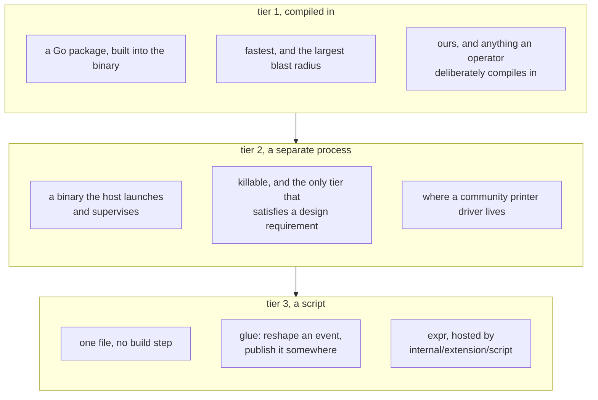
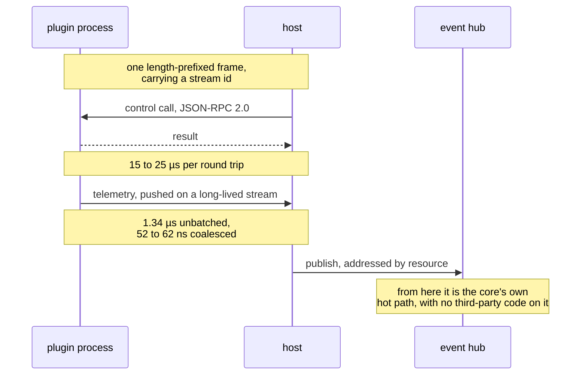
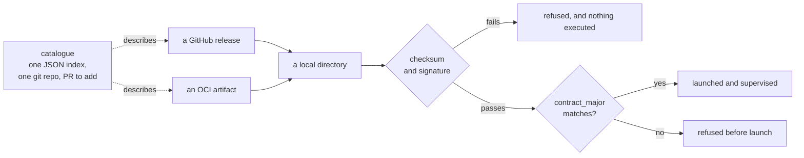
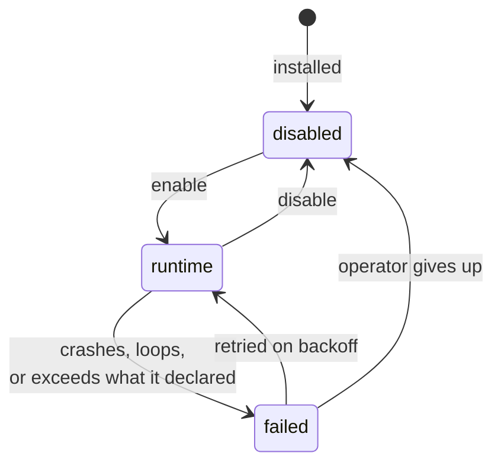
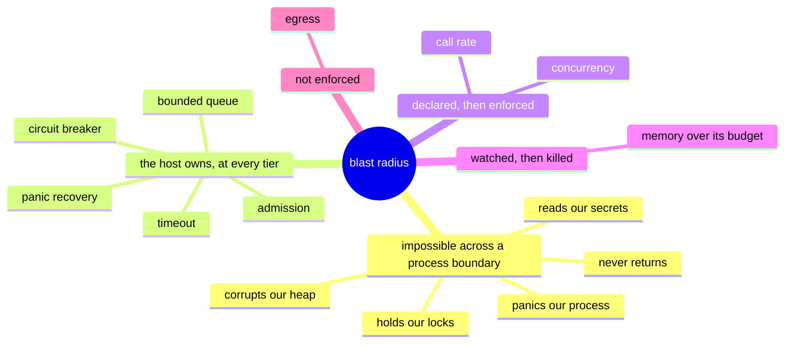
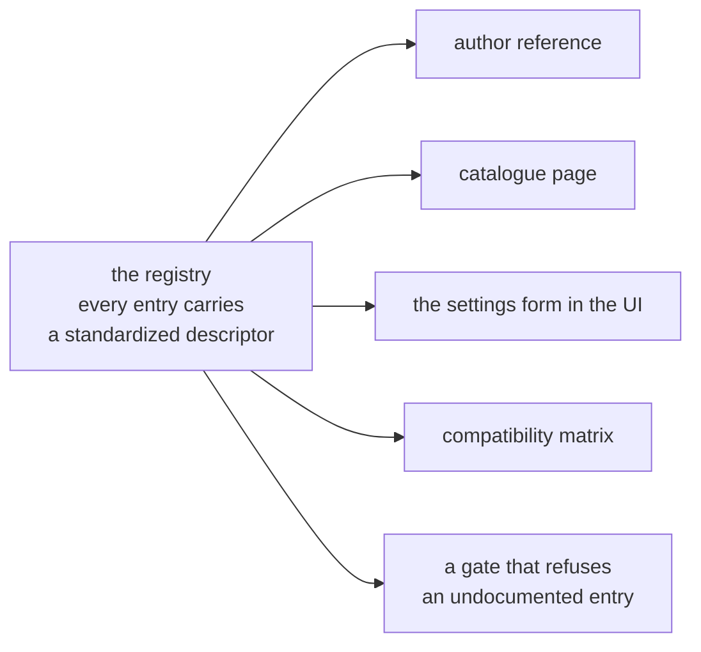

Read this before deciding to write an extension. It says which tier your code
runs at, what the host does to it, and what is not built yet.

[Adapters, modules and runtimes](./extension-concepts.md) is the next page: it
picks the kind for you. [Writing a printer driver](./writing-a-driver.md) and
[Writing a service module](./writing-a-module.md) are the two worked guides.

Every number below is measured and names its source.

## The three tiers

A community printer driver belongs at tier 2. A design requirement says a third party
cannot block, crash or slow the frame path, and compiled-in code cannot deliver
that: nothing preempts it and it reads every secret in the address space. A
separate process delivers it by construction.

The cost was measured and it is small. A one-way stream message crosses the
boundary in 648 ns to 2.26 µs, against 66 to 71 µs for a unary round trip, and
`Session.State()` in `sdk/connectorapi` is already `<-chan StatePatch`. Four
hundred printers spend 0.021 % to 0.27 % of a core there.

Wasm was a fourth tier. It is declared with a named trigger, built on by
nothing, and left out of the author documentation. Its one unique in-process
property is an enforceable budget, and the script runtime gives that for a
third of the size.

## What crosses the boundary

Control frames are JSON-RPC 2.0, which a design requirement already set for every
socket boundary, so the product ships one RPC vocabulary for both. Bulk frames
are raw bytes: JSON-RPC at 64 KiB measured 1,023 to 1,069 µs against 50.1 µs
binary. Every byte of this is specified in [the plugin wire
protocol](./plugin-wire-protocol.md), so an implementation in Python, Rust or
TypeScript needs no Go.

Not gRPC. The three `full` targets carry 5.81 to 6.61 MiB of headroom, a bare
gRPC server plus client measures 7.31 MiB and a fuller stack 8.68 MiB. Both are
over on every target, before the SQL driver. Refusing it has one cost, stated
here openly: this project writes its own flow control, which gRPC ships.
LSP and MCP took the same trade, and neither generates bindings, because an
afternoon implements the whole wire.

## How an extension gets installed

The local directory is the only real path and the others are fetchers in front
of it. That is what makes an air-gapped install a `cp` rather than a special
mode. Terraform needed a filesystem mirror precisely because its default is the
network.

The checksum is re-verified before every launch and not only at install. An
absent `contract_major` is a load error and never a default, which is
OctoPrint's stranding problem inverted.

## The two states an operator picks

There is no build state, and it is not an omission. A cold build of this binary
peaks at 1.42 to 1.48 GiB of RAM and needs 1.35 GiB of disk, so the 1 GB
Raspberry Pi that a design requirement names cannot link it. Shipping the matrix
instead is 194 tag sets and 776 binaries, roughly 29 GB per release, doubling
with each compiled-in plugin. A remote build service is the one path an air gap
cannot reach.

So build stays a `make` target for somebody who wants a minimal binary. It is a
property of the artefact an operator downloaded, which the UI reads and never
sets.

## What stops a bad plugin

Five of the eleven ways a plugin can hurt the host are unprotectable in tier 1
and impossible in tier 2. That asymmetry is the argument for the separate
process, and the latency is not.

The honest limit: killing a watched child is the only enforcement available on
Linux and on Windows, without root and without a delegated cgroup. The host
reads each module's memory every two seconds. A module over
its budget has every process the host finds killed, unless the operator chose to
only warn. That is a watched limit, not a kernel limit.

A process that leaves the group with `setsid` is no longer counted once
its parent has exited. Memory in shared memory or in a `memfd` is not counted
either. On Linux the last bound is the kernel's own out-of-memory killer,
which the host sets to pick a module before the server. Nothing limits which network addresses a module
reaches.

## Every registration carries a descriptor

An entry in the registry carries its identity, the namespace it came from, a
stability level, its documentation, the event types it emits with their
versions, the config keys it accepts with their types and defaults, and two
versions of its own. Two, because one is the implementation's and one is the
contract it compiles against, so a host refuses an incompatible plugin before
loading it.

The config keys are what let the UI render a plugin's settings form without one
hand-written form per plugin, which is the thing that does not scale to a
hundred connectors. [Extensions](./extensions.md) is that reference, generated
from the registry, so it cannot drift from what the binary holds.

Three rules hold the registry, and each has a gate:

| rule | where it is enforced |
|---|---|
| a qualified name registered twice is refused, and the message names both modules | `ErrDuplicateType` in `internal/extension/registry` |
| every registration carries a descriptor | `TestOnlyLegacyRegistersWithoutADescriptor` in `internal/arch` |
| the published reference agrees with the registry | `make extensions-check` |

A registration without a descriptor reaches an operator's configuration and
shows in the published reference as a blank row: no summary, no version, no
config keys, no stability level. No contract package offers an entry point that
takes one. `Register` is the one path: it takes the descriptor, it panics on a
duplicate, and it never replaces one silently. The gate refuses a
descriptor-less entry point coming back, whether it is called directly or bound
to a name and called elsewhere.

## What is built and what is not

| | state |
|---|---|
| registries seal, refuse duplicates, carry descriptors | built. `internal/extension/registry`, gated by `make extensions-check` |
| the script runtime | built. `expr`, hosted by `internal/extension/script`. Only a sink may declare it |
| out-of-process connectors are viable | decided, on two independent measurements |
| the wire: our framing, JSON-RPC control | decided |
| three tiers, wasm declared and unbuilt | decided |
| build mode leaves the UI | decided |
| two states, disabled and runtime | decided |
| inbound tier 2 | open. Undesigned and unmeasured. Outbound ships first |
| a community driver we do not maintain, proved end to end | not built |
